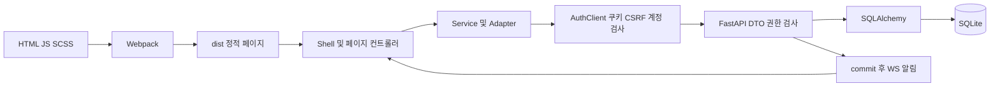

# 아키텍처·코드 품질 검토

2026-10-12. 실제 소스를 기준으로 평가했다. 제안은 적용하지 않았다. 실행 근거는 [03](03_REGRESSION_TEST_REPORT.md), 파일 위치와 발생 조건은 [02](02_ISSUE_REGISTER.md)를 참조한다.

## 디렉터리와 실행 구성

| 위치 | 실제 역할 |
|---|---|
| src/*.html | 24개 원본 페이지, body data-active/data-crumbs와 mount point |
| src/assets/scripts/2026 | Vanilla JS Shell, DOM controller, 서비스와 API adapter |
| src/assets/styles/2026 | Sass tokens, Shell, 공통 UI, 기능별 스타일 |
| webpack / webpack.config.js | HTML plugin, content hash, lazy vendor, HTTP·WS proxy |
| dist | 추적되는 배포 산출물. 이번에는 별도 QA 경로에 빌드 |
| backend | FastAPI, SQLAlchemy, 인증·계정·업무 API, 보호된 정적 호스팅 |
| backend/migrations | Alembic 0001→0005 |
| tests / backend/tests | jsdom Vitest, tmp_path SQLite pytest, Playwright standalone |
| docs / docsForHuman | 상세 기술·사람용 요약. archive와 원본 Jekyll 안내 별도 |
| .github/workflows / ci | Node22/24 검사와 Python3.12 pytest. E2E 필수 job 없음 |
| scripts / bat | 스크린샷, SQLite backup, Windows 설치·서버 시작 |
| backend/data | 개발 DB와 과거 테스트 산출물. 이번 검수에서 보존 |

주요 스택은 Vanilla JS/SCSS, Webpack5, Chart.js4, FullCalendar7, jsvectormap1, FastAPI/Uvicorn, SQLAlchemy/Alembic, Argon2id, SQLite다. React/Vue router나 Redux/Pinia 같은 별도 상태 프레임워크는 없다.

FastAPI는 정적 HTML과 동일 origin API를 제공한다. 개발·preview에서는 Webpack이 HTTP와 WS를 별도 backend로 proxy한다. 프론트의 인증 화면만으로 서버 권한 검사가 생기지는 않는다. 실제 owner는 서버 세션이 결정한다.

## 라우팅·초기화·상태

index.js는 alias redirect → 인증 → Shell/behaviors/palette → preferences → 업무 hub/Calendar/Chat/Home → 상단 메뉴 → charts/Email 순으로 초기화한다. 해당 mount가 없는 컨트롤러는 반환한다. body data-active를 여러 모듈이 해석하고 alias가 Shell과 hub에 분산돼 QA-010이 발생한다. preferences의 전역 gate는 QA-006의 장애 전파 원인이다.

이 앱은 HTML href로 새 문서를 여는 multi-page 구조다. 일반 이동 때 JS 메모리가 재생성된다. 같은 Email 화면에서 폴더를 바꾸면 Label을 초기화하며 검색·카테고리 등 다른 조건은 현재 정책대로 유지한다. mail/event/room/message/task URL은 원본으로 직접 연결한다.

상태는 controller closure의 selected/busy/disposed/generation, DOM, WorkspaceStore의 state/revision/Promise queue, LiveChat의 rooms/messages Map/pending retry, Email adapter의 pending fingerprint/clientId, AccountPreferences의 state/revision에 나뉜다. 큐는 같은 instance의 쓰기를 직렬화하지만 다른 탭 경쟁은 서버 CAS 없이는 보호하지 못한다(QA-001).

auth는 HttpOnly opaque cookie와 browser grant를 사용한다. CSRF는 메모리, X-Account-ID는 오래된 화면의 요청·응답을 거절하는 보조 검사다. 계정 변경 이벤트는 DOM·입력·polling·WS를 정리하고 reload한다. BroadcastChannel로 다른 탭도 새 활성 계정을 따른다. 탭별 독립 계정 서비스가 아니다.

## 저장 원본과 API 계약

| 데이터 | 저장 및 동시성 |
|---|---|
| 사용자·세션·브라우저 grant | 정규화 행, token hash, Argon2, 만료·회전·인증 rate limit |
| Task·legacy Calendar·Mock Chat·preferences | workspace_states JSON, owner+kind unique, expectedRevision CAS |
| Mock mail | mock_mailboxes JSON, owner+namespace, revision CAS |
| 실제 Chat | room/member/message 행, sender+clientId unique, sequence/read cursor |
| Calendar | JSON event 행과 attendee/import 행, revision CAS, 시리즈 확장 |
| 내부 mail | owner별 InternalMail JSON 사본, draft CAS 없음, 발신 MailSubmission retry 보호 |
| Home/Search/Attention/Reports | 원본에서 계산. 불변 감사 원장·검색 index·알림 큐 없음 |

15개 ORM 테이블과 alembic_version을 사용한다. chain은 0001 accounts, 0002 workspace, 0003 resources, 0004 shared/mail submission, 0005 browser grant다. 개발 DB의 실제 schema head나 행 수는 조회하지 않았다. 임시 DB의 migration/FK 회귀는 62개 pytest 범위에서 통과했다. attribution created_by/updated_by는 물리 FK가 없으며 기존 문서도 이를 설명한다.

주요 API군은 auth/users, mock-mailbox, workspace, preferences, directory/search/attention/reports, mail, chat rooms/messages/read/ws, calendar events/response/import/reset, dashboard다. 정확한 입출력은 API_REFERENCE와 DTO를 대조한다. REST adapter가 있다는 사실은 외부 메일 서버가 배포됐다는 뜻이 아니다.

계약 문제는 Internal의 자유 문자열 Label과 Mock/UI 고정 목록의 차이(QA-004), 수신 사본의 개인 분류 승계(QA-003), 초안 revision 부재(QA-001)다. Calendar 신규 생성에는 mail/chat의 idempotency 패턴이 없다(QA-002). Search는 첫50개와 hasMore만 제공하고 자동 병합은 없다.

## 강점·중복·복잡도

권한은 authenticated/member/access_event/owned에서 재사용한다. DTO가 extra 필드·자료량·owner를 검사하고 정적 경로 resolve 경계가 있다. validation 응답에서 비밀번호 input을 제거한다. 실패를 Mock 성공으로 대체하지 않고 loading/error/empty, stable testid, native dialog를 사용한다. commit 후 WS 알림, 메시지·발신 unique retry 제약은 안정성의 장점이다.

calendar.js/chat.js/service-hub.js/email/ui.js는 긴 HTML 문자열과 handler를 작은 줄 수에 압축했다. 줄 수만으로 단순성을 판단하면 안 된다. 편집·조회·동기화·모달·검색·권한 표시가 같은 controller에 있어 변경 파급이 넓다. resources.py가 service_hub를 설치하고 helper를 주입하는 구조는 권한 재사용에는 유리하지만 도메인별 계약과 독립 테스트를 어렵게 한다.

Home/Attention/Search는 같은 원본을 각각 순회하고 목록/count도 별도 snapshot이다. alias표가 entry/hub/Shell에 흩어졌다. 팔레트와 테마 버튼의 중복 전환은 QA-005다. 도달 불가능한 template 분기는 QA-013이다. 그러나 legacy Calendar/Chat adapter와 migration은 Mock/import에서 사용하므로 일괄 삭제 대상이 아니다.

사용되지 않는 전체 함수·의존성의 liveness 분석은 수행하지 않았다. production dependency 3개는 vendor에서 참조된다. 큰 static font/image는 빌드에 복사되지만 모든 사용처를 조사하지 않아 삭제 목록으로 확정하지 않는다.

## 비동기·예외·메모리 위험

Email의 disposed/generation/committedQuery와 이전 계정 응답 폐기는 이번 회귀에서 정상이다. Calendar 검색도 generation을 사용하고 저장 성공 뒤 refresh 실패를 구분한다. 신규 POST 응답 자체 유실은 별도 문제이며 현재 중복 저장을 유발한다. 초안 last-write-wins와 드래그 timezone 변경도 분리해서 다룬다.

Chat은 HTTP 저장과 WS event를 이용해 REST history를 다시 읽고 Map에 전량 보관한다. Calendar는3초, mail/상단은30초 polling, Home은수동이다. 이 지연을 즉시 동기화라고 설명하면 안 된다. 많은 자료·동시 사용자에 대한 비용은 미측정(QA-009).

pagehide는 mail/calendar/menu timer와 Chat을 종료하지만 persisted pageshow 재시작은 명시적이지 않다. auth의 pageshow는 세션만 확인한다. 이번 Back은 persisted=false이며30초 갱신이 복구됐다. 실제 BFCache에서 timer가 중단된 채 유지되는 조건은 추가 검증 위험으로 기록하며 확정 결함으로 집계하지 않는다.

auth interval/BroadcastChannel, createTask의 account-changing listener, WS connections의 빈 key 보존은 장시간 검사 후보다. 일반 multi-page에서 document 수명이 끝나는 점을 고려해야 한다. 장시간 측정 없이 메모리 누수라고 확정하지 않았다.

JSON 오류 envelope와 UI alert는 있으나 preferences 재시도 부족, Calendar conflict catch 안의 refresh 재실패, 손상된 JSON schema 검증은 추가 hardening 후보다. middleware 조기 오류의 헤더 누락은 QA-012로 HTTP 재현했다. 미재현 위험을 Critical로 부풀리지 않는다.

## 오류 주입 결합도·확장

MockEmailApi.execute의 failure 조건과 reset/test hook은 서비스 인터페이스에 노출된다. 분기 범위가 Mock adapter로 좁고 internal/rest에서 failNext를 거절하므로 현재 정상 권한 코드와의 결합은 낮다. UI action도 mode=mock에서만 노출한다.

registry·독립 flag·복구 snapshot·scenario matrix가 없고 failure 한 필드만 존재한다. 여러 설정은 마지막 값으로 덮인다. 다중 버그 플랫폼의 조합 안정성을 평가할 구현 자체가 없다. 앞으로 추가한다면 bug ID, 기대 실패, 적용 기능, 충돌 그룹, 수명, 기본OFF, cleanup, 격리 계정/DB 계약이 필요하다. production 권한 검사에 직접 bug 조건을 섞지 않는다.

## 성능·운영·권장 구조

production은 HTTPS origin/Secure cookie/auto_migrate=false/dev admin OFF를 요구한다. 실제 TLS 운영은 미검증이다. WS map은 process-local이고 shared member는 SQLite insert를 사용하므로 다중 worker/PostgreSQL 준비 완료가 아니다. 인증 외 quota·연결 수·보존량 정책도 확정해야 한다.

먼저 전체 mail 조회, room별 쿼리, history 전량, Calendar 반복 확장과 polling 부하를 측정한다. paging/index·단일 count snapshot은 권한/Bcc/count 의미를 유지해야 한다. unminified 자산 경고는 개선 후보지만 공유 데이터 정합성보다 우선하지 않는다.

작은 도메인 서비스·API 계약으로 책임을 나누고 상태 전환·alias·테마의 진입점을 통합하는 방향을 권장한다. 대규모 framework 재작성이나 일괄 dependency upgrade가 필수는 아니다. 백업·CAS·idempotency·의미 있는 E2E부터 보강하고 성능·운영 목표를 검증한다.
