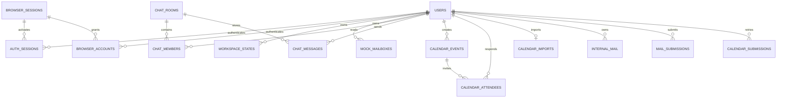

# 데이터베이스와 보존

기준일: 2026-10-12 수정 후. 근거: `backend/models.py`, `database.py`, `migrations/versions/*.py`, `workspace.py`. 기본 URL은 `sqlite:///./backend/data/adminator.db`이며 작업 디렉터리에 상대적이다. `alembic_version` 외 ORM 테이블은 **16개**다. 개발 DB는0007 적용 완료이며 기존15개 테이블 전체 행/값 보존·integrity/FK 검사를 통과했다. 상세 count·백업 경로는 [08 수정 보고](08_QA_REMEDIATION_REPORT.md)에 있다.

## 테이블과 관계

| 테이블 | 키·주요 데이터 | 의미 |
|---|---|---|
| users | UUID 문자열 PK, username/email unique, display_name/password_hash/is_active/UTC timestamps | 회원 |
| auth_sessions | token_hash PK, nullable user_id/browser_id, CSRF, Unix 생성/만료 | 익명/활성 인증 컨텍스트 |
| browser_sessions | id PK, token_hash unique, active_session_hash/version/expires_at | 브라우저 계정 묶음 |
| browser_accounts | browser_id+user_id PK, authenticated_at/expires_at | 비밀번호 인증된 전환 grant |
| auth_attempts | id, hashed key, created_at | 분 단위 인증 제한 |
| mock_mailboxes | id, user_id+namespace unique, state_json/revision/updated_at | 개인 Mock 메일 |
| workspace_states | id, user_id+kind unique, state_json/revision/updated_at | Tasks/preferences 및 legacy Calendar/Chat |
| chat_rooms | id, pair_key unique, name/created_by/is_shared/created_at | 공유 또는 1:1 방 |
| chat_members | room_id+user_id PK, read_sequence | private membership·shared 개인 읽음 |
| chat_messages | sequence PK, id unique, room_id/sender_id/client_id/body/sent_at | sender+client_id unique로 재시도 방지 |
| calendar_events | id, owner_id+legacy_id unique, is_shared/updated_by/updated_at/data_json/revision/created_at | 시리즈 단위 일정 |
| calendar_attendees | event_id+user_id PK, status | pending/accepted/declined |
| calendar_imports | user_id PK, timezone/imported_at | 계정별 명시적 legacy 이전 표식 |
| internal_mail | id, owner_id/data_json/revision(기본1) | 발신·수신·초안의 개인 사본 |
| mail_submissions | owner_id+client_id PK, payload/response_json | 내부 메일 발신 재시도 기록 |
| calendar_submissions | owner_id+client_id PK, fingerprint/response_json | 일정 생성 재시도 영수증; event FK 없이 edit/delete 후 보존 |



0004의 attribution 열 `chat_rooms.created_by`, `calendar_events.updated_by`에는 물리 FK가 없다. ORM도 String(36)으로 맞춰 실제 보존 스키마와 일치시켰다. 이는 새 FK를 추가한 것이 아니다. 강한 참조 제약은 백업·고아 데이터 정책·명시 migration이 필요한 후속 과제다. `mail_submissions.owner_id`의 cascade 없는 FK는 유지한다. dev reset은 협업 자료가 있으면 삭제 전에 409로 중단한다. 격리 DB에서16개 ORM 테이블의 FK를 SQLite PRAGMA와 비교하고 foreign_key_check를 검증했다.

## 저장 DTO

Workspace API snapshot은 `{version:1,ownerId,events|rooms|tasks}`다. 소유자·키 집합·strict 타입·최대 500개·ID 중복을 검증한다. 직렬화 한도는 256 KiB다. Tasks는 기존 id/title/done에 description(4000), dueDate(날짜), priority(normal/high/low), completedAt(완료·시간대 포함), source(kind=mail/calendar/chat,id,roomId?)를 허용한다. 완료시각 없는 과거 done 자료는 그대로 보존하며 날짜를 추정하지 않는다.

preferences는 동일 테이블 `kind=preferences`지만 별도 `/api/preferences`를 사용한다. 기본값은 timezone=Asia/Seoul, theme=system, mailAutoRefresh=true, calendarScope=related, homeCards=[calendar,tasks,mail,chat], favoriteRooms=[]다. homeCards 중복 없이 0–4개, favoriteRooms 중복 없이 최대 100개이며 방 접근을 검증한다. revision 0은 아직 DB 행이 없음을 뜻한다.

Mock mailbox는 `{version:1,emails:[...],files:{...}}`이며 각 mail accountId가 세션 owner와 일치해야 한다. 내부 메일은 JSON 독립 사본이며 정규화된 `mail_messages/mailbox_entries/mail_attachments` 테이블은 없다. Calendar 본문은 JSON, 참석/RSVP는 행으로 나뉜다. timed start/end는 UTC, 종일은 YYYY-MM-DD와 exclusive end, timezone은 IANA 이름이다.

## 스키마 변경과 내용 이전

| revision | 변경 |
|---|---|
| 0001_accounts | users/auth_sessions/mock_mailboxes/auth_attempts |
| 0002_workspace | workspace_states |
| 0003_resources | Chat 3개, Calendar 3개, internal_mail |
| 0004_shared | mail_submissions, 방/일정 공유 메타데이터; 기존 is_shared=false |
| 0005_multi_account | browser_sessions/browser_accounts, nullable auth_sessions.browser_id/index |
| 0006_mail_revision | internal_mail.revision NOT NULL DEFAULT1; 기존 JSON 변경 없음 |
| 0007_calendar_submissions | owner+clientId durable receipt; 기존 일정/attendee 변경 없음 |

0004~0007 downgrade는 RuntimeError로 차단한다. 0001–0003 downgrade는 테이블을 삭제한다. 스키마 downgrade는 자료 보존 rollback이 아니다. 서비스 홈 확장에는 신규 migration이 없다.

Calendar import는 스키마 migration과 별개다. 명시적 `/api/calendar/import`가 지정 timezone으로 legacy wall time을 해석하고 새 UUID/legacy_id 및 import marker를 같은 트랜잭션에 저장한다. 실패 시 부분 복사하지 않고 원본 snapshot을 남긴다. 현재 화면 첫 방문 자동 import는 없다. import 후 legacy와 리소스는 양방향 동기화되지 않는다. 개인 샘플 Reset의 세부 조건은 [Calendar](CALENDAR_IMPLEMENTATION.md)를 확인한다.

## 백업·복원과 호환성

`scripts/backup_sqlite.py`는 DATABASE_URL의 파일 SQLite를 read-only 연결로 열어 SQLite backup API로 일관된 사본과 rowCounts JSON을 만든다. 결과는 원본 DB 옆 `backups/`다. Postgres나 memory DB는 지원하지 않는다.

```powershell
.\.venv\Scripts\python.exe scripts/backup_sqlite.py
.\.venv\Scripts\python.exe -m alembic -c backend/alembic.ini upgrade head
```

위 명령은 운영 절차 안내다. 이번 수정은 별도 read-only SQLite backup과 사본 upgrade/기존 모든 열·행 비교 후 같은 Alembic upgrade를 개발 DB에 명시 적용했다. 기존 데이터는 모두 보존되었다. scripts/backup_sqlite.py 자체를 이번에 실행했다고 주장하지 않는다. 복원 시 서버 중지, 현재 DB 추가 백업, 검증한 백업 복원, 이후 신규 자료 export/병합 계획이 필요하다. 이전 snapshot만 쓰는 구버전 앱은 새 리소스 편집분을 읽지 못한다. 오래된 백업을 복원하면 이후 계정·메일·메시지·일정이 사라질 수 있다.

SQLite FK와 busy_timeout=5000을 설정한다. PostgreSQL 드라이버 목록은 있으나 POST 공유 Chat member insert가 SQLite dialect 전용이므로 실제 호환 테스트가 필요하다. [알려진 문제](KNOWN_ISSUES.md)를 참조한다.
