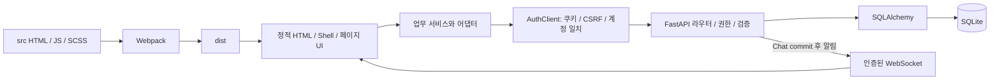

# 시스템 아키텍처와 접근 정책

기준일: 2026-10-11. 구현 위치: `backend/app.py`, `resources.py`, `service_hub.py`, `mail.py`, `accounts.py`, 프론트 `index.js`와 서비스 어댑터.

## 계층별 책임

HTML은 mount point와 `data-active`를 제공한다. Shell이 일반 메뉴/프로필/상단 메뉴를 만든다. 페이지 컨트롤러는 입력·상태·오류·모달을 관리한다. 서비스는 업무 검증, 답장·원본 링크·리소스 호출을 담당한다. UI가 DB나 인증 쿠키를 직접 읽지 않는다.

FastAPI의 `authenticated()`가 쿠키로 사용자를 결정한다. 요청의 ownerId/accountId는 인증 수단이 아니다. `X-Account-ID`는 화면이 표시하는 계정과 서버 활성 계정의 불일치를 잡는 보조 검사다. DB commit 후에 성공 상태를 표시하며 실패를 Mock 성공으로 대체하지 않는다.

## 자료별 단일 원본

| 자료 | 원본 | 조회/변경 정책 |
|---|---|---|
| Tasks | 개인 Workspace snapshot | 세션 owner; 최대 500개/256 KiB, revision 조건부 저장 |
| Preferences | Workspace `kind=preferences` | `/api/preferences`의 별도 DTO·revision; 범용 Workspace 경로로 노출하지 않음 |
| 내부 메일 | 사용자별 `internal_mail` 사본 | owner만 접근; 수신본 Bcc 제거; 삭제는 자기 Trash 이동 |
| Mock 메일 | `mock_mailboxes` | owner+namespace; 실제 배달 없음 |
| 실제 Chat | 방/멤버/메시지 | shared 방은 전체 인증 사용자; private pair는 두 참가자 |
| Calendar | 이벤트/참석자/이전 표식 | shared는 전체 인증 조회·수정·삭제; private는 소유자 편집, 소유자/참석자 조회 |
| Mock Calendar/Chat | 개인 Workspace snapshot | 실제 리소스와 별도; Calendar 이전은 명시적 API |
| Search/Attention/Home/Report | 원본에서 계산 | 별도 업무·알림·불변 감사 테이블 없음 |

Calendar의 `related/owned/invited/all`은 표시 범위이며 접근 권한을 축소하는 보안 경계가 아니다. 참석자 선택은 신규 일정을 비공개로 바꾸지 않는다. Task source는 종류/ID/roomId만 보관한다. 공유 메시지에서 만든 후속 Task도 개인 자료이며 원본 삭제 후 남는다.

## 동기화와 동시성

Chat 메시지는 HTTP로 저장하고 WS `message/read/rooms.changed` 알림을 보내며 재접속 시 REST로 복구한다. 메모리 연결 목록은 worker 사이에 공유되지 않는다. Calendar는 보이는 화면·닫힌 편집 모달에서 3초 재조회, 내부 메일은 preference에 따른 30초 갱신, 상단 Attention/Chat 메뉴도 30초 재조회다. Home은 별도 상시 push가 없다.

Workspace와 preferences는 `expectedRevision`, Calendar는 PATCH `expectedRevision`/DELETE `revision`으로 경쟁 변경을 거절한다. Chat의 `(sender_id,client_id)`와 내부 메일의 `(owner_id,client_id)`가 재시도를 식별한다. 내부 메일은 clientId 또는 Idempotency-Key를 받으며 ID-less legacy 발신은 unprotected로 명시한다. 초안에는 별도 revision 보호가 없다.

다중 계정 전환은 서버 grant·세션·쿠키/CSRF를 한 트랜잭션으로 바꾸고 화면을 재로드한다. 클라이언트는 이전 요청 결과를 폐기하고 WS/polling을 종료한다. BroadcastChannel은 다른 탭에 재로드를 알린다. 정상 이동의 dirty guard는 취소할 수 있지만 만료·다른 탭의 강제 전환을 막지 않는다.

## 개발과 운영 경계

Webpack 4000과 preview3001은 `/api` HTTP·WS를 기본8000으로 프록시한다. ADMINATOR_API_TARGET으로 개발/격리 backend를 지정할 수 있다. 기본 개발 AUTH_ORIGINS는 localhost/127.0.0.1의8000/4000/3001이다. 보호 HTML의 서버 검사는 FastAPI 제공 시 적용된다. Webpack/static host만 실행하는 것은 인증 백엔드 배포가 아니다. production은 HTTPS origin, Secure 쿠키, 명시적 migration을 요구한다.

기본 DB/실시간 구현은 SQLite·단일 worker에 맞춰져 있다. ORM/일부 migration이 PostgreSQL을 고려해도 공유 Chat membership에 SQLite 전용 insert가 있으므로 호환·운영 검증이 끝났다고 설명하면 안 된다. [DB](DATABASE_STRUCTURE.md), [알려진 문제](KNOWN_ISSUES.md)를 참조한다.
