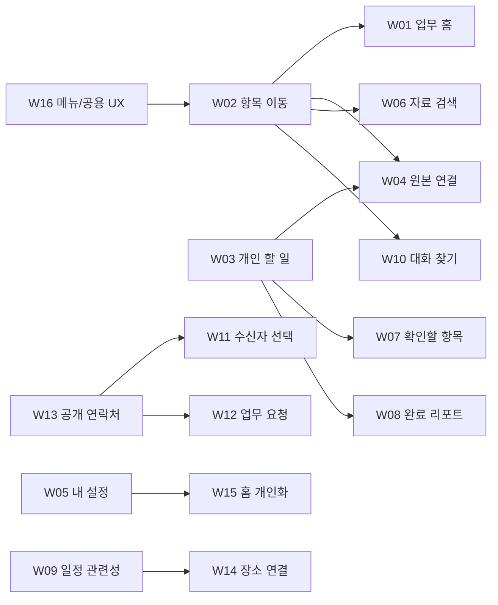

> 이력 보관본: 2026-10-11 문서 정리 전 원문입니다. 당시 구현·계획·검증 기록이며 현재 상태나 작업 승인으로 사용하지 않습니다. 현행 기준은 [개발 문서 진입점](../../../../README.md)입니다. 본문의 코드 경로는 저장소 루트 기준입니다.

> 이 문서는 기획 당시의 상태와 목표를 보존한다. 이후 실제 구현 현황·검증·남은 범위는 [서비스 구현 보고서](../SERVICE_IMPLEMENTATION_REPORT.md)와 [Codex 작업 문서](../PROPOSAL_WORK_CONTEXT.md)를 따른다.

# 서비스 중심 개발 순서 제안
기준일: 2026-10-10 · 개발 일정/구현 착수 승인 아님

작은 UI 실습부터 늘리는 이전 순서를 대체한다. **오늘 업무 확인 → 개인 업무/연락 편의 → 기능 간 후속 작업·검색 → 실제 수요가 있는 독립 도메인** 순서다. High인 W04도 Task와 상세 이동이 있어야 하므로3단계다. 점수는 [서비스 우선순위](04_FEATURE_PRIORITY_MATRIX.md)를 따른다.

## 단계 1. 현재 기능을 하나의 서비스로 정리

**사용자 결과:** 메뉴에서 업무 목적이 보이고 홈에서 필요한 항목으로 바로 이동한다.

**개발 범위:** 기존 홈/일정/메일/채팅과 공통 navigation·feedback를 보강한다. 마감일·구성원·리포트는 준비되기 전 가짜 값/링크로 노출하지 않는다.

**선행 조건:** 현재 기능/URL·공유/개인 자료 범위를 고정한다. 카드 이동 contract를 W02에서 정한 뒤 홈을 재구성한다.

**완료 판단:** 홈에서 선택한 일정·메일·방이 같은 항목으로 열린다. 판매/날씨/방문 fixture는 업무 홈에 없다. 메뉴 목적/현재 계정/로딩·실패·0건이 분명하다.

| 제안 | 난이도 | 서비스 우선순위 |
|---|---|---|
| W16 메뉴 재편·일관된 저장 상태·오류 복귀 | Medium | High |
| W02 항목 바로가기와 맥락을 잇는 빠른 실행 | Medium | High |
| W01 오늘의 업무 홈 | Medium | High |

## 단계 2. 개인 업무 관리와 협업 편의 완성

**사용자 결과:** 할 일을 계획하고, 누구와 소통할지 찾고, 개인 환경에서 일정을 이해할 수 있다.

**개발 범위:** 기존 task 확장/이전·자기 설정·공개 구성원 DTO·수신자 선택·Calendar 관련성 필터와 conflict UI.

**선행 조건:** Task 저장 형태/마감 날짜 정책·profile preference·공개 연락처 범위를 먼저 결정한다. W13 최소 연락처 lookup은 W11의 선행; 전체 구성원 page는 후속이어도 된다.

**완료 판단:** 기존 할 일 보존·같은 task가 홈/목록에 반영, 표시명/시간대 저장, 계정 전환 시 이전 개인 정보 제거, 수신자 선택과 Calendar view의 일관된 범위.

| 제안 | 난이도 | 서비스 우선순위 |
|---|---|---|
| W03 개인 할 일 전용 페이지와 마감 관리 | High | High |
| W05 실제 내 프로필·환경설정과 계정 전환 안내 | Medium | High |
| W09 Calendar의 나와 관련된 일정 보기와 변경 안내 | Medium | High |
| W13 구성원 찾기와 연락처 연결 | Medium | Medium |
| W11 내부 메일 수신자 선택과 최신 수신 확인 | Medium | High |

## 단계 3. 기능 사이의 업무 연결과 정보 발견

**사용자 결과:** 소통에서 나온 일을 놓치지 않고 자료를 찾아 처리하며 업무 흐름을 돌아본다.

**개발 범위:** typed source task·원본 상태 대기함·내용 검색·개인 방 preference·정확한 리포트·홈 개인화.

**선행 조건:** W02/W03 원본·Task 계약, 도메인별 권한/검색 API, 완료 기록/통계 정의, W05 preference 기반. W07은 source의 기존 read/RSVP/완료 상태를 따른다.

**완료 판단:** 할 일→원본 왕복, 삭제된 원본 안내, 검색 권한·계정 전환 유지, 대기항목은 처리 후 반영, 이력 없는 기간을 추정하지 않음, 개인화 기본 복원 가능.

| 제안 | 난이도 | 서비스 우선순위 |
|---|---|---|
| W04 메일·일정·대화에서 후속 할 일 만들기 | High | High |
| W07 확인이 필요한 항목을 모은 알림함 | Medium | Medium |
| W06 업무 내용까지 찾는 통합 검색 | High | Medium |
| W10 채팅방 즐겨찾기와 대화 찾기 | High | Medium |
| W08 Charts를 개인 업무 리포트로 전환 | Medium | Low |
| W15 홈 카드·즐겨찾기 개인화 | Medium | Low |

## 단계 4. 확인된 업무 수요로 독립 기능 확장

**사용자 결과:** 실제로 필요한 요청 처리·장소 재사용을 지원한다.

**개발 범위:** 일반 지원 요청 domain 또는 실제 장소 data. 단순히 Forms/Table/Map 메뉴가 비어 있다는 이유로 만들지 않는다.

**선행 조건:** 요청 유형·requester/assignee 행동 권한·장소 공개/수정 범위·지도 공급자/비용 결정. 인사/금전 결재·organization roles는 별도 범위.

**완료 판단:** 요청이 담당자에게 이어지고 상태/처리 내용이 보존된다. 장소가 Calendar 작성에 재사용된다. 사용 목적이 없으면 보류로 남겨도 된다.

| 제안 | 난이도 | 서비스 우선순위 |
|---|---|---|
| W12 Forms·Tables를 업무 요청 서비스로 통합 | High | Low |
| W14 Maps 통합 장소 목록과 일정 연결 | Medium | Low |

## 의존성과 함께 결정할 것

같은 서비스 객체를 두 번 만들지 않는다. 홈과 Tasks는 같은 개인 task, Calendar와 Agenda는 같은 event, 리포트와 홈 차트는 같은 집계 규칙, 구성원/수신자/참석자/요청 담당 선택은 같은 공개 directory 계약, 홈 개인화/기본시간대는 같은 account preference를 사용한다.

## 보류와 제외

기존 shared 범위를 organization/project membership으로 자동 바꾸지 않는다. 현재 실제 조직/RBAC가 없고 운영자 전체 계정 편집의 요구도 없다. 운영자 서비스·외부 SMTP/첨부·매출/방문 tracking·날씨 공급자·고급 반복 예외·다중 worker Chat은 기존 제한 또는 별도 요구로 남긴다. 동작하지 않는 버튼 수를 채우기 위한 기능, 실습 records·고의 오류 작업대는 이번 서비스 로드맵에서 제외한다.

요청 처리와 개인 할 일은 다르다. 첫3단계는 개인 업무와 현재 공유 소통을 완성하고,4단계에서 명확한 요청자/담당자 관계가 필요한 경우만 요청 도메인을 도입한다. 업무 리포트는 사람별 메시지 발신량을 성과 순위로 해석하지 않는다.

## 다음 구현 요청에 포함할 결정

첫 구현 묶음의 ID와 메뉴 이름, Task의 저장 형태·마감일 규칙, 홈 일정의 기본 관련성 범위, 공개 연락처 필드, preference/draft 보관 범위, 모집/가입 정책을 확인한다. 실제 개발은 선택된 범위와 데이터 보존 계획이 정해진 뒤 시작한다. 이 기획 작업에서는 migration·API/UI 변경·테스트/빌드를 실행하지 않았다.

품질 확인은 실제 이용 흐름·권한·저장·모바일 접근성을 중심으로 한다. 기존 자동 테스트는 결과를 확인하는 수단이고 서비스 메뉴에 테스트 기능을 노출할 근거가 아니다.

