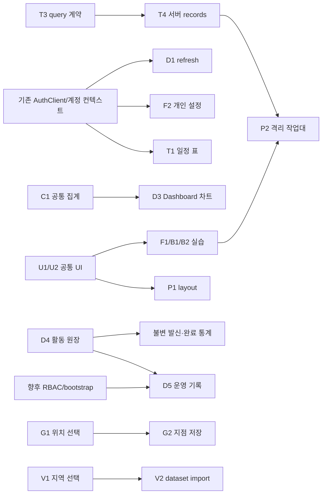

> 이력 보관본: 2026-10-11 문서 정리 전 원문입니다. 당시 구현·계획·검증 기록이며 현재 상태나 작업 승인으로 사용하지 않습니다. 현행 기준은 [개발 문서 진입점](../../../../README.md)입니다. 본문의 코드 경로는 저장소 루트 기준입니다.

# 이전 테스트 중심 기획 보관본

상태: 사용자 재검토로 대체된 과거 제안. 현재 우선순위나 개발 지시로 사용하지 않는다. 현재 기획은 같은 폴더02–07, 개발 인수인계는 docs/PROPOSAL_WORK_CONTEXT.md를 따른다. 아래는 변경 전 본문을 보관한다. 문서 링크는 당시 경로를 텍스트로 남긴다.

---

## 보관 원본: docs/proposals/02_DASHBOARD_PROPOSAL.md

# Dashboard 기능 개선 제안
기준일: 2026-10-10 · 상태: 기획, 미구현 · 실제 탐색 (당시 링크: `01_SITE_EXPLORATION.md`) · 평가표 (당시 링크: `04_FEATURE_PRIORITY_MATRIX.md`)

## 현재 구조와 데이터 의미

현재 화면은 `src/index.html` 위에 `dashboard.js`가 서버 요약을 붙인다. 계정 이름과 4 KPI(Saved events, Events today, Unread chat, Open tasks), Upcoming, Account activity, 실제 7일 차트, 개인 Todo, 읽기 전용 Quick chat이 있다. New report는 dialog, Export는 JSON 다운로드다. 이번 탐색 계정은 eventCount0·recentRooms4·unreadChat1·unreadEmail0·openTasks0을 표시했으며 값은 테스트 데이터에 따라 변한다.

| 데이터 | 실제 원천과 범위 | 한계 |
|---|---|---|
| 저장된 일정 수 | CalendarEvent 중 shared 또는 자기/허용 invite 리소스 | 시리즈 수이며 발생일 수와 다름 |
| 오늘/다가오는 일정 | recurrence 확장, 요청 IANA timezone 날짜 경계; declined 제외 | 화면은 upcoming 5개, API는 최대10; 서버·표시 시간대 구분 필요 |
| unread Chat·recent rooms | shared 전체 접근 + private 참가 권한; 개인 ChatMember.read_sequence | roomCount는 요약의 최근 목록 길이로 작성되어 전체 방 수로 믿으면 안 됨 |
| unread 내부 Email | InternalMail owner+inbox+isRead=false | 수신 push 없음, Mock unread는 별도 |
| 개인 할 일 | WorkspaceState(kind=tasks) snapshot | 완료 시각/이력 없음 |
| eventsCreated | 현재 보이는 CalendarEvent 중 owner가 자신, created_at 일별 | 삭제한 이벤트는 사라짐; 발생 수/편집량 아님 |
| messagesSent | 자신의 ChatMessage.sent_at | 최근7일, 실제 방문/트래픽 아님 |
| mailSent | 자신의 현재 sent 폴더 JSON sentAt | 보관/이동하면 과거 발신 수가 줄 수 있음 |
| Recent activity | 최신 task snapshot·mail updatedAt·각 방 마지막 메시지·event createdAt | 불변 감사 원장 아님, 삭제·중간 수정·로그인 복원 불가 |
| Site visits/Sales/Weather | 시드 차트·정적 HTML + sample 안내 | 실제 방문/매출/날씨 API 없음 |

유지할 기능은 인증·계정 격리, 기존 shared/private 정책, 내부 메일, 개인 tasks, 기존 샘플 모드, 보고서·차트·카드 디자인이다. 개선할 부분은 최신성·수치 이름·기간/시간대 계약·empty/error 처리·활동 기록의 의미다. 신규 기능은 수신 메일 요약과 이후 불변 활동 이력·권한 기반 운영 현황이다. 상단 Notifications는 현재 일정 목록이며 별도 알림 엔티티가 아니다. 알림 read/dismiss 원장을 지금 존재한다고 가정하지 않는다.

## 레이아웃 두 방안 비교

| 항목 | A: 현 구조 유지 | B: 부분 재구성 |
|---|---|---|
| 구성 | 기존 카드에 refresh·필터·메일 요약 추가 | 위쪽을 실제 KPI/오늘 일정/미읽음/할 일로 묶고 하단 Sample 섹션에 판매/날씨/방문 배치 |
| 장점 | 기존 selector·회귀·CSS 영향이 적음 | 업무 데이터와 데모를 바로 구분하고 모바일 우선순위가 명확 |
| 부담 | 긴 페이지에 샘플과 업무 카드가 계속 섞임 | 카드 순서·grid·responsive·스크린 리더/회귀 수정 필요 |
| 테스트 | 현재 testid 유지, 카드 안 상태 전이 검증 | 같은 testid 유지 + 읽기 순서/390px/키보드/표 구역 검증 |
| 권고 | Phase1–2의 기본 | 실제 데이터 카드 안정화 후 작은 범위로 적용 |

권장 B의 최종 순서: 계정/시간대/최신성 → KPI → 오늘·다가오는 일정/Inbox 요약 → 할 일/최근 방 → Activity 차트·수치 표 → 개인 원장(후속) → 명시적인 Samples. 업무 기능은 기존 Calendar/Email/Chat로 이동하고 Dashboard에서 별도 발신·일정 편집기를 만들지 않는다. 개인 widget 배치는 Blank P1 renderer와 공유하되 별도 대형 개편을 선행하지 않는다.

## 제안 기능

### D1. 새로고침·최신성·계정 경계 표시

**대상 페이지:** Dashboard

**현재 상태:** 실제 계정 KPI·오늘/다가오는 일정·개인 할 일·최근 Chat·미읽음 Email·7일 차트가 연결된다. New report dialog와 JSON export가 구현되어 있다. 판매/날씨/방문은 sample. 범위 필터·자동 갱신·불변 감사 로그 없음.

**제안 기능:** 새로고침과 탭 복귀 시 기존 집계를 재조회하고 마지막 성공 시각·갱신 중·오래된 데이터 상태를 표시한다. 병렬 요청 순번과 계정 컨텍스트로 늦은 응답을 폐기한다.

**사용자 시나리오:** Dashboard 진입 → Refresh → 로딩 표시 → 최신 수치 확인 → 네트워크 실패 시 이전 값과 재시도 확인.

**예상 UI 변경:** 현재 KPI·카드 유지, Refresh 버튼과 Last updated 및 stale 배지 추가. 자동 갱신은 보이는 탭에서만 제한적으로 실행.

**필요한 백엔드:** 기존 GET /api/dashboard 및 Workspace tasks 재사용; 새 DB 없음. AuthClient/X-Account-ID와 계정 변경 이벤트 재사용.

**구현 난이도:** Low

**예상 작업 규모:** S · 1–2 작업 단위, Phase 2. 먼저 입력·조회·권한 계약과 fixture를 정하고, 기존 API 또는 실습 어댑터 → UI 상태 연결 → 정상/경계/실패/회귀 검증 순서로 진행한다. 작업 단위는 작은 UI·서비스 변경과 해당 검증 한 묶음이며 일정·인력 산정이 아니다.

**테스트 시나리오:** 고정 fixture에서 다른 계정의 메일·일정 생성 후 Refresh로 기대 수치 비교. 응답 순서를 뒤집어 최신 요청만 표시; 401·503·빈 목록과 계정 전환 직후 이전 계정 수치가 사라지는지 확인.

**버그 인젝션 활용:** 이전 응답 덮어쓰기·계정별 캐시 키 누락·실패 시 0 덮어쓰기 → 지연 응답과 A/B 컨텍스트의 DOM 수치·identity·lastSuccess 비교. 향후 격리된 실습 환경에서만 검토한다. 이번 작업에서는 주입하거나 구현하지 않았다.

**우선순위:** High (94/100). 단계·정책 선행 조건은 로드맵 (당시 링크: `05_RECOMMENDED_ROADMAP.md`)을 따른다.

**추천 이유:** 이미 연결된 데이터를 믿고 확인할 수 있게 하며 작은 변경으로 경쟁 상태·오류·계정 격리를 검증한다.

**8개 기준 평가 근거:** 적합성 5/5: 기존 집계의 사용성 보강 / 테스트 가치 5/5: 갱신·실패·경쟁 상태 다수 / 난이도 2/5: UI와 요청 수명주기 변경 / 재사용성 5/5: 현재 집계/AuthClient 재사용 / 백엔드 필요성 1/5: 기존 조회 API만 사용 / 지속성 2/5: 최신성은 메모리 상태 / 버그 인젝션 5/5: 늦은 응답으로 결정적 재현 / 비중복성 5/5: 통신 기능을 복제하지 않음. 난이도·백엔드 점수는 클수록 부담이며 종합 점수에서는 역산한다.

### D2. 최근 내부 수신 메일 요약과 상세 이동

**대상 페이지:** Dashboard

**현재 상태:** 실제 계정 KPI·오늘/다가오는 일정·개인 할 일·최근 Chat·미읽음 Email·7일 차트가 연결된다. New report dialog와 JSON export가 구현되어 있다. 판매/날씨/방문은 sample. 범위 필터·자동 갱신·불변 감사 로그 없음.

**제안 기능:** 자신의 Inbox 최신 5개 제목·발신자·미읽음 표시를 읽기 전용 카드로 보여 준다. 선택 시 Email의 해당 메시지로 이동한다. 카드 노출로 읽음 상태를 바꾸지 않는다.

**사용자 시나리오:** 요약에서 미읽음 제목 확인 → Open Email → 같은 메시지 reader 확인 → Dashboard 재조회로 읽음 수치 확인.

**예상 UI 변경:** Account activity에 메일 요약 카드, 빈 상태 및 Open inbox 링크. 작성·답장 UI는 기존 Email에 유지.

**필요한 백엔드:** GET /api/mail/emails를 우선 재사용. 초기 메일함 전체 조회의 한계를 명시하고 후속 limit/summary 조회 검토. 기존 Email의 메시지 ID deep link 처리 추가, 새 DB 없음.

**구현 난이도:** Low

**예상 작업 규모:** S · 1–2 작업 단위, Phase 2. 먼저 입력·조회·권한 계약과 fixture를 정하고, 기존 API 또는 실습 어댑터 → UI 상태 연결 → 정상/경계/실패/회귀 검증 순서로 진행한다. 작업 단위는 작은 UI·서비스 변경과 해당 검증 한 묶음이며 일정·인력 산정이 아니다.

**테스트 시나리오:** 본인 메일만 최신순 5개 표시, Bcc 수신본에 타 Bcc가 없는지 확인. 제목 HTML escape, 미리보기 전후 isRead 동일, 없는/타인 ID 상세는 안전한 빈 상태.

**버그 인젝션 활용:** 소유자 필터 누락·미리보기에서 읽음 변경·ID 누락 → A/B 메일 fixture 및 API 전후 isRead·이동 후 reader ID 비교. 향후 격리된 실습 환경에서만 검토한다. 이번 작업에서는 주입하거나 구현하지 않았다.

**우선순위:** High (87/100). 단계·정책 선행 조건은 로드맵 (당시 링크: `05_RECOMMENDED_ROADMAP.md`)을 따른다.

**추천 이유:** 이미 있는 unread 수치에 실제 행동 경로를 더하면서 메일 서비스의 CRUD를 중복하지 않는다.

**8개 기준 평가 근거:** 적합성 5/5: 내부 Email과 직접 연결 / 테스트 가치 4/5: 목록·이동·권한 확인 / 난이도 2/5: 요약 및 deep link 처리 / 재사용성 5/5: 기존 DTO·조회 어댑터 / 백엔드 필요성 2/5: 현재 API 활용, 최적화는 후속 / 지속성 4/5: 메일은 이미 DB에 지속 / 버그 인젝션 4/5: owner와 읽음 부작용 검출 / 비중복성 5/5: 작성은 Email에 위임. 난이도·백엔드 점수는 클수록 부담이며 종합 점수에서는 역산한다.

### D3. 활동 차트 범위·지표 선택과 상세 집계

**대상 페이지:** Dashboard

**현재 상태:** 실제 계정 KPI·오늘/다가오는 일정·개인 할 일·최근 Chat·미읽음 Email·7일 차트가 연결된다. New report dialog와 JSON export가 구현되어 있다. 판매/날씨/방문은 sample. 범위 필터·자동 갱신·불변 감사 로그 없음.

**제안 기능:** 최근 7일 기본 차트에서 지표를 선택하고 지정 기간의 일별 집계 및 대응 데이터 표를 확인한다. Charts의 C1 조회 서비스·경계 규칙을 공통으로 사용한다.

**사용자 시나리오:** 기간 선택 → 일정 생성/채팅 발신/메일 발신 선택 → 막대 선택 → 그 날짜의 수치 표 확인 → 필터 해제.

**예상 UI 변경:** 기존 Last 7 days 카드 확장, date inputs·지표 토글·접근 가능한 데이터 표. 통계 이름은 현재 상태 기반임을 표시.

**필요한 백엔드:** C1의 개인 activity 조회 계약을 공통 사용; 기존 /api/dashboard 고정 7일을 임의 기간으로 간주하지 않는다. shared 일정의 생성자 집계와 내가 볼 수 있는 일정 수를 분리. 새 이력 DB는 D4에서만 도입.

**구현 난이도:** Medium

**예상 작업 규모:** M · 3–4 작업 단위, Phase 2. 먼저 입력·조회·권한 계약과 fixture를 정하고, 서버 검증/저장·조회 어댑터 → UI 상태 연결 → 정상/경계/실패/회귀 검증 순서로 진행한다. 작업 단위는 작은 UI·서비스 변경과 해당 검증 한 묶음이며 일정·인력 산정이 아니다.

**테스트 시나리오:** 시작 포함·종료 제외, 자정·종일·DST fixture의 합계, 숨긴 지표와 표 일치, 0일 값 포함, Calendar 시리즈 수와 발생 수를 구분.

**버그 인젝션 활용:** 끝 날짜 포함·timezone 무시·시리즈/발생 혼동 → 고정 UTC 경계 fixture와 서버 집계·DOM 표의 동일 합계 확인. 향후 격리된 실습 환경에서만 검토한다. 이번 작업에서는 주입하거나 구현하지 않았다.

**우선순위:** High (90/100). 단계·정책 선행 조건은 로드맵 (당시 링크: `05_RECOMMENDED_ROADMAP.md`)을 따른다.

**추천 이유:** 기존 Chart.js와 DB 집계를 직접 활용하며 날짜 경계와 다중 컨트롤을 함께 검증한다.

**8개 기준 평가 근거:** 적합성 5/5: 현재 활동 차트 확장 / 테스트 가치 5/5: 범위·토글·drilldown 교차 / 난이도 3/5: 조회 계약/일자 처리 필요 / 재사용성 5/5: Chart.js·집계·인증 재사용 / 백엔드 필요성 3/5: 조회 API 범위 확장 / 지속성 4/5: 기존 DB가 데이터 원천 / 버그 인젝션 5/5: 경계 오류의 명확한 oracle / 비중복성 4/5: C1 공통화, 화면만 별도. 난이도·백엔드 점수는 클수록 부담이며 종합 점수에서는 역산한다.

### D4. 개인 활동 원장과 할 일 완료 이력

**대상 페이지:** Dashboard

**현재 상태:** 실제 계정 KPI·오늘/다가오는 일정·개인 할 일·최근 Chat·미읽음 Email·7일 차트가 연결된다. New report dialog와 JSON export가 구현되어 있다. 판매/날씨/방문은 sample. 범위 필터·자동 갱신·불변 감사 로그 없음.

**제안 기능:** 생성·수정·삭제·할 일 완료/취소·메일 발신 사실을 append-only 활동 이벤트로 기록한다. 현재 recentActivity 스냅샷과 별도로 필터·커서 조회 및 완료 추이를 제공한다.

**사용자 시나리오:** 테스트 계정 작업 수행 → 활동 종류/날짜 필터 → 이전 이력 더 보기 → 항목 삭제 후에도 활동 사실과 완료 추이 유지.

**예상 UI 변경:** Recent activity에 이력 종류·시간 필터와 더 보기. 원장과 현재 데이터 기반 activity를 명시적으로 구분.

**필요한 백엔드:** 계획 모델 activity_events(actor_id, subject_type/id, action, occurred_at, correlation_id, visibility), task 변경 이벤트. 변경과 로그를 같은 트랜잭션으로 저장하고 clientId 중복 방지. 자신의 이력 기본; 공유/관리자 접근은 별도 정책. 본문·비밀번호·토큰 저장 금지.

**구현 난이도:** High

**예상 작업 규모:** L · 5–8 작업 단위, Phase 3. 먼저 입력·조회·권한 계약과 fixture를 정하고, 서버 검증/저장·조회 어댑터 → UI 상태 연결 → 정상/경계/실패/회귀 검증 순서로 진행한다. 작업 단위는 작은 UI·서비스 변경과 해당 검증 한 묶음이며 일정·인력 산정이 아니다.

**테스트 시나리오:** 실패한 변경은 성공 이벤트가 없어야 함; 재시도는 하나; 완료→취소 각각 기록. 원본 삭제 후 사실 보존, 페이지 사이 중복/누락 없음, A/B 개인 이력 격리.

**버그 인젝션 활용:** commit 전 기록·중복 기록·메일 Sent 폴더 의존·actor 위조 → transaction 실패/재시도/폴더 이동 fixture와 이벤트 수 및 actor 비교. 향후 격리된 실습 환경에서만 검토한다. 이번 작업에서는 주입하거나 구현하지 않았다.

**우선순위:** Medium (78/100). 단계·정책 선행 조건은 로드맵 (당시 링크: `05_RECOMMENDED_ROADMAP.md`)을 따른다.

**추천 이유:** 현재 데이터만으로 복구할 수 없는 삭제·완료·로그인 이력을 실제로 검증할 토대를 마련한다. 첫 구현보다 뒤에 둔다.

**8개 기준 평가 근거:** 적합성 5/5: 활동/통계 정확성 보강 / 테스트 가치 5/5: 트랜잭션·재시도·이력 검증 / 난이도 5/5: 여러 쓰기 경로와 보존 정책 / 재사용성 3/5: 기존 쓰기 서비스 일부 활용 / 백엔드 필요성 5/5: 새 DB와 조회 API 필수 / 지속성 5/5: 삭제 이후도 사실 보존 / 버그 인젝션 5/5: 기록 원자성 검출 용이 / 비중복성 5/5: Chat/메일 본문 기능과 다름. 난이도·백엔드 점수는 클수록 부담이며 종합 점수에서는 역산한다.

### D5. 권한 기반 운영 현황과 로그인 기록

**대상 페이지:** Dashboard

**현재 상태:** 실제 계정 KPI·오늘/다가오는 일정·개인 할 일·최근 Chat·미읽음 Email·7일 차트가 연결된다. New report dialog와 JSON export가 구현되어 있다. 판매/날씨/방문은 sample. 범위 필터·자동 갱신·불변 감사 로그 없음.

**제안 기능:** 권한을 갖춘 운영자만 활성 계정 수·서비스 상태·최근 로그인 결과를 확인한다. 일반 사용자는 자신의 로그인 기록과 비밀 없는 상태만 본다.

**사용자 시나리오:** 일반 계정은 자신의 기록 확인 → 운영 권한 fixture는 요약·기간 필터 확인 → 권한 폐기 후 새로고침으로 차단.

**예상 UI 변경:** 조건부 Operations 카드·로그인 결과 표·상태 확인 버튼. 사용자 전체 목록이나 세션 토큰을 직접 노출하지 않음.

**필요한 백엔드:** 현재 User에 role/RBAC와 로그인 감사 모델 없음. 새 권한 모델·bootstrap 정책·D4 이벤트 보존 정책 선행. /api/health의 최소 상태와 권한 보호 운영 집계 계획 API. AuthAttempt는 제한용이라 로그인 원장으로 재사용하지 않음.

**구현 난이도:** High

**예상 작업 규모:** L · 5–8 작업 단위, Phase 4. 먼저 입력·조회·권한 계약과 fixture를 정하고, 서버 검증/저장·조회 어댑터 → UI 상태 연결 → 정상/경계/실패/회귀 검증 순서로 진행한다. 작업 단위는 작은 UI·서비스 변경과 해당 검증 한 묶음이며 일정·인력 산정이 아니다.

**테스트 시나리오:** UI를 숨긴 상태에서 직접 API 호출도 403, 일반 계정 타인 기록 차단, revoke 후 실패, 상태 timeout/정상 복구. 운영 권한은 전용 fixture에서만 부여.

**버그 인젝션 활용:** UI만 권한 검사·민감 세션 값 출력·권한 캐시 미무효화 → 직접 호출과 응답 allowlist·revoke 후 요청으로 검출. 향후 격리된 실습 환경에서만 검토한다. 이번 작업에서는 주입하거나 구현하지 않았다.

**우선순위:** Low (60/100). 단계·정책 선행 조건은 로드맵 (당시 링크: `05_RECOMMENDED_ROADMAP.md`)을 따른다.

**추천 이유:** 관리자다운 활용은 가능하지만 현재 권한 체계와 기록이 없으므로 업무 요구를 정한 뒤 추진한다.

**8개 기준 평가 근거:** 적합성 3/5: 운영 목적은 추가 정책 필요 / 테스트 가치 4/5: 권한·revoke·장애 검증 / 난이도 5/5: RBAC/bootstrap/감사 범위 큼 / 재사용성 2/5: 현 인증과 health 일부만 재사용 / 백엔드 필요성 5/5: 새 권한/기록 API 필요 / 지속성 4/5: 로그인 기록은 장기 지속 / 버그 인젝션 4/5: 직접 API 우회로 검출 / 비중복성 5/5: 개인 협업 기능과 독립. 난이도·백엔드 점수는 클수록 부담이며 종합 점수에서는 역산한다.

## 현재 DB로 가능한 시각화와 신규 수집

기존 DB에서 가능한 것은 현재 저장된 일정 생성·현재 남은 채팅 발신·현재 Sent 메일·현재 task 완료율이다. D3/C1에서 범위를 확장해도 이력의 불변성이 생기는 것은 아니다. 읽음 변경 수·task 완료 시각별 추이·삭제된 리소스 활동·로그인 성공/실패·실제 페이지 방문·실매출·날씨는 새 이벤트 수집 또는 외부 원천이 필요하다. 첫 두 단계에는 방문 tracking·SMTP·외부 날씨 연동을 권장하지 않는다.

D4 이후 발신 사실은 folder와 독립인 이벤트로 세고, 과거 데이터는 '기록 시작일 이후'를 표시한다. 과거 완료/삭제 이력을 현재 snapshot에서 지어내거나 AuthAttempt를 로그인 로그로 바꾸지 않는다.

## 공통 검증 기준

Playwright는 데이터 변화 전후 값을 독립 fixture/API 기대값과 비교한다. API timeout·401·403·409·422·503을 구분하고 empty를 오류로 보이지 않게 한다. 새 계정으로 전환하면 이전 계정 card/cache/request/subscription이 제거되어야 한다. shared는 계속 공유되고 private는 분리된다. 날짜는 start 포함/end 제외, 종일 종료 exclusive, timezone과 recurrence 정책을 기존 서버와 일치시킨다. 갱신 중 이중 클릭·늦은 응답·tab hide/show를 fake clock 또는 제어된 응답으로 재현하고 DOM에 상태를 노출한다.

---

## 보관 원본: docs/proposals/03_COMPONENTS_PROPOSAL.md

# Components 페이지별 기능 제안
기준일: 2026-10-10 · 모든 항목 기획/미구현 · 탐색 증거 (당시 링크: `01_SITE_EXPLORATION.md`) · 점수 기준 (당시 링크: `04_FEATURE_PRIORITY_MATRIX.md`)

Components는 13개 실제 하위 페이지다. 각 페이지별 2개, 총26개를 제안한다. 갤러리 스타일과 명시적 sample을 보존하면서 일부는 결정적 상호작용 실습으로, 일부는 기존 리소스의 실제 읽기 화면으로 확장한다. 실제 사용자 역할 관리·다른 통신 CRUD를 모든 페이지에 복제하지 않는다.

입력 검증·모달/탭·취소/Undo·정렬/페이지·파일 미리보기·공간 선택·오류 복귀·인증 경로는 서로 다른 테스트 상태를 제공한다. 실습은 seed와 reset으로 반복 가능해야 하고 실제 데이터는 서버 소유권·revision·CSRF를 검사해야 한다. '실습 권한'은 보안 권한으로 간주하지 않는다.

## Charts
### C1. 실제 활동 데이터 기간·범위 조회

**대상 페이지:** Charts

**현재 상태:** 6개 시드 canvas와 테마 변경·PNG export 동작. Q 버튼 active 스타일은 변하지만 조회/값 변화 계약 없음. New chart 클릭 후 본문 변화·열린 dialog 0.

**제안 기능:** 샘플 차트는 명시적으로 남기고 Activity 탭을 추가하여 자신의 이벤트 생성·메시지 발신·메일 발신을 조회한다. 7/30일·직접 날짜·timezone 선택 및 수치 표를 제공한다.

**사용자 시나리오:** Activity 탭 → 30일 → 날짜 범위 수정 → 조회 → 표와 차트 합계 비교. 무효 범위에는 요청 없이 필드 오류.

**예상 UI 변경:** 시드 차트와 실제 데이터 탭 분리; 날짜 필드·Apply·loading/error/empty 표시. New chart는 C2 범위에서 목적 부여.

**필요한 백엔드:** 계획 GET /api/activity/statistics?start&end&timezoneName; start 포함/end 제외·최대 90일·세션 actor 고정. 기존 resources 집계 추출, 새 DB 없음. 고정 7일 API의 통계 한계를 유지해 이름에 반영; D4 뒤 불변 발신 통계로 전환.

**구현 난이도:** Medium

**예상 작업 규모:** M · 3–4 작업 단위, Phase 2. 먼저 입력·조회·권한 계약과 fixture를 정하고, 서버 검증/저장·조회 어댑터 → UI 상태 연결 → 정상/경계/실패/회귀 검증 순서로 진행한다. 작업 단위는 작은 UI·서비스 변경과 해당 검증 한 묶음이며 일정·인력 산정이 아니다.

**테스트 시나리오:** DB fixture의 0/1/경계 값과 차트 데이터 표 비교; 시작>종료·과도한 기간422; A/B 지표 분리. 반복 일정은 생성 리소스 1건으로 세며 발생수는 별도 지표.

**버그 인젝션 활용:** 임의 userId 신뢰·메일 폴더 이동으로 발신수 감소·timezone 오프셋 → 권한·folder 이동·자정 fixture로 각각 탐지. 향후 격리된 실습 환경에서만 검토한다. 이번 작업에서는 주입하거나 구현하지 않았다.

**우선순위:** High (90/100). 단계·정책 선행 조건은 로드맵 (당시 링크: `05_RECOMMENDED_ROADMAP.md`)을 따른다.

**추천 이유:** Dashboard의 통계를 공통 서비스로 재사용하며 M/Q/Y 장식 버튼에 검증 가능한 데이터 계약을 부여한다.

**8개 기준 평가 근거:** 적합성 5/5: 실제 DB 활동과 연결 / 테스트 가치 5/5: 날짜·지표·권한 상호작용 / 난이도 3/5: 기간 쿼리와 경계 정의 / 재사용성 5/5: Chart.js/resources 재사용 / 백엔드 필요성 3/5: 조회 API 확장만 필요 / 지속성 4/5: DB 사실을 읽음 / 버그 인젝션 5/5: 경계·owner 버그 적합 / 비중복성 4/5: D3와 하나의 집계 기반. 난이도·백엔드 점수는 클수록 부담이며 종합 점수에서는 역산한다.

### C2. 차트 종류·범례·값 선택 및 내보내기

**대상 페이지:** Charts

**현재 상태:** 6개 시드 canvas와 테마 변경·PNG export 동작. Q 버튼 active 스타일은 변하지만 조회/값 변화 계약 없음. New chart 클릭 후 본문 변화·열린 dialog 0.

**제안 기능:** 같은 결정적 데이터셋을 line/bar로 전환하고 범례로 시리즈를 숨기며 점 선택 시 정확한 값 표를 표시한다. PNG/CSV export는 현재 표시 범위와 숨김 상태를 따르게 한다.

**사용자 시나리오:** 고정 데이터 선택 → Bar → 한 지표 숨기기 → 점/키보드 선택 → 값 확인 → Export.

**예상 UI 변경:** New chart 버튼은 설정 dialog 열기; 종류·series 토글·값 표·export 옵션 추가. 기존 PNG 기능 유지.

**필요한 백엔드:** 없음. 초기에는 공개된 fixture와 메모리 설정만 사용하고 계정 업무 데이터는 저장하지 않음. C1 연동은 후속.

**구현 난이도:** Low

**예상 작업 규모:** S · 1–2 작업 단위, Phase 1. 먼저 입력·조회·권한 계약과 fixture를 정하고, 기존 API 또는 실습 어댑터 → UI 상태 연결 → 정상/경계/실패/회귀 검증 순서로 진행한다. 작업 단위는 작은 UI·서비스 변경과 해당 검증 한 묶음이며 일정·인력 산정이 아니다.

**테스트 시나리오:** 전환 전후 값 동일, legend hidden 반영, CSV 헤더/행/값 정확, PNG 실제 MIME·크기 확인. 키보드 표 선택으로 canvas와 같은 값을 얻음.

**버그 인젝션 활용:** 차트 전환 시 데이터 재시드·hidden 지표 export 포함·라벨 값 어긋남 → 원본 fixture와 내보낸 바이트/데이터 표 비교. 향후 격리된 실습 환경에서만 검토한다. 이번 작업에서는 주입하거나 구현하지 않았다.

**우선순위:** High (88/100). 단계·정책 선행 조건은 로드맵 (당시 링크: `05_RECOMMENDED_ROADMAP.md`)을 따른다.

**추천 이유:** 외부 서비스 없이 풍부한 상호작용을 재현할 수 있고 현재 Chart.js/PNG를 대부분 활용한다.

**8개 기준 평가 근거:** 적합성 4/5: Charts 목적을 구체화 / 테스트 가치 5/5: 종류·범례·export 교차 / 난이도 2/5: 전환/선택 상태 구현 / 재사용성 5/5: 기존 차트·download 활용 / 백엔드 필요성 1/5: API 불필요 / 지속성 2/5: 설정은 메모리 상태 / 버그 인젝션 4/5: 라벨/데이터 mismatch 검출 / 비중복성 5/5: 업무 CRUD를 복제하지 않음. 난이도·백엔드 점수는 클수록 부담이며 종합 점수에서는 역산한다.

## Forms
### F1. 조건부 입력·다단계 검증 실습

**대상 페이지:** Forms

**현재 상태:** 샘플 John/Doe 값, required/email 네이티브 검증. 빈 first에서 checkValidity=false, 정상 입력 후 'No account profile or role changes were saved', Cancel로 John 복원. Role·Timezone·autosave 문구는 실제 설정 아님.

**제안 기능:** 별도 실습 모드에서 개인/팀 선택에 따라 필드를 바꾸고 기본 정보→옵션→검토의 3단계를 제공한다. 필수·길이·날짜 범위·파일 크기/type 검증과 제출 결과 요약을 처리한다.

**사용자 시나리오:** 팀 선택 → 조직명 누락으로 Next 실패 → 입력 → 뒤로 이동 → 값 보존 → 1KiB/초과 파일 선택 → 검토·제출·Reset.

**예상 UI 변경:** 기존 입력 갤러리 유지, wizard·필드별 오류·진행 단계·결과 패널 추가. 파일은 브라우저 메타데이터 검증만 하고 업로드되지 않음을 표시.

**필요한 백엔드:** 없음. DOM/메모리 상태만 사용; 이메일 발신·가입·역할 변경과 연결하지 않음. 허용 파일 규칙은 fixture에 명시.

**구현 난이도:** Low

**예상 작업 규모:** S · 1–2 작업 단위, Phase 1. 먼저 입력·조회·권한 계약과 fixture를 정하고, 기존 API 또는 실습 어댑터 → UI 상태 연결 → 정상/경계/실패/회귀 검증 순서로 진행한다. 작업 단위는 작은 UI·서비스 변경과 해당 검증 한 묶음이며 일정·인력 산정이 아니다.

**테스트 시나리오:** 숨겨진 필드가 제출을 막지 않는지, Back에서 값 보존, 파일 확장자만 믿지 않는 표시 검증, 중복 제출 결과 1개, Reset 후 단계/값/오류 초기화.

**버그 인젝션 활용:** 숨긴 필수 필드 검증·Back 값 소실·경계 길이 off-by-one → 조건 선택·이전 이동·최대±1 입력의 결과 비교. 향후 격리된 실습 환경에서만 검토한다. 이번 작업에서는 주입하거나 구현하지 않았다.

**우선순위:** High (88/100). 단계·정책 선행 조건은 로드맵 (당시 링크: `05_RECOMMENDED_ROADMAP.md`)을 따른다.

**추천 이유:** 새 DB 없이 입력과 검증의 다양한 상태 전이를 제공한다.

**8개 기준 평가 근거:** 적합성 4/5: Forms 실습 목적과 맞음 / 테스트 가치 5/5: 분기·wizard·경계 값 풍부 / 난이도 2/5: 프런트 상태/검증 구현 / 재사용성 4/5: 기존 field/dialog 스타일 / 백엔드 필요성 1/5: 서버 저장/업로드 없음 / 지속성 2/5: 페이지 내 값만 유지 / 버그 인젝션 5/5: 분기 검증 oracle 명확 / 비중복성 5/5: 가입/업무 폼 복제 아님. 난이도·백엔드 점수는 클수록 부담이며 종합 점수에서는 역산한다.

### F2. 개인 표시명·환경설정 실제 저장

**대상 페이지:** Forms

**현재 상태:** 샘플 John/Doe 값, required/email 네이티브 검증. 빈 first에서 checkValidity=false, 정상 입력 후 'No account profile or role changes were saved', Cancel로 John 복원. Role·Timezone·autosave 문구는 실제 설정 아님.

**제안 기능:** 현재 샘플 Profile settings와 별도로 자신의 표시명·기본 timezone·알림 표시 환경설정을 조회/저장한다. dirty·저장 중·완료·충돌을 구분한다. 역할·내부 주소는 읽기 전용.

**사용자 시나리오:** 실제 설정 탭 → 표시명 수정 → 저장 → 새로고침·다른 탭 확인 → 동시에 다른 수정 시 충돌 안내.

**예상 UI 변경:** 실제/실습 모드 라벨, current user 값, dirty 배지·Discard·Save·conflict 안내. 현재 가짜 autosave 문구 제거는 향후 구현 작업.

**필요한 백엔드:** 현재 /api/users/me는 조회용. 계획 PATCH /api/users/me/profile {displayName,preferences,expectedRevision}; User display_name 재사용, 새 user_preferences/revision 저장. 서버에서 자기 계정·CSRF·allowlist 검증.

**구현 난이도:** Medium

**예상 작업 규모:** M · 3–4 작업 단위, Phase 3. 먼저 입력·조회·권한 계약과 fixture를 정하고, 서버 검증/저장·조회 어댑터 → UI 상태 연결 → 정상/경계/실패/회귀 검증 순서로 진행한다. 작업 단위는 작은 UI·서비스 변경과 해당 검증 한 묶음이며 일정·인력 산정이 아니다.

**테스트 시나리오:** 재로드 지속·A/B 계정 분리·타인 PATCH403/404·role/password/email body 거부, trim/길이 검증, concurrent409와 입력 보존. Shell 이름과 변경 결과 일치.

**버그 인젝션 활용:** 요청 userId 신뢰·저장 실패인데 성공 표시·revision 누락 → 직접 API 접근·503·동시 편집의 DB와 UI 상태 비교. 향후 격리된 실습 환경에서만 검토한다. 이번 작업에서는 주입하거나 구현하지 않았다.

**우선순위:** High (88/100). 단계·정책 선행 조건은 로드맵 (당시 링크: `05_RECOMMENDED_ROADMAP.md`)을 따른다.

**추천 이유:** Forms의 가장 오해하기 쉬운 저장 동작을 실제 기능으로 만들고 기존 auth를 재사용한다.

**8개 기준 평가 근거:** 적합성 5/5: 개인 profile 사용성 / 테스트 가치 5/5: 지속·dirty·충돌·권한 검증 / 난이도 3/5: 설정 계약/동시성 추가 / 재사용성 4/5: User/auth/form 재사용 / 백엔드 필요성 4/5: 새 PATCH·preferences 필요 / 지속성 5/5: 서버에 계정별 지속 / 버그 인젝션 5/5: 저장/권한 실패 oracle 분명 / 비중복성 5/5: 메일주소/역할 관리 제외. 난이도·백엔드 점수는 클수록 부담이며 종합 점수에서는 역산한다.

## UI Elements
### U1. 접근 가능한 모달·알림 수명주기

**대상 페이지:** UI Elements

**현재 상태:** accordion true→false→true 동작. 일반 Activity 탭 클릭 후 class=tab 유지, Delete project 후 dialog0, Dismiss 후 alert가 유지되는 데모. 모달은 modal-demo 정적 박스. 모바일390px에서 tooltip .pop 때문에 문서 폭411px.

**제안 기능:** 상시 표시된 modal-demo 대신 실제 dialog 실습을 제공하고 알림 dismiss·재표시·큐 처리를 구현한다. 열기→Cancel/Escape→복귀 초점과 Confirm 결과를 검증한다.

**사용자 시나리오:** Open modal → Tab 순환 → Cancel → 원래 버튼 복귀 → 다시 열어 Confirm → 알림 dismiss → Restore.

**예상 UI 변경:** Open modal 버튼, native dialog·aria labels·status/alert, 390px에서 넘치지 않는 카드. Delete project는 실습 객체에만 적용.

**필요한 백엔드:** 없음; 실제 프로젝트 삭제 API는 만들지 않음. 공용 dialog/알림 helper로 기존 화면에서 재사용 가능.

**구현 난이도:** Low

**예상 작업 규모:** S · 1–2 작업 단위, Phase 1. 먼저 입력·조회·권한 계약과 fixture를 정하고, 기존 API 또는 실습 어댑터 → UI 상태 연결 → 정상/경계/실패/회귀 검증 순서로 진행한다. 작업 단위는 작은 UI·서비스 변경과 해당 검증 한 묶음이며 일정·인력 산정이 아니다.

**테스트 시나리오:** Escape 닫기·focus 복귀·배경 비활성·dismiss 후 개수·확인 결과 1회, 모바일 document scrollWidth<=viewport. 초점 없는 hidden 알림 확인.

**버그 인젝션 활용:** Escape 미처리·초점 손실·확인 handler 중복·긴 문구 넘침 → role/focus/큐 개수와 viewport 경계 assertion. 향후 격리된 실습 환경에서만 검토한다. 이번 작업에서는 주입하거나 구현하지 않았다.

**우선순위:** High (90/100). 단계·정책 선행 조건은 로드맵 (당시 링크: `05_RECOMMENDED_ROADMAP.md`)을 따른다.

**추천 이유:** 현재 UI의 무동작 요소와 관찰된 모바일 문제를 함께 해소하며 여러 페이지의 공통 테스트 기반이 된다.

**8개 기준 평가 근거:** 적합성 4/5: 현재 modal/alert 데모 확장 / 테스트 가치 5/5: 초점·닫기·큐 상태 풍부 / 난이도 2/5: 공용 컨트롤러 수준 / 재사용성 5/5: native dialog/스타일 활용 / 백엔드 필요성 1/5: 서버 불필요 / 지속성 1/5: 닫기/초기화시 사라짐 / 버그 인젝션 5/5: 접근성 상태 oracle 명확 / 비중복성 5/5: 업무 삭제 기능과 분리. 난이도·백엔드 점수는 클수록 부담이며 종합 점수에서는 역산한다.

### U2. 탭·드롭다운·툴팁 키보드 실습

**대상 페이지:** UI Elements

**현재 상태:** accordion true→false→true 동작. 일반 Activity 탭 클릭 후 class=tab 유지, Delete project 후 dialog0, Dismiss 후 alert가 유지되는 데모. 모달은 modal-demo 정적 박스. 모바일390px에서 tooltip .pop 때문에 문서 폭411px.

**제안 기능:** 일반 Tabs를 실제 panel과 연결하고 Arrow/Home/End 선택, dropdown의 외부 클릭/Escape, hover와 focus tooltip을 제공한다. 전환 후 panel별 값 유지 정책을 명시한다.

**사용자 시나리오:** 탭 A 입력 → Arrow로 B → A 복귀 → 값 유지 → dropdown 선택 → 바깥 클릭 → focus tooltip 확인.

**예상 UI 변경:** tablist/tab/tabpanel·aria-selected·roving tabindex·menu 및 tooltip 관계 추가. 아코디언은 기존 클릭 동작을 유지하고 expanded 상태 반영.

**필요한 백엔드:** 없음; init.js 옵트인 탭과 dropdown 기반 확장. 업무 알림이나 실제 설정을 생성하지 않음.

**구현 난이도:** Low

**예상 작업 규모:** S · 1–2 작업 단위, Phase 1. 먼저 입력·조회·권한 계약과 fixture를 정하고, 기존 API 또는 실습 어댑터 → UI 상태 연결 → 정상/경계/실패/회귀 검증 순서로 진행한다. 작업 단위는 작은 UI·서비스 변경과 해당 검증 한 묶음이며 일정·인력 산정이 아니다.

**테스트 시나리오:** 한 panel만 visible, active와 aria-selected 일치, 비활성 panel focus 차단, Escape 후 trigger focus, 툴팁 텍스트 동일, Accordion true→false→true.

**버그 인젝션 활용:** 탭 스타일만 변경·hidden panel 초점 가능·dropdown 선택 잔류 → visibility/aria/focus와 선택 결과 확인. 향후 격리된 실습 환경에서만 검토한다. 이번 작업에서는 주입하거나 구현하지 않았다.

**우선순위:** High (90/100). 단계·정책 선행 조건은 로드맵 (당시 링크: `05_RECOMMENDED_ROADMAP.md`)을 따른다.

**추천 이유:** 현재 일반 탭은 컨테이너 opt-in이 없어 무동작이며 상호작용을 붙이는 비용이 작다.

**8개 기준 평가 근거:** 적합성 4/5: UI primitives의 실제 행동 / 테스트 가치 5/5: 키보드·pointer 경로 다양 / 난이도 2/5: 기존 초기화 확장 / 재사용성 5/5: init.js/기존 스타일 활용 / 백엔드 필요성 1/5: API 없음 / 지속성 1/5: 일시적 panel 상태 / 버그 인젝션 5/5: aria/DOM 불일치 검출 / 비중복성 5/5: 통신 도메인 중복 없음. 난이도·백엔드 점수는 클수록 부담이며 종합 점수에서는 역산한다.

## Buttons
### B1. 비동기 실행·취소·재시도 버튼

**대상 페이지:** Buttons

**현재 상태:** 디자인·disabled·spinner 예제. Week 클릭 후 class=btn btn--ghost로 선택 변화 없음. Saving... 버튼은 isDisabled=false이며 실제 저장/완료 전이 없음.

**제안 기능:** 버튼 실습 adapter의 작업을 idle→running→success/error/cancelled로 전환한다. 실행 중 중복 클릭을 차단하고 취소 후 지연 성공 응답을 무시한다.

**사용자 시나리오:** Run → running → 두 번 클릭 → Cancel → 늦은 응답 무시 → 오류 fixture → Retry → success.

**예상 UI 변경:** 현재 영구 Saving/Loading 예제를 실행 버튼·Cancel·상태 결과로 확장. 고정 지연/결과 fixture 선택.

**필요한 백엔드:** 없음. abort 가능한 실습 Promise/service adapter 사용; 실제 서버 작업 취소나 메일 취소로 오인시키지 않음.

**구현 난이도:** Low

**예상 작업 규모:** S · 1–2 작업 단위, Phase 1. 먼저 입력·조회·권한 계약과 fixture를 정하고, 기존 API 또는 실습 어댑터 → UI 상태 연결 → 정상/경계/실패/회귀 검증 순서로 진행한다. 작업 단위는 작은 UI·서비스 변경과 해당 검증 한 묶음이며 일정·인력 산정이 아니다.

**테스트 시나리오:** 실행 호출 1회, 취소 뒤 결과 cancelled 유지, 재시도 새 request ID, disabled·aria-busy 실제 상태와 일치. fake timer와 Playwright controlled response 활용.

**버그 인젝션 활용:** 중복 handler·cancel 뒤 완료 덮어쓰기·loading 해제 누락 → adapter 호출 수와 상태 전이 로그 비교. 향후 격리된 실습 환경에서만 검토한다. 이번 작업에서는 주입하거나 구현하지 않았다.

**우선순위:** High (88/100). 단계·정책 선행 조건은 로드맵 (당시 링크: `05_RECOMMENDED_ROADMAP.md`)을 따른다.

**추천 이유:** 현재 Saving 버튼이 disabled도 아닌 정적 예제라는 한계를 작게 바꾸어 경쟁 상태를 검증한다.

**8개 기준 평가 근거:** 적합성 4/5: 버튼 실습에 적합 / 테스트 가치 5/5: 취소·중복·재시도 풍부 / 난이도 2/5: 작은 상태 machine 필요 / 재사용성 4/5: 기존 버튼/서비스 패턴 / 백엔드 필요성 1/5: 실습 adapter만 사용 / 지속성 2/5: 한 실행 동안 상태 유지 / 버그 인젝션 5/5: 응답 순서로 재현 가능 / 비중복성 5/5: 실제 Chat/Email 전송 별개. 난이도·백엔드 점수는 클수록 부담이며 종합 점수에서는 역산한다.

### B2. 확인·되돌리기·선택 상태 버튼

**대상 페이지:** Buttons

**현재 상태:** 디자인·disabled·spinner 예제. Week 클릭 후 class=btn btn--ghost로 선택 변화 없음. Saving... 버튼은 isDisabled=false이며 실제 저장/완료 전이 없음.

**제안 기능:** 메모리 실습 레코드 삭제를 confirm 후 수행하고 일정 시간 Undo를 제공한다. Day/Week 선택은 aria-pressed와 결과 label을 변경한다. 비활성은 권한 fixture 조건을 설명한다.

**사용자 시나리오:** Delete → Cancel로 유지 → Confirm으로 1건 감소 → Undo로 같은 ID 복구 → Viewer fixture로 비활성 사유 확인.

**예상 UI 변경:** Confirm dialog·Undo 알림·선택 결과·disabled reason. 역할 fixture는 '실습 권한'으로 명시.

**필요한 백엔드:** 없음. 실습 권한은 실제 보안 모델이 아님; 향후 실제 기능은 서버 권한 검사가 별도로 필요.

**구현 난이도:** Low

**예상 작업 규모:** S · 1–2 작업 단위, Phase 1. 먼저 입력·조회·권한 계약과 fixture를 정하고, 기존 API 또는 실습 어댑터 → UI 상태 연결 → 정상/경계/실패/회귀 검증 순서로 진행한다. 작업 단위는 작은 UI·서비스 변경과 해당 검증 한 묶음이며 일정·인력 산정이 아니다.

**테스트 시나리오:** Cancel 0회·Confirm 1회·Undo 중복 무시·타임아웃 뒤 불가, 선택 active/pressed/result 일치, disabled 실행 횟수0.

**버그 인젝션 활용:** Cancel에서도 삭제·Undo 다른 ID 복구·disabled handler 실행 → 원본 fixture ID/개수와 실행 counter 비교. 향후 격리된 실습 환경에서만 검토한다. 이번 작업에서는 주입하거나 구현하지 않았다.

**우선순위:** High (91/100). 단계·정책 선행 조건은 로드맵 (당시 링크: `05_RECOMMENDED_ROADMAP.md`)을 따른다.

**추천 이유:** 작업 확인과 되돌리기를 명확한 결과로 만들며 실제 계정·일정 삭제 위험 없이 테스트할 수 있다.

**8개 기준 평가 근거:** 적합성 4/5: Buttons 목적과 잘 맞음 / 테스트 가치 5/5: 확인·Undo·선택 상태 / 난이도 2/5: 메모리 상태/타이머 구현 / 재사용성 5/5: dialog/버튼 스타일 재사용 / 백엔드 필요성 1/5: 서버 불필요 / 지속성 2/5: Undo window 내 상태 / 버그 인젝션 5/5: ID/호출수 oracle 명확 / 비중복성 5/5: 실제 협업 데이터 무관. 난이도·백엔드 점수는 클수록 부담이며 종합 점수에서는 역산한다.

## Tables — Basic Table
### T1. 일정 리소스 읽기 전용 표

**대상 페이지:** Basic Table

**현재 상태:** Monthly orders·Server status 샘플 표, CSV download 동작. View all href=#. 주문·시스템 상태의 실제 데이터 API 없음.

**제안 기능:** Monthly orders 샘플과 구분된 실제 일정 표를 추가한다. 현재 볼 수 있는 일정의 title/start/category/shared/createdBy를 검색·정렬하고 Calendar로 이동한다.

**사용자 시나리오:** 실제 데이터 탭 → 제목 검색 → 시작일 정렬 → 공유 필터 → 행 선택 → Calendar에서 같은 일정 확인.

**예상 UI 변경:** 샘플/실제 전환, 검색·sort header·공유 배지·0건 안내. View all은 Calendar 또는 전체 표 범위로 연결.

**필요한 백엔드:** 기존 GET /api/calendar/events 사용; 실제 CRUD는 Calendar에 위임. 초기 정렬/검색은 클라이언트, 새 DB/API 없음; 지정 일정 deep link는 후속 UI 처리.

**구현 난이도:** Low

**예상 작업 규모:** S · 1–2 작업 단위, Phase 2. 먼저 입력·조회·권한 계약과 fixture를 정하고, 기존 API 또는 실습 어댑터 → UI 상태 연결 → 정상/경계/실패/회귀 검증 순서로 진행한다. 작업 단위는 작은 UI·서비스 변경과 해당 검증 한 묶음이며 일정·인력 산정이 아니다.

**테스트 시나리오:** 공유+자신의 private+허용 초대만 노출; 동률 ID 보조 정렬; 내보낸 데이터와 visible rows 일치. title HTML escape, locale 날짜의 실제 timestamp 순서 확인.

**버그 인젝션 활용:** 문자열 날짜 정렬·전체 private 노출·shared filter 반대 → A/B/C 권한 fixture와 날짜 tie-break ID 순서 비교. 향후 격리된 실습 환경에서만 검토한다. 이번 작업에서는 주입하거나 구현하지 않았다.

**우선순위:** High (96/100). 단계·정책 선행 조건은 로드맵 (당시 링크: `05_RECOMMENDED_ROADMAP.md`)을 따른다.

**추천 이유:** 현재 정적 주문 표를 실제 정보와 연결하되 일정 편집을 두 번 구현하지 않는다.

**8개 기준 평가 근거:** 적합성 5/5: Calendar 데이터 자연스러운 재사용 / 테스트 가치 5/5: 검색·정렬·범위·이동 / 난이도 2/5: 읽기 전용 표 수준 / 재사용성 5/5: 기존 이벤트 API/CSV / 백엔드 필요성 1/5: 새 서버 없음 / 지속성 4/5: 실제 일정은 DB 지속 / 버그 인젝션 5/5: 권한/정렬 oracle 뚜렷 / 비중복성 5/5: Calendar에 CRUD 위임. 난이도·백엔드 점수는 클수록 부담이며 종합 점수에서는 역산한다.

### T2. CSV 범위·선택·직렬화 검증

**대상 페이지:** Basic Table

**현재 상태:** Monthly orders·Server status 샘플 표, CSV download 동작. View all href=#. 주문·시스템 상태의 실제 데이터 API 없음.

**제안 기능:** 샘플 표의 행 선택과 visible/all/selected export 범위를 추가한다. 따옴표·쉼표·줄바꿈·한글·spreadsheet 수식 접두어 fixture로 안전한 CSV 형식을 정의한다.

**사용자 시나리오:** 샘플 검색 → 두 행 선택 → Selected export → 미선택 행 제외 → All export → 모든 fixture 확인.

**예상 UI 변경:** 행 checkbox·선택 수·export scope·완료 status 추가. 주문/서버 상태가 실제 원장이 아님을 유지.

**필요한 백엔드:** 없음. 현재 template-pages.js CSV helper 공통 확장; download 결과를 DOM export preview로도 제공.

**구현 난이도:** Low

**예상 작업 규모:** S · 1–2 작업 단위, Phase 1. 먼저 입력·조회·권한 계약과 fixture를 정하고, 기존 API 또는 실습 어댑터 → UI 상태 연결 → 정상/경계/실패/회귀 검증 순서로 진행한다. 작업 단위는 작은 UI·서비스 변경과 해당 검증 한 묶음이며 일정·인력 산정이 아니다.

**테스트 시나리오:** RFC4180 방식 quoting과 header/컬럼 순서, 한글 UTF-8, '+/=/-/@' 등의 spreadsheet 해석 완화 규칙, 선택 ID와 CSV row 정확 일치; 실제 download content를 읽음.

**버그 인젝션 활용:** 쉼표 escape 누락·hidden/selected 무시·수식 문자열 그대로 출력 → CSV parser와 원본 fixture 비교, 셀 prefix 정책 assertion. 향후 격리된 실습 환경에서만 검토한다. 이번 작업에서는 주입하거나 구현하지 않았다.

**우선순위:** High (91/100). 단계·정책 선행 조건은 로드맵 (당시 링크: `05_RECOMMENDED_ROADMAP.md`)을 따른다.

**추천 이유:** 이미 동작하는 CSV를 확장해 단순 클릭 성공을 넘어 정확한 출력 검증을 제공한다.

**8개 기준 평가 근거:** 적합성 4/5: 표 export 기능 보강 / 테스트 가치 5/5: 선택·범위·출력 검증 / 난이도 2/5: helper/선택 상태 변경 / 재사용성 5/5: 현재 CSV/download 활용 / 백엔드 필요성 1/5: API 없음 / 지속성 2/5: 선택은 메모리 / 버그 인젝션 5/5: 직렬화 결함 재현 쉬움 / 비중복성 5/5: 업무 리소스와 독립. 난이도·백엔드 점수는 클수록 부담이며 종합 점수에서는 역산한다.

## Tables — Data Table
### T3. 검색·복합 필터·정렬·페이지 상태

**대상 페이지:** Data Table

**현재 상태:** 15개 fixture 행; 불일치 검색으로 visible0, View dialog는 'not a registered account'. CSV export 동작. Invite/Edit/More/Next 및 header/Filter 조작 후 데이터·dialog 변화 없음.

**제안 기능:** 15개 시드 행을 결정적 45개 실습 행으로 확장하는 향후 작업에서 검색+역할/상태 필터+안정 정렬+page size를 연결한다. 필터 변화는 첫 페이지로 이동하고 주소 query와 상태를 일치시킨다.

**사용자 시나리오:** 2페이지 → Active 필터 → 첫 페이지 → 이름 정렬 → 검색0건 → 해제 → Back으로 이전 query 상태 복원.

**예상 UI 변경:** 현재 Filter·header·pager에 행동 연결, 실제 filtered total과 범위·empty 상태 표시. sample users가 실제 User가 아님을 유지.

**필요한 백엔드:** 없음. 실습 데이터는 fixture; 상태는 URL query와 메모리에 한정. T4 서버 adapter와 동일 query DTO 설계.

**구현 난이도:** Low

**예상 작업 규모:** S · 1–2 작업 단위, Phase 1. 먼저 입력·조회·권한 계약과 fixture를 정하고, 기존 API 또는 실습 어댑터 → UI 상태 연결 → 정상/경계/실패/회귀 검증 순서로 진행한다. 작업 단위는 작은 UI·서비스 변경과 해당 검증 한 묶음이며 일정·인력 산정이 아니다.

**테스트 시나리오:** filter→sort→paginate 순서, 동률 ID 순서, 끝 페이지/0건 Prev·Next, visible total/범위 정확, debounce 이전 응답이 최신 검색을 덮지 않음.

**버그 인젝션 활용:** pagination 먼저 수행·filter 후 page 미초기화·불안정 sort → 독립 기준 함수/고정 기대 ID 목록·query URL 비교. 향후 격리된 실습 환경에서만 검토한다. 이번 작업에서는 주입하거나 구현하지 않았다.

**우선순위:** High (91/100). 단계·정책 선행 조건은 로드맵 (당시 링크: `05_RECOMMENDED_ROADMAP.md`)을 따른다.

**추천 이유:** 현재 검색만 동작하는 표에 자동화 탐색의 핵심 조합을 낮은 비용으로 추가한다.

**8개 기준 평가 근거:** 적합성 4/5: 현재 partial 표의 핵심 보완 / 테스트 가치 5/5: 여러 query 상태 조합 / 난이도 2/5: 클라이언트 계산/URL 수준 / 재사용성 5/5: 검색/행/CSV/스타일 활용 / 백엔드 필요성 1/5: 실습 API 불필요 / 지속성 2/5: query는 URL 상태 / 버그 인젝션 5/5: 독립 기대 목록 사용 가능 / 비중복성 5/5: 메일 목록 기능 복제 아님. 난이도·백엔드 점수는 클수록 부담이며 종합 점수에서는 역산한다.

### T4. 서버 실습 레코드 인라인 편집·일괄 작업

**대상 페이지:** Data Table

**현재 상태:** 15개 fixture 행; 불일치 검색으로 visible0, View dialog는 'not a registered account'. CSV export 동작. Invite/Edit/More/Next 및 header/Filter 조작 후 데이터·dialog 변화 없음.

**제안 기능:** 실제 User 관리 대신 계정 소유의 실습 레코드(이름/상태/태그)를 조회하고 인라인 편집·다중 선택·bulk 상태 변경한다. 부분 실패와 revision 충돌을 행별로 표시한다.

**사용자 시나리오:** 전용 실습 레코드 생성 → 셀 편집 → 두 행 선택 → 상태 변경 → 다른 탭 revision 충돌 → 실패 행만 재시도.

**예상 UI 변경:** 실습 records 모드·Add record·dirty cell·행별 결과·bulk confirmation. Invite user는 실제 초대처럼 동작하지 않도록 이름/설명 변경 계획.

**필요한 백엔드:** 계획 scenario_records(owner_id,id,name,status,tags,revision), GET query/page + PATCH expectedRevision + POST bulk idempotency. 소유자 서버 강제. 부분 성공 또는 전체 원자성 중 계약은 '행별 결과/독립 변경'으로 확정하고 테스트.

**구현 난이도:** High

**예상 작업 규모:** L · 5–8 작업 단위, Phase 3. 먼저 입력·조회·권한 계약과 fixture를 정하고, 서버 검증/저장·조회 어댑터 → UI 상태 연결 → 정상/경계/실패/회귀 검증 순서로 진행한다. 작업 단위는 작은 UI·서비스 변경과 해당 검증 한 묶음이며 일정·인력 산정이 아니다.

**테스트 시나리오:** reload 지속·타인 record404·직접 role 필드 거부·중복 bulk1회·성공/충돌 row 결과 대응·필터 중 선택 범위가 visible selection인지 명시·CSV 일치.

**버그 인젝션 활용:** bulk 결과 순서 착각·revision 미검사·owner 누락 → ID별 결과/DB 행 비교와 A/B·동시편집 테스트. 향후 격리된 실습 환경에서만 검토한다. 이번 작업에서는 주입하거나 구현하지 않았다.

**우선순위:** Medium (78/100). 단계·정책 선행 조건은 로드맵 (당시 링크: `05_RECOMMENDED_ROADMAP.md`)을 따른다.

**추천 이유:** 실제 계정을 관리하는 위험과 RBAC 비용을 피하면서 서버 상태·권한·동시성 테스트를 확장한다.

**8개 기준 평가 근거:** 적합성 4/5: 테스트 대상 관리 자료 / 테스트 가치 5/5: 저장·batch·충돌 풍부 / 난이도 4/5: 새 리소스/행별 계약 / 재사용성 3/5: 표/인증/revision 패턴 / 백엔드 필요성 5/5: 새 모델/API 필요 / 지속성 5/5: 실습 레코드 DB 지속 / 버그 인젝션 5/5: ID/transaction 오류 검출 / 비중복성 5/5: User 관리와 기능 구분. 난이도·백엔드 점수는 클수록 부담이며 종합 점수에서는 역산한다.

## Maps — Google Map
### G1. 결정적 위치 목록·선택 지도 연동

**대상 페이지:** Google Map

**현재 상태:** Riga 외부 Google iframe 1개와 샘플 지점·연락처. embed frame URL 확인, 내부 body 텍스트는 비어 공급자 동작은 미검증. Add location 무동작; View all href=#.

**제안 기능:** 외부 iframe을 유지하되 고정 좌표의 실습 위치 목록 검색·유형 필터·선택을 제공한다. 선택 ID·좌표·주소를 텍스트로 표시하고 iframe embed 위치와 일치시킨다. 외부 실패에도 목록은 사용 가능.

**사용자 시나리오:** 도시 검색 → Office 필터 → 위치 선택 → 좌표/주소 확인 → 지도 로딩 실패 안내 → 목록 계속 사용.

**예상 UI 변경:** Other locations에 검색·유형·selected row·map status, 고정 zoom과 Reset. geocoding 대신 fixture 명칭 검색으로 시작.

**필요한 백엔드:** 없음. 테스트 가능한 로컬 목록 상태와 외부 provider adapter 구분; 실제 지점 저장은 G2. 외부 iframe DOM은 핵심 oracle로 사용하지 않음.

**구현 난이도:** Low

**예상 작업 규모:** S · 1–2 작업 단위, Phase 1. 먼저 입력·조회·권한 계약과 fixture를 정하고, 기존 API 또는 실습 어댑터 → UI 상태 연결 → 정상/경계/실패/회귀 검증 순서로 진행한다. 작업 단위는 작은 UI·서비스 변경과 해당 검증 한 묶음이며 일정·인력 산정이 아니다.

**테스트 시나리오:** 목록 선택 ID와 provider에 넘긴 coords 일치, 0건/Reset, map timeout이어도 목록 유지. provider stub과 실제 iframe smoke를 분리.

**버그 인젝션 활용:** 위경도 반전·필터 후 잘못된 ID 선택·provider 실패 시 목록 삭제 → fixture coords/selection DOM/adapter 인수 비교. 향후 격리된 실습 환경에서만 검토한다. 이번 작업에서는 주입하거나 구현하지 않았다.

**우선순위:** Medium (74/100). 단계·정책 선행 조건은 로드맵 (당시 링크: `05_RECOMMENDED_ROADMAP.md`)을 따른다.

**추천 이유:** 외부 지도 변동성을 줄이고 설치된 iframe만으로는 부족한 검증 가능한 상태를 제공한다.

**8개 기준 평가 근거:** 적합성 3/5: 지점은 추가 사용 사례 / 테스트 가치 4/5: 목록/지도 선택·오류 검증 / 난이도 2/5: 로컬 상태 및 adapter 수준 / 재사용성 3/5: 현재 iframe/목록 일부 활용 / 백엔드 필요성 1/5: 신규 API 없음 / 지속성 2/5: 선택 메모리 유지 / 버그 인젝션 4/5: coords oracle 사용 가능 / 비중복성 5/5: Calendar location 텍스트와 별도. 난이도·백엔드 점수는 클수록 부담이며 종합 점수에서는 역산한다.

### G2. 개인 지점 CRUD·좌표 검증

**대상 페이지:** Google Map

**현재 상태:** Riga 외부 Google iframe 1개와 샘플 지점·연락처. embed frame URL 확인, 내부 body 텍스트는 비어 공급자 동작은 미검증. Add location 무동작; View all href=#.

**제안 기능:** 계정 소유의 테스트 지점을 추가/수정/삭제하고 좌표·유형으로 검색한다. 저장된 좌표 목록을 G1 지도 선택과 연동한다. 주소 자동검색은 외부 공급자 설정이 있는 후속 옵션.

**사용자 시나리오:** Add location → 이름/좌표 → invalid 경계 오류 → 저장 → reload → 수정 → 삭제 Cancel/Confirm.

**예상 UI 변경:** native dialog·latitude/longitude 입력·유형·행 편집·read-only coords/updated 표시. 외부 키가 없어도 좌표 CRUD 가능.

**필요한 백엔드:** 계획 locations(owner_id,id,name,latitude,longitude,type,revision); 인증·CSRF·owner·expectedRevision 검증. lat[-90,90], lon[-180,180], NaN/Infinity 거부. actual geocoding은 미선정.

**구현 난이도:** High

**예상 작업 규모:** L · 5–8 작업 단위, Phase 3. 먼저 입력·조회·권한 계약과 fixture를 정하고, 서버 검증/저장·조회 어댑터 → UI 상태 연결 → 정상/경계/실패/회귀 검증 순서로 진행한다. 작업 단위는 작은 UI·서비스 변경과 해당 검증 한 묶음이며 일정·인력 산정이 아니다.

**테스트 시나리오:** 경계±값·동명이름 ID 구분·계정 격리·재로드 지속·409 원복·삭제 후 선택 해제; provider unavailable 상태에서도 CRUD 결과 조회 가능.

**버그 인젝션 활용:** lat/lon 허용범위 반전·owner 미검사·실패한 저장 marker 표시 → API422/DB row/선택 marker 비교. 향후 격리된 실습 환경에서만 검토한다. 이번 작업에서는 주입하거나 구현하지 않았다.

**우선순위:** Medium (75/100). 단계·정책 선행 조건은 로드맵 (당시 링크: `05_RECOMMENDED_ROADMAP.md`)을 따른다.

**추천 이유:** 새로운 공간 데이터 도메인으로 다양한 검증을 추가하지만 저장·권한 비용 때문에 3단계로 둔다.

**8개 기준 평가 근거:** 적합성 3/5: 지도 목적은 정책 추가 / 테스트 가치 5/5: CRUD/경계/충돌 검증 / 난이도 4/5: 모델/지도 상태 동기화 / 재사용성 3/5: 기존 dialog/인증 활용 / 백엔드 필요성 5/5: 새 locations/API 필요 / 지속성 5/5: 계정별 지점 DB 지속 / 버그 인젝션 5/5: 좌표/owner 오류 검출 / 비중복성 5/5: 일정 장소 편집 복제 아님. 난이도·백엔드 점수는 클수록 부담이며 종합 점수에서는 역산한다.

## Maps — Vector Map
### V1. 지역 선택·목록 교차 필터·SVG 범위

**대상 페이지:** Vector Map

**현재 상태:** 176 region·10 sample markers SVG 렌더, Export SVG 동작. 확대 애니메이션 완료 후 transform scale0.953→1.430. Add region 무동작, 도시/세션 통계 sample. SVG US hover는 다중 path bbox 중심에 pointer interception으로 timeout하여 미검증.

**제안 기능:** 국가/지역 선택을 텍스트 선택 목록과 연결하고 도시 fixture를 해당 지역으로 필터한다. zoom/reset·region 선택 해제·SVG export에 현재 선택/범위 기준을 명시한다.

**사용자 시나리오:** 지역 목록에서 선택 → 지도 highlight → 도시 행 감소 → zoom → Reset → SVG export.

**예상 UI 변경:** region select·선택 count·도시 filter·Reset·aria-live summary. 마우스 SVG 외에 키보드 선택 경로 추가.

**필요한 백엔드:** 없음. 기존 jsvectormap 데이터와 sample markers 재사용; 실제 방문/활성 접속 통계로 표시하지 않음.

**구현 난이도:** Low

**예상 작업 규모:** S · 1–2 작업 단위, Phase 1. 먼저 입력·조회·권한 계약과 fixture를 정하고, 기존 API 또는 실습 어댑터 → UI 상태 연결 → 정상/경계/실패/회귀 검증 순서로 진행한다. 작업 단위는 작은 UI·서비스 변경과 해당 검증 한 묶음이며 일정·인력 산정이 아니다.

**테스트 시나리오:** region code와 highlight/list ID 일치, zoom 애니메이션 종료 후 transform 변경, Reset 복구, export SVG에 선택 영역 스타일과 위험 스크립트 없음.

**버그 인젝션 활용:** 국가명/code 혼동·theme 재생성 후 선택 소실·export 전 상태 누락 → fixture ID/선택 DOM/SVG 문자열 비교. 향후 격리된 실습 환경에서만 검토한다. 이번 작업에서는 주입하거나 구현하지 않았다.

**우선순위:** High (91/100). 단계·정책 선행 조건은 로드맵 (당시 링크: `05_RECOMMENDED_ROADMAP.md`)을 따른다.

**추천 이유:** 로컬 벡터 지도를 활용해 외부 네트워크 없이 교차 필터와 상태 복구를 테스트한다.

**8개 기준 평가 근거:** 적합성 4/5: 현재 vector 지도 활용 / 테스트 가치 5/5: 선택·zoom·목록·export / 난이도 2/5: 클라이언트 상태 수준 / 재사용성 5/5: 기존 지도/markers/SVG / 백엔드 필요성 1/5: API 없음 / 지속성 2/5: 세션 내 selection / 버그 인젝션 5/5: ID/theme/export 결함 검출 / 비중복성 5/5: Google 위치 CRUD와 별도. 난이도·백엔드 점수는 클수록 부담이며 종합 점수에서는 역산한다.

### V2. 지역 수치 import·미리보기·버전 저장

**대상 페이지:** Vector Map

**현재 상태:** 176 region·10 sample markers SVG 렌더, Export SVG 동작. 확대 애니메이션 완료 후 transform scale0.953→1.430. Add region 무동작, 도시/세션 통계 sample. SVG US hover는 다중 path bbox 중심에 pointer interception으로 timeout하여 미검증.

**제안 기능:** regionCode,value CSV/JSON을 검증해 미리보기하고 색상 범례·합계를 보여 준다. Apply 전 오류/중복/알 수 없는 code를 수정하고 개인 dataset 버전으로 저장한다.

**사용자 시나리오:** fixture 파일 선택 → 중복 code 오류 → 교정 → preview 합계 확인 → Apply → reload → 이전 version 비교.

**예상 UI 변경:** Add region을 dataset import dialog로 구체화, 오류 행 표·단위·min/max 범례·version chooser·원본 다운로드. 파일 실행 없음.

**필요한 백엔드:** 계획 region_datasets(owner_id,id,version,entries_json,unit); JSON으로 검증된 bounded entries만 전송. 자체 파일 저장소는 없음. revision/owner 검사, 크기·row count·numeric 범위 제한.

**구현 난이도:** High

**예상 작업 규모:** L · 5–8 작업 단위, Phase 3. 먼저 입력·조회·권한 계약과 fixture를 정하고, 서버 검증/저장·조회 어댑터 → UI 상태 연결 → 정상/경계/실패/회귀 검증 순서로 진행한다. 작업 단위는 작은 UI·서비스 변경과 해당 검증 한 묶음이며 일정·인력 산정이 아니다.

**테스트 시나리오:** 중복/unknown/NaN/음수·빈 dataset·row limit, locale 소수점 정책, preview total=저장 total=legend table, failed Apply 기존 dataset 보존, A/B 격리.

**버그 인젝션 활용:** 오류 행 부분 저장·0값 누락·범례 범위 왜곡 → validated canonical entries와 DB/DOM 합계 비교. 향후 격리된 실습 환경에서만 검토한다. 이번 작업에서는 주입하거나 구현하지 않았다.

**우선순위:** Medium (79/100). 단계·정책 선행 조건은 로드맵 (당시 링크: `05_RECOMMENDED_ROADMAP.md`)을 따른다.

**추천 이유:** 지도와 Forms/파일 검증을 결합하면서 실제 방문 분석 데이터를 수집하는 부담을 만들지 않는다.

**8개 기준 평가 근거:** 적합성 3/5: 추가 데이터 실습 목적 / 테스트 가치 5/5: import·preview·commit 검증 / 난이도 4/5: 검증/버전 저장 필요 / 재사용성 4/5: 지도/폼/인증 활용 / 백엔드 필요성 4/5: bounded dataset API/DB / 지속성 5/5: dataset 버전 지속 / 버그 인젝션 5/5: 부분 저장/수치 결함 적합 / 비중복성 5/5: 실제 방문 tracking과 구분. 난이도·백엔드 점수는 클수록 부담이며 종합 점수에서는 역산한다.

## Pages — Blank
### P1. 개인 위젯 배치·복제·저장

**대상 페이지:** Blank

**현재 상태:** Blank canvas 레이아웃과 Template example. Add section 클릭 후 본문 변화·dialog0. Duplicate 구현 이벤트도 없음.

**제안 기능:** Blank를 읽기 전용 위젯 구성 화면으로 사용한다. Add section으로 제공된 KPI/일정 요약 타입 추가, 이름·순서·숨김 변경, Duplicate 후 서버 저장/복구한다.

**사용자 시나리오:** 위젯2개 → 이름/순서 수정 → Duplicate → 새 ID 확인 → 저장 → reload → Reset draft.

**예상 UI 변경:** section type chooser·이동 위/아래·제목 편집·Preview·Save layout·dirty 안내. 임의 HTML/script 입력은 허용하지 않음.

**필요한 백엔드:** 계획 user_layouts(owner_id,page_key,layout_json,revision); 허용 widget enum 및 수량 제한. D1/T1 읽기 adapter 공유. Dashboard 반영은 사용자가 Apply 할 때만 후속 구현.

**구현 난이도:** Medium

**예상 작업 규모:** M · 3–4 작업 단위, Phase 3. 먼저 입력·조회·권한 계약과 fixture를 정하고, 서버 검증/저장·조회 어댑터 → UI 상태 연결 → 정상/경계/실패/회귀 검증 순서로 진행한다. 작업 단위는 작은 UI·서비스 변경과 해당 검증 한 묶음이며 일정·인력 산정이 아니다.

**테스트 시나리오:** duplicate 새ID·원본 불변·정렬/숨김 재로드 유지·A/B 격리·409 입력 보존·모바일 순서 일치, 없는 widget type422.

**버그 인젝션 활용:** 얕은 복사로 원본 수정·ID 중복·owner key 누락 → 원본/복제 object·DOM 순서·DB layout 비교. 향후 격리된 실습 환경에서만 검토한다. 이번 작업에서는 주입하거나 구현하지 않았다.

**우선순위:** Medium (84/100). 단계·정책 선행 조건은 로드맵 (당시 링크: `05_RECOMMENDED_ROADMAP.md`)을 따른다.

**추천 이유:** 현재 두 무동작 버튼에 실제 목적을 부여하면서 새로운 업무 CRUD를 중복하지 않는다.

**8개 기준 평가 근거:** 적합성 4/5: 빈 캔버스 활용 / 테스트 가치 5/5: 배치·복제·저장·충돌 / 난이도 3/5: layout 계약/편집 필요 / 재사용성 4/5: 기존 카드/집계 활용 / 백엔드 필요성 4/5: 개인 layout API/DB / 지속성 5/5: layout 계정별 지속 / 버그 인젝션 5/5: 복제/순서 오류 적합 / 비중복성 4/5: Dashboard와 renderer 공유. 난이도·백엔드 점수는 클수록 부담이며 종합 점수에서는 역산한다.

### P2. 격리 시나리오·상태 전이 작업대

**대상 페이지:** Blank

**현재 상태:** Blank canvas 레이아웃과 Template example. Add section 클릭 후 본문 변화·dialog0. Duplicate 구현 이벤트도 없음.

**제안 기능:** 실습 adapter에 한해 seed·clock·지연·오류·응답 순서를 선택하고 현재 scenario ID·전이 기록·기대 결과를 표시하는 작업대를 제공한다. 정상 기능과 버그 변형의 기대 결과를 따로 정의한다.

**사용자 시나리오:** 실습 시나리오 선택 → 고정 seed/clock → UI 또는 Buttons 작업 실행 → 상태 기록 확인 → 같은 seed 재현 → session reset.

**예상 UI 변경:** scenario panel·정상/실습 모드 라벨·전이 표·Copy scenario metadata. 사용자 password/token이나 업무 본문은 기록하지 않음.

**필요한 백엔드:** 기본 브라우저 fixture adapter; 서버 장애/권한 injection이 필요하면 명시적 test 환경·전용 DB의 설정만 허용. 운영에서 fault flag/API가 동작하면 실패로 판정. 새 DB 저장은 초기 범위 아님.

**구현 난이도:** High

**예상 작업 규모:** L · 5–8 작업 단위, Phase 4. 먼저 입력·조회·권한 계약과 fixture를 정하고, 서버 검증/저장·조회 어댑터 → UI 상태 연결 → 정상/경계/실패/회귀 검증 순서로 진행한다. 작업 단위는 작은 UI·서비스 변경과 해당 검증 한 묶음이며 일정·인력 산정이 아니다.

**테스트 시나리오:** 같은 seed/clock 동일 결과, 정상 계약과 mutation별 기대 실패, 오프 상태에서 정상 회귀 전체 유지, test flag가 production에서 접근 불가.

**버그 인젝션 활용:** 느린 응답 덮어쓰기·실패인데 success·role UI만 검사 등 catalog → 각 변형의 실패 assertion과 정상 assertion을 독립 oracle로 지정. 향후 격리된 실습 환경에서만 검토한다. 이번 작업에서는 주입하거나 구현하지 않았다.

**우선순위:** Medium (74/100). 단계·정책 선행 조건은 로드맵 (당시 링크: `05_RECOMMENDED_ROADMAP.md`)을 따른다.

**추천 이유:** WebTestPilot 평가를 결정적으로 반복할 수 있으나 여러 adapter와 환경 격리가 선행되어야 한다. 이번 기획에서는 버그를 주입하지 않는다.

**8개 기준 평가 근거:** 적합성 4/5: 테스트 대상 목적에 적합 / 테스트 가치 5/5: 재현/전이/변형 검증 풍부 / 난이도 5/5: 여러 실습 adapter/격리 설계 / 재사용성 3/5: 기존 E2E fixture 일부 재사용 / 백엔드 필요성 3/5: 선택적 test 환경 API / 지속성 2/5: 초기 시나리오는 메모리 / 버그 인젝션 5/5: 직접 mutation catalog 제공 / 비중복성 5/5: 실제 업무 재구현 아님. 난이도·백엔드 점수는 클수록 부담이며 종합 점수에서는 역산한다.

## Pages — 404
### N1. 실제 미존재 경로와 복귀 흐름

**대상 페이지:** 404

**현재 상태:** 정적 오류 디자인과 Dashboard/Go back 링크. Dashboard 링크 실제 이동 확인. /404.html HTTP200 미리보기이며 실제 없는 경로 자동 연계는 없음.

**제안 기능:** 브라우저 HTML 요청의 없는 경로에는 실제 HTTP404로 기존 오류 화면을 제공하고 로그인/홈/뒤로가기 복귀를 안전하게 처리한다. API404 JSON 계약은 유지한다.

**사용자 시나리오:** 알 수 없는 HTML 경로 방문 →404 화면 → Back to Dashboard; history 없는 직접 방문에서는 Go back 대신 홈.

**예상 UI 변경:** 기존 오류 디자인 유지, 복귀 가능 여부에 따른 링크, 고정 REF가 아닌 비밀 없는 request ID 계획.

**필요한 백엔드:** backend/app.py 정적 fallback/content negotiation 변경 계획. HTML404와 APIJSON404를 명확히 분리. 인증 이전/이후 경로 정책 결정, 새 DB 없음.

**구현 난이도:** Medium

**예상 작업 규모:** M · 3–4 작업 단위, Phase 2. 먼저 입력·조회·권한 계약과 fixture를 정하고, 서버 검증/저장·조회 어댑터 → UI 상태 연결 → 정상/경계/실패/회귀 검증 순서로 진행한다. 작업 단위는 작은 UI·서비스 변경과 해당 검증 한 묶음이며 일정·인력 산정이 아니다.

**테스트 시나리오:** /missing-path HTTP404와 body, /api/...404는 JSON, known404.html preview200과 구분; 외부 return URL 차단·직접진입/뒤로가기 각각 안전.

**버그 인젝션 활용:** 모든 missing에200·API 오류를 HTML로 바꿈·외부 redirect → response status/content-type와 최종 same-origin URL 비교. 향후 격리된 실습 환경에서만 검토한다. 이번 작업에서는 주입하거나 구현하지 않았다.

**우선순위:** Medium (74/100). 단계·정책 선행 조건은 로드맵 (당시 링크: `05_RECOMMENDED_ROADMAP.md`)을 따른다.

**추천 이유:** 현재 404.html은200 미리보기라 실제 상태 코드까지 검증할 경로가 필요하다.

**8개 기준 평가 근거:** 적합성 4/5: 현재 오류 페이지 활용 / 테스트 가치 4/5: 상태·복귀 경로 검증 / 난이도 3/5: 서버 HTML/API 분기 / 재사용성 4/5: 기존 디자인/error handler / 백엔드 필요성 3/5: 정적 처리 API 서버 변경 / 지속성 1/5: 일시적 오류 화면 / 버그 인젝션 4/5: 상태/content type oracle / 비중복성 5/5: 업무 화면과 독립. 난이도·백엔드 점수는 클수록 부담이며 종합 점수에서는 역산한다.

### N2. 실패 URL 안내·빠른 내부 페이지 찾기

**대상 페이지:** 404

**현재 상태:** 정적 오류 디자인과 Dashboard/Go back 링크. Dashboard 링크 실제 이동 확인. /404.html HTTP200 미리보기이며 실제 없는 경로 자동 연계는 없음.

**제안 기능:** 찾지 못한 경로를 escaped 텍스트로 보여 주고 허용 NAV의 페이지 제목만 검색한다. 선택하면 실제 내부 경로로 이동한다.

**사용자 시나리오:** 404 실습에서 경로 확인 → 'calendar' 검색 → 결과1개 → Calendar 이동 → 검색0건 안내.

**예상 UI 변경:** 안전한 path 표시·내부 페이지 검색 field·홈 링크. 기존 command palette 인덱스를 공유.

**필요한 백엔드:** 없음. 현재 NAV 기반 메모리 검색; 인증이 필요한 이동은 기존 보호 정책에 맡김. 사용자/메시지 본문 검색은 제외.

**구현 난이도:** Low

**예상 작업 규모:** S · 1–2 작업 단위, Phase 1. 먼저 입력·조회·권한 계약과 fixture를 정하고, 기존 API 또는 실습 어댑터 → UI 상태 연결 → 정상/경계/실패/회귀 검증 순서로 진행한다. 작업 단위는 작은 UI·서비스 변경과 해당 검증 한 묶음이며 일정·인력 산정이 아니다.

**테스트 시나리오:** URL의 <script>·퍼센트 인코딩은 텍스트, 허용된 같은 origin 경로만 결과, 0건/키보드 Enter, hidden 페이지/외부 URL 없음.

**버그 인젝션 활용:** innerHTML로 실패 URL 삽입·href 임의 URL 허용 → 악성 path 문자열과 DOM 실행 없음/allowlist 비교. 향후 격리된 실습 환경에서만 검토한다. 이번 작업에서는 주입하거나 구현하지 않았다.

**우선순위:** Medium (81/100). 단계·정책 선행 조건은 로드맵 (당시 링크: `05_RECOMMENDED_ROADMAP.md`)을 따른다.

**추천 이유:** 작은 변경으로 입력·빈 상태·안전한 탐색을 추가할 수 있으나 기존 palette와 중복을 최소화해야 한다.

**8개 기준 평가 근거:** 적합성 3/5: 오류에서 복귀 보조 / 테스트 가치 4/5: 검색/escape/이동 검증 / 난이도 1/5: NAV 검색 renderer 수준 / 재사용성 5/5: palette/NAV 활용 / 백엔드 필요성 1/5: 서버 없음 / 지속성 1/5: 오류 페이지 일시 상태 / 버그 인젝션 4/5: escape/URL oracle 명확 / 비중복성 4/5: palette와 index 공유 필요. 난이도·백엔드 점수는 클수록 부담이며 종합 점수에서는 역산한다.

## Pages — 500
### E1. 안전한 재시도·연결 상태와 오류 참조

**대상 페이지:** 500

**현재 상태:** 정적 오류 디자인과 Try again/Dashboard 링크. Try again 실제 재로드 확인. /500.html HTTP200 미리보기, REF와 'notified' 문구는 정적이고 실제 장애 보고 기록 아님.

**제안 기능:** 500 안내에서 최소 health 확인과 읽기 전용 원 요청 재시도를 제공한다. 반복 실패 시 backoff/Retry disabled를 표시하고 실제 request ID를 보여 준다.

**사용자 시나리오:** 읽기 요청 실패 → 오류 안내 → Check status → timeout → Retry → 정상 복귀; 반복 실패에서도 요청 폭증 없음.

**예상 UI 변경:** 현재 Try again 재로드 외에 status/retry count·last attempt·복귀 링크. '통보했다' 문구는 실제 로깅 계약 없이 성공을 암시하지 않도록 계획.

**필요한 백엔드:** 기존 GET /api/health + HTML 오류 처리/비밀 없는 correlation ID 계획. 쓰기 요청 자동 replay 금지; UI explicit retry와 idempotent adapter 정책 우선. 새 DB 없음.

**구현 난이도:** Medium

**예상 작업 규모:** M · 3–4 작업 단위, Phase 2. 먼저 입력·조회·권한 계약과 fixture를 정하고, 서버 검증/저장·조회 어댑터 → UI 상태 연결 → 정상/경계/실패/회귀 검증 순서로 진행한다. 작업 단위는 작은 UI·서비스 변경과 해당 검증 한 묶음이며 일정·인력 산정이 아니다.

**테스트 시나리오:** 실제500 HTML과 /500.html200 preview 구분, 503/timeout/복구, 재시도 호출 상한, 내부 traceback/token 안 보임, 쓰기 자동 반복0.

**버그 인젝션 활용:** 재시도 무한 loop·POST 중복·stack trace 노출 → network method/count·응답 allowlist·정상복귀 DOM 비교. 향후 격리된 실습 환경에서만 검토한다. 이번 작업에서는 주입하거나 구현하지 않았다.

**우선순위:** Medium (82/100). 단계·정책 선행 조건은 로드맵 (당시 링크: `05_RECOMMENDED_ROADMAP.md`)을 따른다.

**추천 이유:** 정적 오류 문구를 실제 실패·회복 상태로 연결해 오류 탐색의 가치가 높다.

**8개 기준 평가 근거:** 적합성 4/5: 오류 페이지 실제 용도 / 테스트 가치 5/5: 장애/복구/재시도 검증 / 난이도 3/5: 상태/HTML 오류 계약 / 재사용성 4/5: health/auth/error 활용 / 백엔드 필요성 3/5: 서버 오류 분기 확장 / 지속성 1/5: 실패 동안만 상태 / 버그 인젝션 5/5: loop/중복/비밀 노출 검출 / 비중복성 5/5: 업무 재시도는 기존 adapter. 난이도·백엔드 점수는 클수록 부담이며 종합 점수에서는 역산한다.

### E2. 오류 보고서 미리보기·안전한 복사

**대상 페이지:** 500

**현재 상태:** 정적 오류 디자인과 Try again/Dashboard 링크. Try again 실제 재로드 확인. /500.html HTTP200 미리보기, REF와 'notified' 문구는 정적이고 실제 장애 보고 기록 아님.

**제안 기능:** 현재 경로·시각·빌드 식별·request ID·상태 코드를 allowlist 보고서로 미리보고 복사한다. 개인정보/메일/세션 없이 clipboard 실패 시 선택 가능한 텍스트를 제공한다.

**사용자 시나리오:** View diagnostic → 필드 확인 → Copy → 권한 거부 fallback → Close → 이전 초점.

**예상 UI 변경:** diagnostic dialog·Copy·status·수동 텍스트 선택. 지원팀 전송이나 이메일 송신은 포함하지 않음.

**필요한 백엔드:** 없음. server request ID가 없는 preview는 'unavailable' 표시. 임의 REF나 가짜 신고 완료를 생성하지 않음.

**구현 난이도:** Low

**예상 작업 규모:** S · 1–2 작업 단위, Phase 1. 먼저 입력·조회·권한 계약과 fixture를 정하고, 기존 API 또는 실습 어댑터 → UI 상태 연결 → 정상/경계/실패/회귀 검증 순서로 진행한다. 작업 단위는 작은 UI·서비스 변경과 해당 검증 한 묶음이며 일정·인력 산정이 아니다.

**테스트 시나리오:** clipboard 성공/실패·중복 Copy·정확한 allowlist, query에서 token/password 필드 제거, escaped path·focus 복귀.

**버그 인젝션 활용:** query 전체 복사·clipboard 실패인데 Copied 표시 → 권한 실패 adapter 및 보고서 keys/금지 문자열 검사. 향후 격리된 실습 환경에서만 검토한다. 이번 작업에서는 주입하거나 구현하지 않았다.

**우선순위:** Medium (79/100). 단계·정책 선행 조건은 로드맵 (당시 링크: `05_RECOMMENDED_ROADMAP.md`)을 따른다.

**추천 이유:** 독립적인 오류 상태와 clipboard permission 테스트를 낮은 비용으로 제공한다.

**8개 기준 평가 근거:** 적합성 3/5: 오류 조사 보조 역할 / 테스트 가치 4/5: 미리보기/권한/복사 검증 / 난이도 1/5: 작은 dialog/clipboard 작업 / 재사용성 4/5: 기존 dialog/export 패턴 / 백엔드 필요성 1/5: 서버 없음 / 지속성 1/5: 보고서는 저장하지 않음 / 버그 인젝션 4/5: 필드/실패 oracle 명확 / 비중복성 5/5: 실제 지원 송신과 독립. 난이도·백엔드 점수는 클수록 부담이며 종합 점수에서는 역산한다.

## Pages — Sign In
### A1. 비밀번호 표시·Caps Lock·접근 가능한 오류

**대상 페이지:** Sign In

**현재 상태:** 실제 테스트 계정 로그인으로 Dashboard 이동 확인. identifier/password·pending/error와 CSRF 인증 구현. 외부 Google/GitHub/Apple disabled, Terms/Privacy href=#. 보호 경로 returnTo와 show password 없음.

**제안 기능:** Show password를 aria-pressed로 제공하고 Caps Lock·필드 focus·오류 연결을 보완한다. 로그인 결과나 비밀번호는 로그·저장소에 기록하지 않는다.

**사용자 시나리오:** 비밀번호 입력 → Show/Hide → Caps Lock 안내 → 빈 필드 제출 → 오류 필드 이동 → 유효 입력.

**예상 UI 변경:** 현재 auth-form과 testid 유지, 토글·caps hint·오류 summary 및 input aria-describedby.

**필요한 백엔드:** 기존 auth API 그대로. 비밀번호 정책/인증 제한 변경 없음.

**구현 난이도:** Low

**예상 작업 규모:** S · 1–2 작업 단위, Phase 1. 먼저 입력·조회·권한 계약과 fixture를 정하고, 기존 API 또는 실습 어댑터 → UI 상태 연결 → 정상/경계/실패/회귀 검증 순서로 진행한다. 작업 단위는 작은 UI·서비스 변경과 해당 검증 한 묶음이며 일정·인력 산정이 아니다.

**테스트 시나리오:** type=password/text 왕복·값 유지·pressed 일치·키보드 동작·오류 focus·개발 콘솔/저장소에 비밀번호 없음. 유효 로그인은 기존 auth 회귀 재사용.

**버그 인젝션 활용:** 표시 토글이 값 초기화·오류가 다른 field에 연결·민감값 기록 → input value·aria 참조·storage/로그 capture 검사. 향후 격리된 실습 환경에서만 검토한다. 이번 작업에서는 주입하거나 구현하지 않았다.

**우선순위:** High (88/100). 단계·정책 선행 조건은 로드맵 (당시 링크: `05_RECOMMENDED_ROADMAP.md`)을 따른다.

**추천 이유:** 현재 실제 인증을 유지하면서 작은 접근성 개선으로 입력 상태 테스트를 추가한다.

**8개 기준 평가 근거:** 적합성 5/5: 실제 인증 UX 보강 / 테스트 가치 4/5: 입력/aria/error 상태 / 난이도 1/5: 작은 form renderer 변경 / 재사용성 5/5: 현 auth-form/API 활용 / 백엔드 필요성 1/5: 새 API 없음 / 지속성 1/5: password 일시 입력만 / 버그 인젝션 4/5: DOM/로그 oracle 활용 / 비중복성 5/5: 계정 switch 재구현 아님. 난이도·백엔드 점수는 클수록 부담이며 종합 점수에서는 역산한다.

### A2. 보호 경로 복귀·중복 제출·안전 재시도

**대상 페이지:** Sign In

**현재 상태:** 실제 테스트 계정 로그인으로 Dashboard 이동 확인. identifier/password·pending/error와 CSRF 인증 구현. 외부 Google/GitHub/Apple disabled, Terms/Privacy href=#. 보호 경로 returnTo와 show password 없음.

**제안 기능:** 로그인 전 보호 페이지를 same-origin allowlist returnTo로 전달하고 로그인 성공 후 복귀한다. 로그인 요청의 pending/error/retry와 계정 전환 중 redirect를 일관되게 처리한다.

**사용자 시나리오:** Calendar 직접 접근 → Sign In → 네트워크 오류로 입력 유지(비밀번호 정책은 명시) → 재시도 → 원 경로 복귀; 외부 returnTo는 Dashboard.

**예상 UI 변경:** 복귀 대상의 안전한 제목·pending·Retry 상태. 현재 중복 제출 방어를 보존하고 경로 복귀만 확장.

**필요한 백엔드:** 기존 login/session/CSRF 활용; 정적 보호 redirect에서 returnTo 보존 계획. server/client 모두 URL 검증. 토큰/credentials를 query에 넣지 않음.

**구현 난이도:** Medium

**예상 작업 규모:** M · 3–4 작업 단위, Phase 2. 먼저 입력·조회·권한 계약과 fixture를 정하고, 기존 API 또는 실습 어댑터 → UI 상태 연결 → 정상/경계/실패/회귀 검증 순서로 진행한다. 작업 단위는 작은 UI·서비스 변경과 해당 검증 한 묶음이며 일정·인력 산정이 아니다.

**테스트 시나리오:** 외부 //host·javascript·중첩 encoding 거부, 401/429의 메시지 및 pending 해제, 더블클릭 request1회, 기존 다중 계정 변경 후 stale redirect 무효화.

**버그 인젝션 활용:** open redirect·중복 로그인·기존 계정 응답 redirect → 공격 returnTo·request counter·지연 응답 컨텍스트 비교. 향후 격리된 실습 환경에서만 검토한다. 이번 작업에서는 주입하거나 구현하지 않았다.

**우선순위:** High (90/100). 단계·정책 선행 조건은 로드맵 (당시 링크: `05_RECOMMENDED_ROADMAP.md`)을 따른다.

**추천 이유:** 여러 실제 기능에 직접 진입하는 테스트 흐름을 안정적으로 연결한다.

**8개 기준 평가 근거:** 적합성 5/5: 모든 보호 페이지 연결 / 테스트 가치 5/5: redirect/오류/중복 검증 / 난이도 3/5: 클라이언트/서버 경로 처리 / 재사용성 5/5: auth request/session 활용 / 백엔드 필요성 2/5: 기존 redirect 변경만 / 지속성 2/5: 복귀 대상 세션 내 값 / 버그 인젝션 5/5: URL/요청횟수 oracle / 비중복성 5/5: 현재 계정 전환 정책 유지. 난이도·백엔드 점수는 클수록 부담이며 종합 점수에서는 역산한다.

## Pages — Sign Up
### R1. 가입 검증·미리보기·중복 이름 오류 강화

**대상 페이지:** Sign Up

**현재 상태:** 실제 register API/클라이언트 검증은 코드·기존 회귀 확인, 이번에는 계정 생성 미실행. username/displayName/password/confirm 및 internal address preview. 'mock mail only' 설명은 현재 내부 메일 기본 정책과 불일치.

**제안 기능:** 기존 username 규칙·내부 주소 preview·password confirm을 필드 오류 summary와 연결하고 3/32·12/128 경계 및 서버 중복409 후 입력 복구를 명시한다.

**사용자 시나리오:** 무효 username → 오류 → 수정하여 주소 preview → confirm 불일치 → 수정 → 전용 fixture에서 중복명409 → 다른 이름.

**예상 UI 변경:** 기존 register form/testid 유지, field-specific error·pending·internal mail 실제 용도 설명. signup의 'mock mail only' 문구와 현재 내부 송수신 불일치를 향후 수정.

**필요한 백엔드:** 기존 register API/unique/validation 그대로. 이름 가용성 조회 API를 추가하지 않음. 실제 가입 테스트는 향후 전용 DB에서만 수행.

**구현 난이도:** Low

**예상 작업 규모:** S · 1–2 작업 단위, Phase 1. 먼저 입력·조회·권한 계약과 fixture를 정하고, 기존 API 또는 실습 어댑터 → UI 상태 연결 → 정상/경계/실패/회귀 검증 순서로 진행한다. 작업 단위는 작은 UI·서비스 변경과 해당 검증 한 묶음이며 일정·인력 산정이 아니다.

**테스트 시나리오:** 대소문자 중복·공백 정책·길이±1·address preview와 서버 DTO 일치,429/409 입력 보존 및 password 처리 명시, 성공 후 로그인 이동/계정 추가 행1.

**버그 인젝션 활용:** client와 server 길이 불일치·중복명에서 가짜 성공·preview case 혼동 → 경계 fixture와 API error/최종 username/address 비교. 향후 격리된 실습 환경에서만 검토한다. 이번 작업에서는 주입하거나 구현하지 않았다.

**우선순위:** High (93/100). 단계·정책 선행 조건은 로드맵 (당시 링크: `05_RECOMMENDED_ROADMAP.md`)을 따른다.

**추천 이유:** 이미 구현된 인증을 더 검증하기 쉽게 만들고 오래된 안내를 바로잡는 작은 작업이다.

**8개 기준 평가 근거:** 적합성 5/5: 현재 등록 기능 보강 / 테스트 가치 5/5: 경계/중복/preview 조합 / 난이도 2/5: field error UI 변경 / 재사용성 5/5: 기존 register/unique 활용 / 백엔드 필요성 1/5: 새 API 없음 / 지속성 1/5: 가입 전 입력은 일시적 / 버그 인젝션 5/5: 규칙/서버 불일치 검출 / 비중복성 5/5: 새 가입 플로우 중복 없음. 난이도·백엔드 점수는 클수록 부담이며 종합 점수에서는 역산한다.

### R2. 가입 전 검토·동의 기록 선택 기능

**대상 페이지:** Sign Up

**현재 상태:** 실제 register API/클라이언트 검증은 코드·기존 회귀 확인, 이번에는 계정 생성 미실행. username/displayName/password/confirm 및 internal address preview. 'mock mail only' 설명은 현재 내부 메일 기본 정책과 불일치.

**제안 기능:** 제공된 정책 문서가 있을 때만 가입 전 계정 정보 검토와 선택적 약관 확인 단계를 추가한다. 내부 메일 주소 생성·로그인 방식·공유 데이터 범위를 설명한다. 정책 부재 시 도입을 보류한다.

**사용자 시나리오:** 입력 → Review에서 비밀번호 제외 계정/공유 범위 확인 → Back 수정 → 정책 링크 → 확인 → 단일 등록.

**예상 UI 변경:** Review panel·정책 실제 링크·버전 label·명시적 확인. 현재 href=# Terms/Privacy를 동의 완료로 취급하지 않음.

**필요한 백엔드:** 제품 정책 선행. 계획 user_acceptances(user_id,document_key,version,accepted_at); register와 같은 transaction. 비밀번호 사본·지문 원장 수집 없음. 동의 요구 범위는 제품 결정이며 법적 적합성 판단 아님.

**구현 난이도:** Medium

**예상 작업 규모:** M · 3–4 작업 단위, Phase 3. 먼저 입력·조회·권한 계약과 fixture를 정하고, 서버 검증/저장·조회 어댑터 → UI 상태 연결 → 정상/경계/실패/회귀 검증 순서로 진행한다. 작업 단위는 작은 UI·서비스 변경과 해당 검증 한 묶음이며 일정·인력 산정이 아니다.

**테스트 시나리오:** 검토에 password 없음·Back 값 보존·무효 정책 version422·등록 실패 시 acceptance도 없음·중복 제출 사용자/기록1개, 정책 링크 실제 document 표시.

**버그 인젝션 활용:** 확인 없이 기록·회원 없이 acceptance 저장·비밀번호 review 출력 → fixture version/transaction 원자성·DOM 금지값 검사. 향후 격리된 실습 환경에서만 검토한다. 이번 작업에서는 주입하거나 구현하지 않았다.

**우선순위:** Medium (74/100). 단계·정책 선행 조건은 로드맵 (당시 링크: `05_RECOMMENDED_ROADMAP.md`)을 따른다.

**추천 이유:** Pages의 실제 가입 이해를 높이지만 정책 문서·요구가 정해지지 않아 초기 개발 우선순위는 낮다.

**8개 기준 평가 근거:** 적합성 3/5: 정책 요구가 아직 불명확 / 테스트 가치 4/5: review/동의/원자성 검증 / 난이도 3/5: 가입 contract/기록 확장 / 재사용성 4/5: auth/폼 일부 활용 / 백엔드 필요성 4/5: 새 acceptance 모델 필요 / 지속성 5/5: 버전별 사실 지속 / 버그 인젝션 4/5: 원자성/비밀 노출 검출 / 비중복성 5/5: 통신 기능과 별도. 난이도·백엔드 점수는 클수록 부담이며 종합 점수에서는 역산한다.

## 구현 시 공통 재사용

`init.js`의 탭은 `[data-tab-group]` opt-in이며 현재 UI 일반 탭은 해당 연결이 없다. 현재 dropdown·drawer·accordion은 재사용하고 focus/aria 계약을 보강한다. `template-pages.js`의 export/샘플 검색 helper는 공통 코드로 분리하는 후속 구현을 검토한다. Chart.js·jsvectormap은 기존 동적 import를 유지한다.

추가 API는 AuthClient 경유로 호출한다. 내부 Email의 기존 query/pagination을 Components용 별도 메일함으로 복제하지 않는다. T1은 Calendar 읽기 UI, T4는 소유권이 명확한 실습 records다. G1은 네트워크 독립 목록 fixture, G2는 계정별 실제 저장, V1/V2는 지역 dataset이며 지점 편집과 의미가 다르다.

파일 업로드 아이디어는 F1 브라우저 메타데이터와 V2 bounded dataset import로 시작한다. 실제 첨부 저장·검사·다운로드 권한은 별도 범위이며 지금 구현된 것으로 표시하지 않는다.

---

## 보관 원본: docs/proposals/04_FEATURE_PRIORITY_MATRIX.md

# 전체 기능 우선순위 평가표
기준일: 2026-10-10 · 31개 제안(5 Dashboard + 26 Components) · 점수는 기술 판단이며 구현 완료/일정 확정이 아니다.

## 기준·방향·가중치

| 약어 | 기준 | 1점 → 3점 → 5점 | 가중치 |
|---|---|---|---:|
| F | 프로젝트 적합성 | 목적 불명확 → 별도 실습/정책 필요 → 현재 기능 직접 보강 | 15% |
| T | 테스트 가치 | 표시만 → 단일 상호작용 → 분기/오류/권한/경쟁 상태 다수 | 25% |
| D | 구현 난이도(부담) | 작은 UI → 서비스 계약/서버 변경 → 다중 영역/권한/이력 기반 | 15% |
| R | 재사용성 | 신규 기반 → 일부 재사용 → 현재 API/컴포넌트 직접 사용 | 15% |
| B | 백엔드 필요성(부담) | 없음/기존 GET → 기존 계약 확장 → 신규 핵심 모델·API | 5% |
| P | 데이터 지속성 필요 | 화면 일시 상태 → 브라우저/세션 지속 → 서버에 계정별 장기 사실 필요 | 5% |
| I | 버그 인젝션 적합성 | oracle 모호 → 일부 재현 → 결정적 독립 oracle·변형 다수 | 15% |
| N | 비중복성 | 기존 도메인 복제 → 목적 일부 겹침 → 읽기 재사용/독립 테스트 목적 | 5% |

2/4는 양끝과 중간의 경계다. D/B는 높을수록 부담이므로 `6-D`, `6-B`로 역산한다. P는 장기 상태 테스트의 가치로 작은 양의 가중치를 준다. 저장 필요성이 낮다는 이유만으로 UI 실습을 배제하지 않으며 저장 부담은 D/B에 반영한다.

`종합 = round((15F + 25T + 15(6-D) + 15R + 5(6-B) + 5P + 15I + 5N) / 5)`

High ≥85, Medium 70–84, Low <70. 정수 반올림하며 동점은 선행 기반·작업 규모·반복 검증 가능성을 고려해 로드맵에서 순서를 정한다. 예: D1=(75+125+60+75+25+10+75+25)/5=94. 낮은 난이도는 D1–2=Low, D3=Medium, D4–5=High이다.

점수는 현재 코드/관찰에서 유도한 상대 판단이다. 각 항목의 8개 점수 **구체적 근거**는 Dashboard (당시 링크: `02_DASHBOARD_PROPOSAL.md`)와 Components (당시 링크: `03_COMPONENTS_PROPOSAL.md`)의 같은 ID에 기록했다. 새 API/DB는 모두 계획 이름이며 현재 구현으로 간주하지 않는다.

## 모든 제안 비교

| ID·기능 | 페이지 | 난이도 | F | T | D | R | B | P | I | N | 백엔드 범위 | 점수 | 우선순위 | Phase |
|---|---|---|---:|---:|---:|---:|---:|---:|---:|---:|---|---:|---|---:|
| D1 새로고침·최신성·계정 경계 표시 | Dashboard | Low | 5 | 5 | 2 | 5 | 1 | 2 | 5 | 5 | 없음/기존 GET | 94 | High | 2 |
| D2 최근 내부 수신 메일 요약과 상세 이동 | Dashboard | Low | 5 | 4 | 2 | 5 | 2 | 4 | 4 | 5 | 기존 API·경로 연동 | 87 | High | 2 |
| D3 활동 차트 범위·지표 선택과 상세 집계 | Dashboard | Medium | 5 | 5 | 3 | 5 | 3 | 4 | 5 | 4 | 조회/서버 계약 확장 | 90 | High | 2 |
| D4 개인 활동 원장과 할 일 완료 이력 | Dashboard | High | 5 | 5 | 5 | 3 | 5 | 5 | 5 | 5 | 신규 모델·API 기반 | 78 | Medium | 3 |
| D5 권한 기반 운영 현황과 로그인 기록 | Dashboard | High | 3 | 4 | 5 | 2 | 5 | 4 | 4 | 5 | 신규 모델·API 기반 | 60 | Low | 4 |
| C1 실제 활동 데이터 기간·범위 조회 | Charts | Medium | 5 | 5 | 3 | 5 | 3 | 4 | 5 | 4 | 조회/서버 계약 확장 | 90 | High | 2 |
| C2 차트 종류·범례·값 선택 및 내보내기 | Charts | Low | 4 | 5 | 2 | 5 | 1 | 2 | 4 | 5 | 없음/기존 GET | 88 | High | 1 |
| F1 조건부 입력·다단계 검증 실습 | Forms | Low | 4 | 5 | 2 | 4 | 1 | 2 | 5 | 5 | 없음/기존 GET | 88 | High | 1 |
| F2 개인 표시명·환경설정 실제 저장 | Forms | Medium | 5 | 5 | 3 | 4 | 4 | 5 | 5 | 5 | 새 저장·API | 88 | High | 3 |
| U1 접근 가능한 모달·알림 수명주기 | UI Elements | Low | 4 | 5 | 2 | 5 | 1 | 1 | 5 | 5 | 없음/기존 GET | 90 | High | 1 |
| U2 탭·드롭다운·툴팁 키보드 실습 | UI Elements | Low | 4 | 5 | 2 | 5 | 1 | 1 | 5 | 5 | 없음/기존 GET | 90 | High | 1 |
| B1 비동기 실행·취소·재시도 버튼 | Buttons | Low | 4 | 5 | 2 | 4 | 1 | 2 | 5 | 5 | 없음/기존 GET | 88 | High | 1 |
| B2 확인·되돌리기·선택 상태 버튼 | Buttons | Low | 4 | 5 | 2 | 5 | 1 | 2 | 5 | 5 | 없음/기존 GET | 91 | High | 1 |
| T1 일정 리소스 읽기 전용 표 | Basic Table | Low | 5 | 5 | 2 | 5 | 1 | 4 | 5 | 5 | 없음/기존 GET | 96 | High | 2 |
| T2 CSV 범위·선택·직렬화 검증 | Basic Table | Low | 4 | 5 | 2 | 5 | 1 | 2 | 5 | 5 | 없음/기존 GET | 91 | High | 1 |
| T3 검색·복합 필터·정렬·페이지 상태 | Data Table | Low | 4 | 5 | 2 | 5 | 1 | 2 | 5 | 5 | 없음/기존 GET | 91 | High | 1 |
| T4 서버 실습 레코드 인라인 편집·일괄 작업 | Data Table | High | 4 | 5 | 4 | 3 | 5 | 5 | 5 | 5 | 신규 모델·API 기반 | 78 | Medium | 3 |
| G1 결정적 위치 목록·선택 지도 연동 | Google Map | Low | 3 | 4 | 2 | 3 | 1 | 2 | 4 | 5 | 없음/기존 GET | 74 | Medium | 1 |
| G2 개인 지점 CRUD·좌표 검증 | Google Map | High | 3 | 5 | 4 | 3 | 5 | 5 | 5 | 5 | 신규 모델·API 기반 | 75 | Medium | 3 |
| V1 지역 선택·목록 교차 필터·SVG 범위 | Vector Map | Low | 4 | 5 | 2 | 5 | 1 | 2 | 5 | 5 | 없음/기존 GET | 91 | High | 1 |
| V2 지역 수치 import·미리보기·버전 저장 | Vector Map | High | 3 | 5 | 4 | 4 | 4 | 5 | 5 | 5 | 새 저장·API | 79 | Medium | 3 |
| P1 개인 위젯 배치·복제·저장 | Blank | Medium | 4 | 5 | 3 | 4 | 4 | 5 | 5 | 4 | 새 저장·API | 84 | Medium | 3 |
| P2 격리 시나리오·상태 전이 작업대 | Blank | High | 4 | 5 | 5 | 3 | 3 | 2 | 5 | 5 | 조회/서버 계약 확장 | 74 | Medium | 4 |
| N1 실제 미존재 경로와 복귀 흐름 | 404 | Medium | 4 | 4 | 3 | 4 | 3 | 1 | 4 | 5 | 조회/서버 계약 확장 | 74 | Medium | 2 |
| N2 실패 URL 안내·빠른 내부 페이지 찾기 | 404 | Low | 3 | 4 | 1 | 5 | 1 | 1 | 4 | 4 | 없음/기존 GET | 81 | Medium | 1 |
| E1 안전한 재시도·연결 상태와 오류 참조 | 500 | Medium | 4 | 5 | 3 | 4 | 3 | 1 | 5 | 5 | 조회/서버 계약 확장 | 82 | Medium | 2 |
| E2 오류 보고서 미리보기·안전한 복사 | 500 | Low | 3 | 4 | 1 | 4 | 1 | 1 | 4 | 5 | 없음/기존 GET | 79 | Medium | 1 |
| A1 비밀번호 표시·Caps Lock·접근 가능한 오류 | Sign In | Low | 5 | 4 | 1 | 5 | 1 | 1 | 4 | 5 | 없음/기존 GET | 88 | High | 1 |
| A2 보호 경로 복귀·중복 제출·안전 재시도 | Sign In | Medium | 5 | 5 | 3 | 5 | 2 | 2 | 5 | 5 | 기존 API·경로 연동 | 90 | High | 2 |
| R1 가입 검증·미리보기·중복 이름 오류 강화 | Sign Up | Low | 5 | 5 | 2 | 5 | 1 | 1 | 5 | 5 | 없음/기존 GET | 93 | High | 1 |
| R2 가입 전 검토·동의 기록 선택 기능 | Sign Up | Medium | 3 | 4 | 3 | 4 | 4 | 5 | 4 | 5 | 새 저장·API | 74 | Medium | 3 |

## 점수와 실제 추진 순서의 관계

T1(96)은 기존 Calendar 조회만으로 가장 높은 재사용성을 얻는다. D1(94)은 이미 집계된 숫자의 갱신·계정 경계를 개선한다. R1(93)은 실제 인증과 작은 검증 UI를 결합한다. 하지만 첫 배치는 조회 권한·기존 DOM 계약을 더 바꾸지 않는 U1/U2·T3·F1·B1/B2로 구성해 결정적 테스트 기반을 먼저 만든다.

F2(88)는 가치가 높아도 새 개인 설정 저장·revision이 필요해 Phase3이다. D4(78)는 작업이 크지만 불변 통계의 선행 기반이므로 Phase3에서 우선한다. D5(60)는 RBAC/bootstrap/감사·개인정보 범위 미정이라 Phase4 또는 보류다. R2(74)는 정책 문서가 없으면 보류; 점수만으로 동의 기능을 요구하지 않는다. G2/V2는 위치·지역 dataset 사용 목적이 승인된 경우에만 새 DB를 도입한다.

C1/D3는 한 집계 service를 공유하고 서로 다른 화면 조작을 제공한다. F1은 메모리 실습, F2는 실제 자기 설정 저장, T3는 fixture query, T4는 실제 실습 records 저장이다. 이런 분리는 코드·업무 중복을 줄이고 각 테스트의 oracle을 명확히 한다.

---

## 보관 원본: docs/proposals/05_RECOMMENDED_ROADMAP.md

# 권장 구현 로드맵
기준일: 2026-10-10 · 기획 전용 · 31개 제안 모두 아래 Phase에 한 번씩 배정

점수는 기능 가치, Phase는 데이터·공용 기반·권한 의존성이다. High라도 새 모델이 필요하면 늦게 시작한다. 작업 규모 S1–2/M3–4/L5–8 단위는 상대 비교일 뿐 개발일수 약속이 아니다. 모든 단계는 정상 기능을 만든 뒤 독립 oracle과 향후 버그 변형을 설계한다.

## Phase 1: 적은 작업량·높은 테스트 가치

새 DB 없이 결정적 fixture 상태를 만든다. 추천 시작 묶음은 U1/U2→T3→F1→B1/B2. C2/T2/V1을 이어 export/차트/지도 상태를 확장하고 A1/R1로 실제 인증 UI의 경계 검증을 보강한다. G1/N2/E2는 목적이 필요할 때 작은 보조 기능으로 추가한다.

**선행 조건:** 기존 testid/NAV·sample 계약을 보존하고 seed/clock/reset을 정의한다. 일시 상태를 계정 데이터처럼 localStorage에 저장하지 않는다. UI 모바일411px tooltip 넘침을 U1/U2와 함께 검증한다.

**영향 범위:** src HTML·init/template-pages/charts/maps 및 공용 실습 adapter; DB/migration 없음. 실제 업무 원장을 바꾸지 않는다.

**종료 기준:** 정상/취소/실패/빈 상태에 독립 fixture oracle이 있고390px·키보드·내보내기 내용 검증을 통과한다.

| ID | 기능 | 난이도 | 우선순위 |
|---|---|---|---|
| C2 | 차트 종류·범례·값 선택 및 내보내기 | Low | High |
| F1 | 조건부 입력·다단계 검증 실습 | Low | High |
| U1 | 접근 가능한 모달·알림 수명주기 | Low | High |
| U2 | 탭·드롭다운·툴팁 키보드 실습 | Low | High |
| B1 | 비동기 실행·취소·재시도 버튼 | Low | High |
| B2 | 확인·되돌리기·선택 상태 버튼 | Low | High |
| T2 | CSV 범위·선택·직렬화 검증 | Low | High |
| T3 | 검색·복합 필터·정렬·페이지 상태 | Low | High |
| G1 | 결정적 위치 목록·선택 지도 연동 | Low | Medium |
| V1 | 지역 선택·목록 교차 필터·SVG 범위 | Low | High |
| N2 | 실패 URL 안내·빠른 내부 페이지 찾기 | Low | Medium |
| E2 | 오류 보고서 미리보기·안전한 복사 | Low | Medium |
| A1 | 비밀번호 표시·Caps Lock·접근 가능한 오류 | Low | High |
| R1 | 가입 검증·미리보기·중복 이름 오류 강화 | Low | High |

## Phase 2: 기존 백엔드 활용

D1→T1/D2→C1→D3 순으로 계정 데이터를 연결한다. A2는 보호 경로 진입 계약을 정리하고 N1/E1은 실제 HTTP 오류/회복 흐름을 연결한다.

**선행 조건:** Phase1 공용 컨트롤·오류 상태와 기존 auth/계정 전환 이벤트 확인. C1 조회 계약을 D3보다 먼저 구현한다. dates/timezone/series 정의·요약 deep link·메일 읽음 부작용 금지 계약 확정.

**영향 범위:** dashboard·calendar/mail readonly adapters·Charts 공통 집계·backend/resources/app 조회/정적 처리. 새 업무 모델 없이 초기 구현; query 개선을 migration으로 과도하게 확장하지 않는다.

**종료 기준:** A/B 계정 격리·shared/private 유지·범위 합계·최신 응답 우선·503 stale·401 이동·진짜404/500 response 계약을 통과한다.

| ID | 기능 | 난이도 | 우선순위 |
|---|---|---|---|
| D1 | 새로고침·최신성·계정 경계 표시 | Low | High |
| D2 | 최근 내부 수신 메일 요약과 상세 이동 | Low | High |
| D3 | 활동 차트 범위·지표 선택과 상세 집계 | Medium | High |
| C1 | 실제 활동 데이터 기간·범위 조회 | Medium | High |
| T1 | 일정 리소스 읽기 전용 표 | Low | High |
| N1 | 실제 미존재 경로와 복귀 흐름 | Medium | Medium |
| E1 | 안전한 재시도·연결 상태와 오류 참조 | Medium | Medium |
| A2 | 보호 경로 복귀·중복 제출·안전 재시도 | Medium | High |

## Phase 3: 새 모델·API·영속 상태

D4와 F2를 우선 검토한다. T4는 서버 실습 records, P1은 개인 layout으로 확장한다. 지도 사용 목적이 확정될 때 G2/V2를 추가한다. R2는 실제 정책 문서/요구가 있을 때만 추진한다.

**선행 조건:** 별도의 구현 승인 후 모델/권한/보존/DTO/revision/마이그레이션 계획을 리뷰한다. User 역할·메일주소·구 private 데이터 정책을 유지한다. 지금은 migration/DB를 만들지 않는다.

**영향 범위:** backend/models와 새 resource modules·향후 새 Alembic version·서비스/HTML controller·pytest/E2E. 기존 DB 백업·비파괴 추가·롤백 영향 검토 필요.

**종료 기준:** 재로드/재시작 지속·owner·CSRF·409·idempotency·transaction 실패 원자성·bulk 행별 결과·기존 데이터 보존을 통과한다.

| ID | 기능 | 난이도 | 우선순위 |
|---|---|---|---|
| D4 | 개인 활동 원장과 할 일 완료 이력 | High | Medium |
| F2 | 개인 표시명·환경설정 실제 저장 | Medium | High |
| T4 | 서버 실습 레코드 인라인 편집·일괄 작업 | High | Medium |
| G2 | 개인 지점 CRUD·좌표 검증 | High | Medium |
| V2 | 지역 수치 import·미리보기·버전 저장 | High | Medium |
| P1 | 개인 위젯 배치·복제·저장 | Medium | Medium |
| R2 | 가입 전 검토·동의 기록 선택 기능 | Medium | Medium |

## Phase 4: 고급 상호작용·실습 통제

P2는 앞 단계 실습 adapter를 모아 재현 가능한 WebTestPilot scenario 작업대로 발전시킨다. D5 운영 현황은 RBAC/bootstrap/감사 정책이 결정된 경우에 추진한다.

**선행 조건:** P2에는 seed/clock/oracle·실습/정상 경계와 production 비활성 계약이 필요하다. D5는 D4 감사 기반 + 독립된 실제 RBAC/bootstrap/보존 정책 선행. shared 전체 권한을 운영자 권한으로 오인하지 않는다.

**영향 범위:** 여러 UI adapter·test fixture harness/선택적 test-only 서버·운영 권한 모델. Chat 다중 worker나 Calendar push는 별도 운영 로드맵이며 이 기획의 필수 선행 아님.

**종료 기준:** 정상 회귀 전체와 mutation별 기대 실패를 분리; 재현 seed 동일 결과·production 접근 차단·권한 revoke/직접 API 우회 차단을 통과한다.

| ID | 기능 | 난이도 | 우선순위 |
|---|---|---|---|
| D5 | 권한 기반 운영 현황과 로그인 기록 | High | Low |
| P2 | 격리 시나리오·상태 전이 작업대 | High | Medium |

## 핵심 의존성

D1/T1/D2는 병렬 개발이 가능한 독립 조회지만 동일 계정 컨텍스트 계약을 공유한다. C1/D3의 집계 API를 두 번 만들지 않는다. D4 도입 전의 통계는 현재 리소스 기반임을 표시하고 불변 감사 수치로 오해하게 하지 않는다. P1은 Dashboard/card renderer를 공유하지만 기존 Dashboard를 자동 재구성하지 않는다.

## 미래 구현 시 검증과 운영 영향

API fixture는 전용 DB/계정에서 만들어 운영DB를 초기화하지 않는다. 미래 Playwright에서는 `tests/auth-server.mjs` 격리를 활용하고 새로운 E2E를 추가하되 기존 회귀를 삭제/비활성화하지 않는다. 스키마 변경이 승인된 경우에만 새 migration·백업/기존 행 비교·rollback 계획을 준비한다.

Vitest는 순수 query/validation/state·timer/late response·CSV를, pytest는 ownership/revision/idempotency/timezone/transaction을, 실제 Chrome E2E는 사용자 행동·DOM/aria·download·모바일·다중 계정을 검증한다. 성공 표시만으로 저장을 판정하지 않고 서버 row/독립 fixture와 함께 검증한다. 외부 Google iframe smoke와 로컬 adapter 결정적 검증을 분리한다.

새 테스트 ID는 목적별로 추가하고 기존 auth/calendar/chat/mail/workspace ID는 유지한다. pending/success/error/empty/stale를 `role=status/alert`와 상태 속성으로 관찰 가능하게 한다. fault injection은 명시적 test 환경·별도 fixture에 한정하고 정상 환경 기본값은 off, API 권한을 우회하는 production 경로는 만들지 않는다.

보류: 정책 없는 R2·RBAC 없는 D5·목적 없는 지점/지역 DB·외부 SMTP·매출/날씨/방문 analytics. 단일 worker Chat·Calendar polling·첨부 제한은 기존 제한으로 남기며 이 문서 때문에 완료 상태로 바꾸지 않는다.

---

## 보관 원본: docs/proposals/06_FINAL_RECOMMENDATIONS.md

# 최종 종합 제안
기준일: 2026-10-10 · 조사·기획 완료, 제안 기능은 전부 미구현

## 분석 결론

실제 Chrome으로18개 HTML을 탐색했다. Dashboard는 이미 인증된 협업 데이터의 요약 화면이며 대부분의 Components는 명시적인 샘플 갤러리다. 현재 가장 큰 빈틈은 무동작 버튼 자체보다 결과·상태·실패·권한·저장 여부를 구분하기 어려운 상호작용이다. UI Elements의390px tooltip overflow도 관찰했다.

Dashboard5개, Components13개 페이지에 각각2개씩26개, **총31개 기능**을 제안한다. 각 제안의 입력/상태/서버 범위·사용자 행동·독립 oracle·버그 변형·8개 점수 근거는 Dashboard (당시 링크: `02_DASHBOARD_PROPOSAL.md`), Components (당시 링크: `03_COMPONENTS_PROPOSAL.md`)에 있으며 평가표 (당시 링크: `04_FEATURE_PRIORITY_MATRIX.md`)는 모든 기능을 같은 계산식으로 비교한다.

## 가장 추천하는10개

| 순서 | 기능 | 난이도 | 우선순위·점수 | 기대 효과·추천 이유 | 단계 |
|---:|---|---|---|---|---:|
| 1 | U1 접근 가능한 모달·알림 수명주기 | Low | High · 90 | 현재 UI의 무동작 요소와 관찰된 모바일 문제를 함께 해소하며 여러 페이지의 공통 테스트 기반이 된다. | 1 |
| 2 | T3 검색·복합 필터·정렬·페이지 상태 | Low | High · 91 | 현재 검색만 동작하는 표에 자동화 탐색의 핵심 조합을 낮은 비용으로 추가한다. | 1 |
| 3 | F1 조건부 입력·다단계 검증 실습 | Low | High · 88 | 새 DB 없이 입력과 검증의 다양한 상태 전이를 제공한다. | 1 |
| 4 | B1 비동기 실행·취소·재시도 버튼 | Low | High · 88 | 현재 Saving 버튼이 disabled도 아닌 정적 예제라는 한계를 작게 바꾸어 경쟁 상태를 검증한다. | 1 |
| 5 | C2 차트 종류·범례·값 선택 및 내보내기 | Low | High · 88 | 외부 서비스 없이 풍부한 상호작용을 재현할 수 있고 현재 Chart.js/PNG를 대부분 활용한다. | 1 |
| 6 | D1 새로고침·최신성·계정 경계 표시 | Low | High · 94 | 이미 연결된 데이터를 믿고 확인할 수 있게 하며 작은 변경으로 경쟁 상태·오류·계정 격리를 검증한다. | 2 |
| 7 | T1 일정 리소스 읽기 전용 표 | Low | High · 96 | 현재 정적 주문 표를 실제 정보와 연결하되 일정 편집을 두 번 구현하지 않는다. | 2 |
| 8 | C1 실제 활동 데이터 기간·범위 조회 | Medium | High · 90 | Dashboard의 통계를 공통 서비스로 재사용하며 M/Q/Y 장식 버튼에 검증 가능한 데이터 계약을 부여한다. | 2 |
| 9 | F2 개인 표시명·환경설정 실제 저장 | Medium | High · 88 | Forms의 가장 오해하기 쉬운 저장 동작을 실제 기능으로 만들고 기존 auth를 재사용한다. | 3 |
| 10 | D4 개인 활동 원장과 할 일 완료 이력 | High | Medium · 78 | 현재 데이터만으로 복구할 수 없는 삭제·완료·로그인 이력을 실제로 검증할 토대를 마련한다. 첫 구현보다 뒤에 둔다. | 3 |

위 순서는 초기 개발 묶음과 테스트 유형의 다양성을 고려한 권고이며 점수 내림차순과 다르다. U2/B2/T2/V1은 첫 묶음의 좋은 후속 기능이다. A1/R1은 높은 점수지만 인증에 이미 회귀가 있으므로 작은 UI 보완으로 병행하고 Components의 부족한 상태 전이 coverage를 우선 확보한다. F2는 가치가 높아도 새 저장 계약 때문에 Phase3, D4는 부담이 크지만 불변 통계에 필수라 장기 추천에 포함한다.

## Dashboard 방향

인증된 현재 계정의 업무 중심으로 발전시킨다. 이미 있는 일정·unread Chat/Email·tasks·활동 차트를 유지하고 **Refresh/최신성 → 최근 Inbox → 기간/지표 차트 → 개인 활동 원장** 순으로 확장한다. 공유 일정/방은 shared 정책을 유지하고 개인 메일/tasks/구 private 정보는 분리한다. Dashboard는 기존 업무 화면의 읽기 요약·이동 허브이며 통신 편집기를 복제하지 않는다.

초기에는 현 카드 구조를 유지한다. 안정화 후 실제 데이터를 위쪽에, 판매·방문·날씨 샘플을 아래 Sample 구역에 묶는 부분 재구성을 권장한다. 일정 생성 리소스 수와 반복 발생 수, 현재 Sent 기반 발신 수와 불변 발신 이력, 스냅샷 활동과 감사 원장은 명확히 다르게 이름 붙인다.

## Components 방향

스타일 갤러리는 남기고 그 안에 **결정적 상호작용 실습**을 추가한다. Forms wizard·UI dialog/tab·Buttons async/cancel·Data Table query·Chart kind/export·Vector region filter는 새 DB 없이도 가치가 높다. Basic Table은 Calendar 실제 읽기 UI로 활용한다. 실제 저장이 필요한 profile/실습 records/layout/location/dataset은 계정별 서버 리소스로 후속 확장한다.

Pages는 현재 Blank/404/500/Sign In/Sign Up을 활용한다. 없는 Profile·Settings·관리자/User management 페이지가 존재한다고 가정하지 않는다. Forms 자기 설정은 기존 auth를 확장하고, 실제 전체 사용자 관리는 RBAC/bootstrap 정책이 결정될 때까지 보류한다.

## 기존 기능과 가장 자연스럽게 연결되는 신규 기능

T1의 실제 일정 표와 D1의 통합 갱신이 기존 조회 API를 가장 많이 재사용한다. D2 최근 Inbox는 Email의 독립 사본/권한을 그대로 쓰며 읽음 변경 없이 요약한다. C1/D3의 기간 집계는 현재 Chart.js·DB 활동과 연결된다. F2 자기 표시명/환경설정은 실제 auth에 연결하지만 역할·메일주소 임의 변경은 포함하지 않는다.

별도 통합 알림 원장을 즉시 만들거나 모든 데모를 Chat/Calendar/Email의 또 다른 편집 화면으로 바꾸는 방향은 권장하지 않는다.

## WebTestPilot에 가장 가치 있는 기능

T3의 filter→sort→paginate 조합, F1의 조건부 검증/뒤로가기/제출, B1의 중복 방지/취소/늦은 응답, U1의 focus/모달/알림, D1의 계정 전환과 stale response가 높은 초기 가치다. 이후 F2/T4/D4의 저장·409·ownership·원자성이 서버 상태 검증을 보강한다. P2는 이 정상 oracle들이 확보된 다음 재현 작업대로 도입한다.

테스트는 '클릭 후 아무 텍스트 변화'가 아니라 fixture 예상 ID·값·API row·aria/focus·download content·응답 status와 비교해야 한다. 향후 버그 변형마다 정상 기대와 의도된 실패 assertion을 분리하고 이번에는 버그를 주입하지 않았다.

## 효율적인 구현 순서

1. U1/U2·T3·F1·B1/B2로 작은 실습 상태와 공용 컨트롤을 확보한다.
2. D1·T1·D2·C1/D3으로 현재 계정의 실제 데이터를 연결한다.
3. D4/F2를 우선 검토하고 T4/P1, 목적이 확정된 지도 dataset 저장을 추가한다.
4. P2의 격리된 고급 시나리오와 정책이 정해진 D5 운영 기능을 검토한다.

실제 구현 시 영향·선행 조건·단계별 종료 기준은 로드맵 (당시 링크: `05_RECOMMENDED_ROADMAP.md`), 예상 변경 파일과 개발 인수인계는 작업 컨텍스트 (당시 링크: `../PROPOSAL_WORK_CONTEXT.md`)를 따른다.

## 산출물·검증

이번 산출물은 `docs/proposals/01–06` 6개, `docs/PROPOSAL_WORK_CONTEXT.md`, `docsForHuman/11_FEATURE_PLANNING_SUMMARY.md`의8개 Markdown이며 사람용 README 링크를 추가했다. 기존 구현 현황·기존 테스트·소스·UI·API·스키마·의존성·dist는 수정하지 않았다.224개 소스/설정/테스트/자산 해시 동일을 확인했다. DB는 원복 직후12개 비교 테이블이 같았지만 마지막 재검사에서는11개만 같고 chat_members 해시가 달라 전체 무변경을 확정하지 않는다.

실제 로그인은 인증 런타임 메타데이터를 변화시켰다. GET이 자동 생성한 테스트 read cursor2행은 정확히 원복했다. 이후 chat_members 차이의 원인/변경 주체는 미확정이며 임의 복원을 수행하지 않았다. 따라서 DB 파일을 포함한 모든 파일 무변경을 주장하지 않는다. 상세 경위·검증 한계는 탐색 결과 (당시 링크: `01_SITE_EXPLORATION.md`)에 명시했다.

---

## 보관 원본: docs/PROPOSAL_WORK_CONTEXT.md

# 기획 작업 개발 인수인계
기준일: 2026-10-10 · 상태: 조사/Markdown 제안서 작성 완료, **기능 개발 미착수**

## 범위와 권위

사용자 요청은 Dashboard/Components 조사·제안서 전용이다. 이번 문서의 미래 API/모델/파일은 계획이며 생성·구현되지 않았다. 다음 Codex는 이 문서만으로 구현/배포/스키마 변경이 승인되었다고 해석하면 안 된다. 별도 구현 요청의 범위와 현재 workspace instructions를 다시 확인한다.

읽은 기반 문서는 docsForHuman00/01/02/03/04/08/09,07 테스트 안내, docs의 공유 협업·다중 계정 구현 보고서 및 원본 template 안내다. 현재 source 및 실제 관찰이 과거 설명보다 우선한다. 신규 기획으로 기존 구현 현황을 완료 표시하지 않았다. 이 checkout은 Git 저장소로 확인되지 않아 이번 보존 검증은 파일/행 SHA-256을 사용했다.

## 현재 구현 단계·기술

프런트는 Vanilla JS/HTML/SCSS, Webpack, Chart.js4.5.1·FullCalendar7.0.2·jsvectormap1.7.0(package 선언 기준), 서버는 FastAPI/SQLAlchemy/Alembic, 현재 SQLite `backend/data/adminator.db`다. 설치된 Chrome154를 Playwright1.62 계열로 탐색했다. dependency update/install은 하지 않았다.

`src`가 원본이고 `dist`는 현재8000 서버가 제공하는 자산이다. entry `src/assets/scripts/2026/index.js`: initializeAuthentication → Shell → 현재 사용자 → workspace services → Calendar/Chat/Dashboard/Email 및 template/chart/map 초기화. `Shell.js` NAV가 실제 메뉴의 기준이다. 소문자 shell 파일로 착각하지 말고 정확한 대소문자를 사용한다.

인증은 Argon2id+opaque HttpOnly cookie, DB token hash, CSRF/Origin, rate limit, 계정 identity 검사다. AuthClient가 요청·CSRF·15초 timeout·response X-Account-ID 검사를 담당한다. request body의 임의 userId가 활성 계정을 결정하지 않는다.

현재 DB 버전은 read-only 조회 `0005_multi_account`:0001accounts→0002workspace→0003resources→0004shared→0005multi.이번에는 migration을 실행하지 않았다.

## 핵심 현재 모델·정책

| 영역 | 현재 모델/정책 | 향후 계획과 구분 |
|---|---|---|
| 사용자 | users: username/display_name/email_address/password_hash/is_active | role/RBAC/profile preferences/version 없음 |
| 인증 | auth_sessions/auth_attempts, browser_sessions/browser_accounts | auth_attempts는 제한 카운터; 로그인 감사 없음 |
| 다중 계정 | 최대10, browser active grant·만료·version·cookie/CSRF 회전 | 탭별 활성 계정 아님, 전환 전체 reload; logout-all UI는 없음 |
| Workspace | workspace_states user/kind/state_json/revision | tasks snapshot, 완료 이력 없음 |
| Mock 메일 | mock_mailboxes user/namespace/state/revision | 실제 내부 Mail과 분리 |
| Chat | chat_rooms shared/name/created_by + private pair; chat_members read_sequence; chat_messages sequence/client_id | shared 전체 auth/private 참가자, 단일 worker WS; 그룹권한/첨부 없음 |
| Calendar | calendar_events shared/owner(생성자)/updated_by/revision/data_json; attendees/imports | new shared 전체 CRUD/old private 유지,3초 polling·반복 시리즈, 자동 import 없음 |
| 내부 Email | internal_mail 사용자별 JSON 사본, mail_submissions(owner,client_id) | internal 기본, registered To/Cc/Bcc·idempotency, 첨부/외부 SMTP 없음 |
| Dashboard | resources.py 현재자료 집계 + tasks snapshot | 7일 고정; 불변 감사/전체 user 운영통계 없음 |

공유 Calendar도 expectedRevision/version409로 동시 변경을 막는다. private 수정을 owner/기존 invite 정책대로 유지한다. 타인의 개인 mail/tasks 접근은 금지한다. 새 Calendar를 개인 snapshot으로 자동 import하거나 구 자료를 자동 shared로 공개하면 회귀다.

Switch/add/remove/logout 시 `adminator-account-changing`로 chat WS·calendar polling·Email async UI를 정리하고 페이지를 reload한다. 다른 탭 BroadcastChannel과 주기/focus session check가 활성 context 변경을 반영한다. 신규 Dashboard/Components adapter도 늦은 응답·전환 후 private cache 제거 계약을 따라야 한다.

## 실제 탐색 결과

18개 HTML: index/charts/forms/ui/buttons/basic-table/datatable/google-maps/vector-maps/blank/404/500/signin/signup + email/compose/calendar/chat. 주요14개는1440px/390px, 추가4개는 업무 연계 읽기 탐색이다. Tables/Maps/Pages 메뉴 자식2/2/5개 실제 열기 및 사이드바 이동을 확인했다.

Dashboard는 실제 요약·report dialog·일부 샘플이다. Components는 sample+일부 검색/export/native validation·accordion·map zoom, 다수 관리 버튼은 무동작이다. UI Elements는 tooltip pop 때문에390→411px overflow다. Charts Q는 active 스타일만 변경, Data Table15행은 실제 users가 아니고 search0/View/export만 의미 있는 결과다. Forms Save는 미저장 안내다.404/500.html은200 preview며 실제 HTTP 오류 자동 연결은 별도다.

외부 Google iframe 내부 작업·US SVG bbox hover·일부 chart tooltip/legend·모든 터치 제스처는 미검증이다. code/API/기존 E2E 근거와 이번 관찰을 혼동하지 않는다. 첫 실행 pageerror0, mixed 탐색 console4041건 URL미확정, 보호장치 blocked request는 제품 장애가 아니다. 자세한 원시 결과 요약은 탐색 보고서 (당시 링크: `proposals/01_SITE_EXPLORATION.md`).

## 분석한 소스와 미래 변경 위치

아래 JS basename은 `src/assets/scripts/2026/`, stylesheet는 `src/assets/styles/2026/`, bare HTML은 `src/` 기준이다. **계획 이름의 새 파일/모델/API는 지금 존재하지 않는다.** 실제 구현에서는 현재 공용 책임에 맞춰 파일명을 확정하며 이 표 때문에 불필요한 새 추상화를 만들지 않는다.

| 제안 ID | 현재 연결 코드 | 예상 미래 변경/추가 | 확인할 계약 |
|---|---|---|---|
| D1 | src/assets/scripts/2026/dashboard.js; auth/client.js; auth/accounts-ui.js | dashboard refresh controller/기존 services 확장 | 늦은 응답·계정 변경·stale; 기존 GET |
| D2 | dashboard.js; email/ui.js; email/internal-api.js; backend/mail.py | 메일 요약/reader deep link, 필요 시 GET limit | read-only preview·owner·Bcc; 현재 전체메일 조회 한계 |
| C1/D3 | charts.js; dashboard.js; backend/resources.py | 공통 activity service와 계획 backend/activity.py | start/end/timezone·현재 상태 지표; DB 신규 없음 |
| C2 | charts.js; template-pages.js; src/charts.html | 차트 설정/선택/export adapter | Chart.js destroy/rebuild·legend·PNG/CSV |
| F1 | src/forms.html; template-pages.js | 계획 components/forms.js wizard/fixture | 업로드 없이 파일 메타 검증·reset |
| F2 | src/forms.html; auth/ui.js; backend/models.py; app.py | 계획 backend/profile.py·자기 설정 service·새 migration | display_name reuse·preferences/revision 신규, role/email 금지 |
| U1/U2 | src/ui.html; init.js; styles/2026/_ui.scss | 계획 공용 components/dialogs.js 및 탭/알림 controller | focus/aria·tooltip411px overflow |
| B1/B2 | src/buttons.html; init.js; workspace/store.js 패턴 | 계획 components/buttons.js·실습 async adapter | abort·request generation·Undo; 서버 작업 아님 |
| T1 | src/basic-table.html; workspace/resources.js; backend/resources.py | 읽기 전용 event table controller·Calendar deep link | visible_events/shared/private 정책 |
| T2/T3 | src/basic-table.html; src/datatable.html; template-pages.js | 계획 components/tables.js·공통 query/export helper | fixture query→sort→page·ID oracle·CSV |
| T4 | src/datatable.html; backend/models.py; security.py | 계획 backend/scenarios.py·scenario_records migration/API | owner/revision·bulk 행별 결과·idempotency |
| G1/G2 | src/google-maps.html; backend/models.py | provider adapter/로컬 fixture; 계획 backend/locations.py+model | lat/lon·owner·공급자 실패와 CRUD 독립 |
| V1/V2 | src/vector-maps.html; maps.js; template-pages.js | region selection/import controller; 계획 region_datasets 저장 API | zoom animation 완료·canonical code·bounded import |
| P1 | src/blank.html; dashboard.js; backend/models.py | 계획 layout controller/user_layouts API·model | widget enum·ID deep copy·revision·개인 범위 |
| P2 | src/blank.html; tests/auth-server.mjs 패턴; 기존 adapters | 계획 test scenario workbench/fixture harness | production off·seed/clock/oracle·비밀 제외 |
| N1/E1 | src/404.html; src/500.html; backend/app.py | HTML response/정적 오류 fallback·correlation ID | API JSON과 분리·404/500 status·POST replay 금지 |
| N2/E2 | 404.html; 500.html; palette.js; Shell.js | 내부 NAV search·diagnostic allowlist renderer | return path escape·clipboard fallback·저장/전송 없음 |
| A1/A2/R1 | signin.html; signup.html; auth/ui.js; auth/client.js; backend/app.py | auth 접근성·returnTo allowlist·field error 보완 | 현 auth/testid/CSRF·rate limit·multi-account 회귀 유지 |
| R2 | signup.html; backend/app.py; models.py | 제품 정책 후 user_acceptances/register transaction 계획 | 정책 version·password 미노출·실패 원자성 |
| D4 | backend/workspace.py; app.py; resources.py; mail.py; models.py | 계획 activity_events 및 activity 조회·새 migration | 성공 transaction 원자 기록·중복 방지·삭제 후 사실 |
| D5 | backend/accounts.py; security.py; app.py; models.py | 계획 RBAC/bootstrap/운영 집계·로그인 감사 | AuthAttempt 제한기록과 분리·직접 API403·revoke |

확정된 기본 방향은 Phase1 메모리 fixture, Phase2 기존 resource 조회, Phase3 owner/revision 저장, Phase4 test-only 통제·실제 RBAC다. 목적 없는 새 DB나 통신 기능 복제는 하지 않는다.

## 제안 전체 목록·의존성

| ID | 제안 | Phase | 난이도 | 상태 |
|---|---|---:|---|---|
| D1 | 새로고침·최신성·계정 경계 표시 | 2 | Low | 계획·미구현 |
| D2 | 최근 내부 수신 메일 요약과 상세 이동 | 2 | Low | 계획·미구현 |
| D3 | 활동 차트 범위·지표 선택과 상세 집계 | 2 | Medium | 계획·미구현 |
| D4 | 개인 활동 원장과 할 일 완료 이력 | 3 | High | 계획·미구현 |
| D5 | 권한 기반 운영 현황과 로그인 기록 | 4 | High | 계획·미구현 |
| C1 | 실제 활동 데이터 기간·범위 조회 | 2 | Medium | 계획·미구현 |
| C2 | 차트 종류·범례·값 선택 및 내보내기 | 1 | Low | 계획·미구현 |
| F1 | 조건부 입력·다단계 검증 실습 | 1 | Low | 계획·미구현 |
| F2 | 개인 표시명·환경설정 실제 저장 | 3 | Medium | 계획·미구현 |
| U1 | 접근 가능한 모달·알림 수명주기 | 1 | Low | 계획·미구현 |
| U2 | 탭·드롭다운·툴팁 키보드 실습 | 1 | Low | 계획·미구현 |
| B1 | 비동기 실행·취소·재시도 버튼 | 1 | Low | 계획·미구현 |
| B2 | 확인·되돌리기·선택 상태 버튼 | 1 | Low | 계획·미구현 |
| T1 | 일정 리소스 읽기 전용 표 | 2 | Low | 계획·미구현 |
| T2 | CSV 범위·선택·직렬화 검증 | 1 | Low | 계획·미구현 |
| T3 | 검색·복합 필터·정렬·페이지 상태 | 1 | Low | 계획·미구현 |
| T4 | 서버 실습 레코드 인라인 편집·일괄 작업 | 3 | High | 계획·미구현 |
| G1 | 결정적 위치 목록·선택 지도 연동 | 1 | Low | 계획·미구현 |
| G2 | 개인 지점 CRUD·좌표 검증 | 3 | High | 계획·미구현 |
| V1 | 지역 선택·목록 교차 필터·SVG 범위 | 1 | Low | 계획·미구현 |
| V2 | 지역 수치 import·미리보기·버전 저장 | 3 | High | 계획·미구현 |
| P1 | 개인 위젯 배치·복제·저장 | 3 | Medium | 계획·미구현 |
| P2 | 격리 시나리오·상태 전이 작업대 | 4 | High | 계획·미구현 |
| N1 | 실제 미존재 경로와 복귀 흐름 | 2 | Medium | 계획·미구현 |
| N2 | 실패 URL 안내·빠른 내부 페이지 찾기 | 1 | Low | 계획·미구현 |
| E1 | 안전한 재시도·연결 상태와 오류 참조 | 2 | Medium | 계획·미구현 |
| E2 | 오류 보고서 미리보기·안전한 복사 | 1 | Low | 계획·미구현 |
| A1 | 비밀번호 표시·Caps Lock·접근 가능한 오류 | 1 | Low | 계획·미구현 |
| A2 | 보호 경로 복귀·중복 제출·안전 재시도 | 2 | Medium | 계획·미구현 |
| R1 | 가입 검증·미리보기·중복 이름 오류 강화 | 1 | Low | 계획·미구현 |
| R2 | 가입 전 검토·동의 기록 선택 기능 | 3 | Medium | 계획·미구현 |

중요 의존성: U1/U2 공용 UI→F1/B1/B2·P1; T3 query DTO→T4 서버 records; C1 공통 집계→D3; G1→G2, V1→V2; D4 원장+향후 RBAC/bootstrap→D5; 앞 단계 정상 adapters/oracle→P2. D1/T1/D2는 기존 AuthClient 계정 경계를 공유한다. R2는 정책 문서가 없으면 보류한다. 전체 순서/종료 기준은 로드맵 (당시 링크: `proposals/05_RECOMMENDED_ROADMAP.md`).

## 현재 통계의 정확한 한계

eventCount는 보이는 저장 리소스 수이고 today/upcoming은 반복 occurrences다. eventsCreated는 현재 남은 CalendarEvent own owner의 생성일 집계, messagesSent는 자신의 현재 DB 메시지, mailSent는 현재 폴더가 sent인 사본의 sentAt이다. event 삭제·mail 폴더 변경으로 과거 통계가 바뀔 수 있다. recentActivity는 원본의 현재 최신 정보 조합이며 update/delete/login 감사가 아니다. D4 이전 데이터에 과거 완료 시각을 추정해 붙이지 않는다.

Dashboard report의 roomCount/eventCount는 제한된 recent/upcoming 배열 길이로 작성되어 전체 리소스 총수와 다를 수 있다. 미래 Refresh/report 계약에서 총수·표시수 이름을 분리하고 independent fixture로 확인한다.

## 향후 개발 시작 체크

1. 별도 구현 범위·선택 ID·사용자 목적을 확인하고 현 source/dist/DB migration 버전 및 AGENTS 지시를 확인한다. 이번 기획은 코드 변경 승인으로 사용하지 않는다.
2. 기존 auth/shared/private/Mock 정책·multi-account 전체 reload와 새 API의 owner identity/CSRF/Origin을 확인한다. UI role fixture를 실제 권한으로 사용하지 않는다.
3. DOM의 현재 testid를 목록화해 유지한다. 새로운 상태를 pending/success/error/empty/stale 및 aria/status로 드러내고 selector가 스타일/시간/무작위 이름에 의존하지 않게 한다.
4. seed·clock·timezone·query tie-break·CSV 규칙·bulk 결과·returnTo allowlist·revision·idempotency를 먼저 정의한다.
5. 새 모델이 필요하면 owner·retention·unique/index·거래 원자성·migration/백업·기존 행 보존·rollback을 설계한다. 새 schema 요청 전 migration을 실행하지 않는다.
6. 실습 adapter와 실제 조회/쓰기 모드를 분리한다. 실습 reset은 자기 fixture만 초기화하고 전역 reset/기존 DB delete를 사용하지 않는다.
7. 외부 지도는 로컬 목록/좌표 oracle와 공급자 smoke를 분리하고 새 dependency는 필요성이 확정될 때만 검토한다.
8. 구현 후 필요한 Vitest/pytest/Chrome 및 build/lint를 수행한다. 이번 기획의 문서 검사 결과를 새 기능 테스트 통과로 인용하지 않는다.

## 미래 테스트 전략

기존 `tests/*.test.js`(auth/accounts/email/workspace/resources/charts/init/shell/palette), `backend/tests/test_auth,test_accounts,test_workspace,test_resources.py`, `tests/*.e2e.mjs`를 유지한다. 새 Components query/state/export는 공용 logic Vitest와 Chrome E2E를 보강하고 서버 새 자원은 pytest ownership/revision/atomicity로 검증한다. `tests/auth-server.mjs`의 전용 DB/랜덤 포트 격리는 미래 구현 검증에 활용할 수 있지만 이번엔 migration/새 DB를 피하려고 실행하지 않았다.

독립 oracle 예: query 고정 예상ID·CSV parser·canonical region entries·timezone 고정 UTC fixture·idempotent DB row 수·revision·HTTP status/content-type·DOM focus/aria·계정 전환 후 identity. 정상 구현과 bug flag를 동일 함수의 자기 결과만으로 검증하지 않는다.

향후 mutation은 별도 branch/test adapter·명시적 scenario ID·production off·테스트 DB만 사용한다. 필요한 variants: stale response, duplicate submit, owner leak, end-boundary, revision skip, hidden-field validation, cancel overwrite, sort/page order, CSV escape, marker coords swap, permission UI-only. 각각 기대 실패 assertion과 normal baseline을 기록한다. 이번 작업은 실제 mutation 없음.

## 이번 변경·검증과 예외

8개 신규 Markdown과 docsForHuman/README 링크만 편집했다.224개 소스/설정/테스트/dist 해시 전후 동일·추가 source0; DB 버전0005 유지. 신규 구현·UI/API·schema·dependency·test·build 변경 없음. DB는 원복 직후12개 비교 테이블 전체행 해시 동일이었으나 마지막 재검사에서는11개만 같고 chat_members 해시가 달랐다.

정상 로그인 과정의4개 인증 런타임 테이블은 메타데이터가 변했다. GET rooms가 생성한 테스트 read cursor2개를 '그 행을 제외하면 원래 전체 chat_members 해시와 정확히 일치'하는 조건으로 식별·원복했다. 원복 SQL은 기존 row를 삭제/수정하지 않았다. 이후 chat_members는 행 수29가 유지되고 원복한2개 테스트 row도 없지만 해시는 달랐다. 차이의 행·원인·변경 주체는 미확정이며 실행 중 서버를 임의로 복원하지 않았다. 원래 행 내용을 메모리에 보관하지 않고 전체 해시만 확보했기 때문에 이후 차이를 정확히 추적하는 데 한계가 있다. 향후 비파괴 조사에서는 읽기 부작용을 먼저 점검하고 비교용 원본 행을 메모리에 함께 보관한다. 인증 DB byte와 최종 DB 전체 무변경은 확정하지 않는다. 이 현재 GET 부작용은 이번 제안 개발과 별도의 후보 개선이다.

이번엔 테스트/빌드/migration을 재실행하지 않았고 신규 screenshot·script·JSON artifact를 만들지 않았다. 추가 Markdown 검사는31개 ID·페이지별2개·12개 작성 필드·8개 평가·점수/Phase/링크 일관성을 대상으로 한다.

## 산출물

- 01 탐색 (당시 링크: `proposals/01_SITE_EXPLORATION.md`)
- 02 Dashboard (당시 링크: `proposals/02_DASHBOARD_PROPOSAL.md`)
- 03 Components (당시 링크: `proposals/03_COMPONENTS_PROPOSAL.md`)
- 04 평가표 (당시 링크: `proposals/04_FEATURE_PRIORITY_MATRIX.md`)
- 05 로드맵 (당시 링크: `proposals/05_RECOMMENDED_ROADMAP.md`)
- 06 최종 추천 (당시 링크: `proposals/06_FINAL_RECOMMENDATIONS.md`)
- 사람용 요약 (당시 링크: `../docsForHuman/11_FEATURE_PLANNING_SUMMARY.md`)

---

## 보관 원본: docsForHuman/11_FEATURE_PLANNING_SUMMARY.md

# Dashboard·Components 기능 기획 요약
기준일: 2026-10-10 · **기획 완료 / 제안 기능 미구현**

## 현재 사이트

실제 Chrome으로18개 화면을 조사했다. Dashboard·Components14개는 Dashboard, Charts, Forms, UI Elements, Buttons, Basic Table, Data Table, Google Map, Vector Map, Blank,404,500,Sign In,Sign Up이다. 연계 화면은 Email·Compose·Calendar·Chat4개다.

인증·계정 전환·공유 Chat/Calendar·내부 Email은 실제 서버 기능이다. Dashboard의 계정 요약·할 일·미읽음·7일 활동 차트도 연결되어 있다. Components는 샘플 중심이며 검색/다운로드/검증 등 일부만 동작한다. Forms는 실제 profile을 저장하지 않고 Data Table의 사용자 행은 가짜 계정이다. UI Elements의 모바일 tooltip 가로 넘침도 확인했다.

## 권장 방향

Dashboard는 현재 계정의 업무 요약·이동 중심으로 개선한다. 새로고침/최신성, 최근 Inbox, 날짜/지표 차트부터 추가하고 이후 개인 활동 이력을 도입한다. 판매·날씨·방문 샘플은 명시적인 Sample 구역으로 모은다. 기존 Chat/Calendar/Email의 편집 기능을 또 만들지 않는다.

Components는 스타일 갤러리를 유지하면서 검증 가능한 실습을 추가한다. 조건부 폼·실제 모달·탭/키보드·취소/재시도·복합 표 query·지도 선택/import가 주요 방향이다. 실제 데이터는 기존 조회 API 또는 계정별 저장 리소스를 활용한다. 전체 User 관리·운영 통계는 실제 권한 정책이 정해질 때까지 뒤로 둔다.

## 가장 추천하는10개

| 기능 | 난이도 | 우선순위 | 기대 효과 |
|---|---|---|---|
| U1 접근 가능한 모달·알림 수명주기 | Low | High | 현재 UI의 무동작 요소와 관찰된 모바일 문제를 함께 해소하며 여러 페이지의 공통 테스트 기반이 된다. |
| T3 검색·복합 필터·정렬·페이지 상태 | Low | High | 현재 검색만 동작하는 표에 자동화 탐색의 핵심 조합을 낮은 비용으로 추가한다. |
| F1 조건부 입력·다단계 검증 실습 | Low | High | 새 DB 없이 입력과 검증의 다양한 상태 전이를 제공한다. |
| B1 비동기 실행·취소·재시도 버튼 | Low | High | 현재 Saving 버튼이 disabled도 아닌 정적 예제라는 한계를 작게 바꾸어 경쟁 상태를 검증한다. |
| C2 차트 종류·범례·값 선택 및 내보내기 | Low | High | 외부 서비스 없이 풍부한 상호작용을 재현할 수 있고 현재 Chart.js/PNG를 대부분 활용한다. |
| D1 새로고침·최신성·계정 경계 표시 | Low | High | 이미 연결된 데이터를 믿고 확인할 수 있게 하며 작은 변경으로 경쟁 상태·오류·계정 격리를 검증한다. |
| T1 일정 리소스 읽기 전용 표 | Low | High | 현재 정적 주문 표를 실제 정보와 연결하되 일정 편집을 두 번 구현하지 않는다. |
| C1 실제 활동 데이터 기간·범위 조회 | Medium | High | Dashboard의 통계를 공통 서비스로 재사용하며 M/Q/Y 장식 버튼에 검증 가능한 데이터 계약을 부여한다. |
| F2 개인 표시명·환경설정 실제 저장 | Medium | High | Forms의 가장 오해하기 쉬운 저장 동작을 실제 기능으로 만들고 기존 auth를 재사용한다. |
| D4 개인 활동 원장과 할 일 완료 이력 | High | Medium | 현재 데이터만으로 복구할 수 없는 삭제·완료·로그인 이력을 실제로 검증할 토대를 마련한다. 첫 구현보다 뒤에 둔다. |

## 개발 순서

1. **Phase1:** 모달/탭·표 정렬/필터/페이지·조건부 폼·비동기 버튼 등 새 DB 없는 실습.
2. **Phase2:** Dashboard 갱신·메일 요약·실제 일정 표·공통 기간별 활동 차트 및 안전한 경로/오류 복귀.
3. **Phase3:** 실제 자기 설정·활동 원장·서버 실습 records·개인 layout·목적이 정해진 지도 dataset 저장.
4. **Phase4:** 결정적 시나리오 작업대와 정책이 확정된 권한 기반 운영 기능.

High 점수라도 새 DB나 정책이 필요한 기능은 뒤 단계다. 각13개 Components 페이지에2개씩, Dashboard5개를 더해31개 제안을 작성했다. WebTestPilot은 입력/결과·지연 응답·취소·저장·권한·오류·날짜 경계를 검증할 수 있게 된다. 버그 인젝션은 미래 격리된 테스트에서만 검토하며 지금은 주입하지 않았다.

## 문서와 이번 변경

최종 제안서 (당시 링크: `../docs/proposals/06_FINAL_RECOMMENDATIONS.md`) · 전체 점수표 (당시 링크: `../docs/proposals/04_FEATURE_PRIORITY_MATRIX.md`) · 로드맵 (당시 링크: `../docs/proposals/05_RECOMMENDED_ROADMAP.md`) · 상세 탐색 (당시 링크: `../docs/proposals/01_SITE_EXPLORATION.md`) · Codex 개발 인수인계 (당시 링크: `../docs/PROPOSAL_WORK_CONTEXT.md`)

이번 산출물로 Markdown만 작성·편집했으며 소스/UI/API/스키마/의존성/기존 테스트를 변경하지 않았다.224개 소스·설정·테스트·자산 파일의 전후 해시가 같다. 실제 로그인에 따른 인증 메타데이터 변화는 있었고 GET이 자동 생성한 테스트 읽음 커서2행은 원복했다. DB는 원복 직후12개 비교 테이블이 같았으나 마지막 확인에는11개만 같고 chat_members 해시가 달라 전체 무변경을 확정하지 않는다. 이후 차이의 원인/변경 주체는 미확정이다. 신규 기능 개발·빌드·migration 실행은 하지 않았다.

