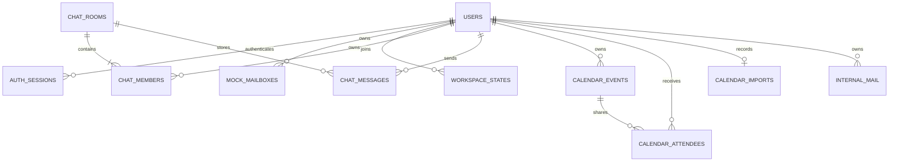

> 이력 보관본: 2026-10-11 문서 정리 전 원문입니다. 당시 구현·계획·검증 기록이며 현재 상태나 작업 승인으로 사용하지 않습니다. 현행 기준은 [개발 문서 진입점](../../../README.md)입니다. 본문의 코드 경로는 저장소 루트 기준입니다.

## 2026-10-10 다중 계정 최신 업데이트

0005_multi_account를 추가·적용했다. browser_sessions(id,token_hash,active_session_hash,version,expires_at), browser_accounts(browser_id+user_id,authenticated_at,expires_at)를 생성하고 auth_sessions에 nullable browser_id FK/index를 추가했다. 기존 테이블 재작성/사용자 데이터 삭제는 없다. 백업은 backend/data/backups/adminator-20261010T102154063427Z.db이며 원본12개 업무/세션 테이블의 행 내용 보존을 screenshots/accounts-data-preservation.json으로 확인했다.

[사용 안내](10_MULTI_ACCOUNT_SWITCHING.md) · [Codex 상세 문서](../docs/MULTI_ACCOUNT_SESSION_IMPLEMENTATION.md). 아래 이전 기록과 다른 인증 정책은 이 업데이트를 기준으로 한다.

---

# 2026-10-10 공유 협업 업데이트

0004_shared 마이그레이션을 추가·적용했다. chat_rooms에 name, created_by, is_shared를 추가했다. calendar_events에 is_shared, updated_by, updated_at를 추가했다. 기존 행 is_shared는 false이므로 기존 개인 데이터를 공개하지 않는다. mail_submissions는 (owner_id, client_id) 복합 PK와 요청 payload/응답 JSON을 저장하여 발신 재시도를 식별한다. 기존 테이블 및 사용자 데이터 삭제는 없다. chat_members가 공유 방의 개인 read state 역할을 담당한다. 신규 공유 테스트 일정은 자동 시드하지 않는다. 가입마다 5개 공유 일정이 생성되지 않는다. 적용 전 백업: backend/data/backups/adminator-20261010T095256024163Z.db. 원본 10개 업무 테이블의 모든 행 내용 보존을 screenshots/shared-data-preservation.json에서 확인했다.

상세 구현·검증: [공유 협업 구현 보고서](../docs/SHARED_COLLABORATION_REPORT.md). 아래는 이전 구현의 상세 기록이며 정책이 다른 경우 이 업데이트를 우선한다.

---

# 데이터베이스 구조와 보존

기준일: 2026-10-09. 기본 DB는 `sqlite:///./backend/data/adminator.db`다. SQLAlchemy가 테이블을 매핑하고 Alembic이 버전 변경을 적용한다. FK 검사와 busy timeout을 활성화한다. PostgreSQL 설정은 기존 구조에 있지만 이번 검증은 SQLite만 수행했다.

| 테이블 / 모델 | 주요 필드 | 의미 |
|---|---|---|
| users / User | id, username, display_name, email_address, password_hash, timestamps, is_active | 실제 계정 |
| auth_sessions / AuthSession | token_hash, user_id, csrf_token, created_at, expires_at | 익명 또는 로그인 세션 |
| auth_attempts / AuthAttempt | id, key_hash, created_at | 인증 요청 제한 |
| mock_mailboxes / MockMailbox | id, user_id, namespace, state_json, revision, updated_at | 원래 Mock 메일함 |
| workspace_states / WorkspaceState | id, user_id, kind, state_json, revision, updated_at | 원래 Calendar/Chat/tasks snapshot |
| chat_rooms / ChatRoom | id, pair_key unique, created_at | 실제 1:1 방 |
| chat_members / ChatMember | room_id + user_id PK, read_sequence | 참가자와 개인 읽음 순번 |
| chat_messages / ChatMessage | sequence PK, id unique, room_id, sender_id, client_id, body, sent_at | 실제 메시지; sender+client ID unique |
| calendar_events / CalendarEvent | id, owner_id, legacy_id, data_json, revision, created_at | 서버 일정 리소스; owner+legacy unique |
| calendar_attendees / CalendarAttendee | event_id + user_id PK, status | 공유받은 계정의 pending/accepted/declined |
| calendar_imports / CalendarImport | user_id PK, timezone, imported_at | 계정별 1회 이전 기록 |
| internal_mail / InternalMail | id, owner_id, data_json | 실제 내부 메일의 사용자별 독립 사본 |

Calendar JSON에는 title/description/start/end/allDay/category/timezone/recurrence/location이 있다. 시간 일정 start/end는 UTC offset 문자열, 종일은 날짜다. InternalMail JSON은 기존 Email DTO에 맞춰 주소/폴더/본문/읽음/별표/라벨/thread ID를 담는다. 정규화된 메시지 본문 공유 및 검색 인덱스는 향후 개선 대상이다.



## 마이그레이션과 실제 데이터 보존

`0001_accounts → 0002_workspace → 0003_resources`다. 0003은 7개 테이블과 인덱스를 추가하고 기존 테이블을 수정/삭제하지 않는다. 운영에서는 사전 백업 후 명시적으로 적용한다.

```powershell
.venv/Scripts/python.exe scripts/backup_sqlite.py
.venv/Scripts/python.exe -m alembic -c backend/alembic.ini upgrade head
```

실행 중 DB도 SQLite backup API로 일관된 사본을 만든다. 백업 경로는 `backend/data/backups`이며 Git에 포함하지 않는다. 이번 적용 전 백업은 `adminator-20261009T143439219355Z.db`다. 적용 전후 기존 데이터 행 수는 users 8, mock_mailboxes 2, workspace_states 18로 동일함을 확인했다. 이후 실제 사이트 탐색은 별도 Alice/Bob/Eve 계정을 추가했다. `screenshots/data-preservation.json`에서 백업의 기존 users 8행, Mock mailbox 2행, Workspace 18행이 최종 DB에도 내용까지 동일하게 남아 있음을 확인했다. 추가된 테스트 행은 이 비교에서 기존 데이터 변경으로 취급하지 않는다.

Calendar 내용 이전은 스키마 변경과 별개다. 첫 화면 진입 시 `/api/calendar/import`를 호출하며 현재 브라우저의 IANA timezone을 기준으로 기존 local wall time을 해석한다. 원본에 timezone 정보가 없으므로 과거 실제 zone을 복구할 수는 없다. 서로 다른 지역에서 쓰던 계정은 최초 이전 전에 적절한 zone을 정해 API로 import해야 한다.

원본 `workspace_states`는 그대로 유지하고 새 UUID 리소스에 `legacy_id`를 남긴다. import marker와 owner+legacy unique가 중복 복사를 막는다. 모든 이전이 하나의 트랜잭션이며 모호한 DST 시간은 422로 중단한다. import 후 옛 Workspace API에 쓰는 값은 새 리소스에 자동 양방향 반영되지 않는다.

## 롤백

구버전 앱으로 잠시 돌아갈 때는 새 테이블을 그대로 두고 구버전 프론트/서버를 사용할 수 있지만, 새 리소스의 편집 내용이 구 snapshot으로 돌아가지는 않는다. 구 snapshot은 보존된 최초 이전본이다.

스키마 downgrade는 **새 실제 채팅/일정/메일 테이블을 삭제하므로 데이터 보존용 롤백이 아니다**. 실행하지 않았다. 필요한 롤백은 서버를 멈추고 현재 DB도 추가 백업한 뒤 검증한 사전 백업을 복원하는 방식이다. 사전 백업 이후 추가된 메시지/일정/계정은 별도 export·병합 계획 없이 복원하면 사라진다. 공유 DB 초기화 및 기존 계정 제거는 이번 작업에서 수행하지 않았다.
