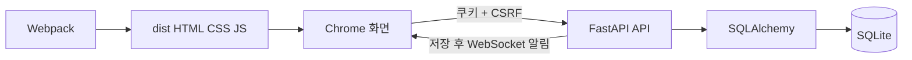

# 프로젝트 개요

기준일: 2026-10-09.

Adminator는 관리자 화면 템플릿에 계정 인증, 개인 일정, 할 일, 이메일, 채팅을 연결한 웹 프로젝트다. WebTestPilot이 접근성 및 `data-testid`를 이용해 테스트할 수 있는 상태 변화를 제공한다. 기존 디자인을 유지하며 업무 기능을 단계적으로 구현하고 있다.

현재 실제 계정 간 Chat과 내부 Email을 사용할 수 있다. Calendar는 개인 스냅샷에서 서버 일정 리소스로 확장되었다. 판매, 날씨, 방문 통계와 컴포넌트 갤러리는 명시적인 샘플이다. 외부 SMTP/IMAP, 실매출 원장, 날씨 서비스는 없다.

| 영역 | 사용 기술 |
|---|---|
| 화면 | Vanilla JavaScript, HTML, SCSS, Webpack |
| 차트·일정·지도 | Chart.js, FullCalendar, jsvectormap |
| 서버 | Python, FastAPI, Uvicorn |
| 저장 | SQLAlchemy, Alembic, 기본 SQLite |
| 인증 | Argon2id 비밀번호, HttpOnly 쿠키 세션, CSRF, Origin 검사 |
| 실시간 | 인증된 FastAPI WebSocket + HTTP 저장 API |
| 검증 | Vitest, pytest, Playwright 및 설치된 Chrome |



서버는 `dist` 파일을 제공하고 로그인되지 않은 사용자의 보호된 HTML 요청을 로그인 화면으로 이동시킨다. 화면은 같은 서버의 `/api`를 호출한다. 개발 빌드 서버만 실행하면 백엔드 기능을 사용할 수 없다.

## 실행

저장소 루트에서 실행한다. Node.js는 `package.json`의 `>=22.22.2` 기준을 따른다. 검증 환경은 Python 3.12, Node 24 및 Windows 설치 Chrome이다.

```powershell
npm install
uv venv .venv --python 3.12
uv pip install --python .venv/Scripts/python.exe -r backend/requirements.lock.txt
$env:NODE_ENV='production'
$env:MINIFY='false'
node node_modules/webpack/bin/webpack.js
.venv/Scripts/python.exe -m uvicorn backend.app:app --host 127.0.0.1 --port 8000
```

이미 있는 `.venv`는 새로 만들 필요 없이 의존성만 설치한다. `uv`를 쓰지 않는 환경은 `python -m venv`와 해당 환경의 `pip`로 같은 requirements 파일을 설치할 수 있다. Windows의 IANA 시간대 데이터는 `tzdata`, WebSocket 실행은 `websockets`가 필요하다.

[사이트](http://127.0.0.1:8000), [개발 API 문서](http://127.0.0.1:8000/api/docs), `/api/health`를 확인한다. 기본 DB는 `backend/data/adminator.db`다. 현재 8000번 서버에는 `0003_resources`를 적용했다.

## 설정

`backend/config.py`가 설정을 읽는다. `DATABASE_URL`, `AUTH_ORIGINS`, `APP_ENV`, `AUTH_SESSION_TTL`, `AUTH_COOKIE_SECURE`, `AUTH_AUTO_MIGRATE`를 환경변수로 지정한다. 기본 세션은 8시간이다. 운영 환경에서는 HTTPS, Secure 쿠키, 명시적인 마이그레이션이 필요하며 개발 관리자 API를 켤 수 없다.

날씨 API 키 설정 및 공급자 어댑터는 아직 없다. 날씨 패널은 기존 정적 샘플로 표시된다. API 키를 임의로 만들거나 외부 수신 기능을 구현한 것처럼 표시하지 않는다.
