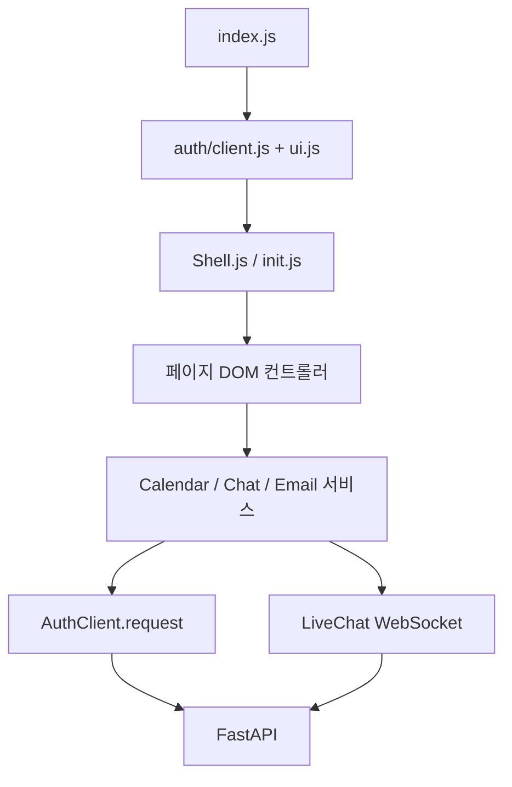

# 프론트엔드 구조

기준일: 2026-10-09. 소스 루트는 `src`, 실제 제공 파일은 Webpack이 만든 `dist`다. `dist`를 직접 편집하지 않는다.

| 위치 | 역할 |
|---|---|
| `src/*.html` | 페이지 뼈대, body의 `data-active`, Shell 마운트 자리 |
| `src/assets/scripts/2026/index.js` | 인증 완료 → Shell → 페이지 기능 → 메뉴 → 차트/Email 초기화 |
| `Shell.js`, `init.js`, `palette.js` | 공통 메뉴, 테마, 모바일 drawer, 아코디언, 색상 선택 |
| `calendar.js` | FullCalendar 렌더링, 모달, 참석자 검색, 반복, RSVP, 드래그 |
| `chat.js` | Mock/실제 모드, 방/사용자 검색, 메시지/읽음 UI |
| `dashboard.js` | 통합 API, KPI, 보고서, 개인 할 일 |
| `workspace/services.js`, `store.js` | 기존 snapshot 서비스, 저장 큐, revision 충돌 |
| `workspace/resources.js` | ResourceCalendar, LiveChat, HTTP/WS 연결 및 재접속 |
| `workspace/menus.js` | 전체 Shell 페이지의 서버 일정/실제 채팅 메뉴 |
| `email/ui.js`, `service.js`, `model.js` | Email DOM, 업무 검증, 주소/조회 모델 |
| `email/internal-api.js` | 실제 내부 메일 어댑터 |
| `email/mock-api.js`, `account-persistence.js` | 보존된 Mock 메일함, 계정별 snapshot 저장 |
| `email/rest-api.js` | 별도 외부 서버용 선택적 어댑터; 기본 내부 API와 계약이 다름 |
| `template-pages.js` | 샘플 안내, CSV/PNG/SVG 다운로드, 샘플 검색/검증 |
| `charts.js`, `maps.js` | Chart.js, jsvectormap 동적 로딩 |
| `src/assets/styles/2026` | 디자인 토큰, 컴포넌트 SCSS, workspace 상호작용 스타일 |
| `webpack/config.js`, `webpack.config.js` | HTML/JS/CSS 빌드 및 정적 자산 복사 |

## 이벤트와 상태

페이지 컨트롤러는 버튼, `input`, `submit`, FullCalendar callback을 서비스로 전달한다. 저장 중 버튼을 제한하고 오류를 `role="alert"`, 진행 상태를 `role="status"`로 표시한다. native `dialog`는 Cancel/Escape로 닫는다. 공유 일정은 서버가 주는 `canEdit=false`에 따라 편집 컨트롤을 숨긴다. `[hidden]` 스타일이 실제로 요소를 감추도록 보완했다.

WorkspaceStore는 복사본을 수정하고 DB PUT 성공 후 상태를 확정한다. 변경 큐로 같은 탭의 순서를 보장하며 revision 불일치는 409다. 계정 데이터는 localStorage에 저장하지 않는다. 테마·색상 선택은 기존 localStorage를 사용한다.

ResourceCalendar는 최초 진입 시 기존 스냅샷을 읽고 시간대를 지정해 한 번만 import한다. 실제 일정은 이후 리소스 API를 사용한다. 반복 발생일은 시리즈 ID + 발생 순번으로 렌더링하며 모달 수정/삭제는 시리즈 전체에 적용된다. 공유/반복 일정 드래그 제한은 렌더링 옵션에 반영된다.

LiveChat은 HTTP로 메시지를 저장하며 서버 성공 응답 이후 확정한다. 입력/방이 동일한 실패 재시도는 같은 `clientId`를 사용한다. WS는 알림만 전달하고 HTTP로 이력을 다시 조회한다. 재접속은 1초부터 최대 30초까지 지연을 늘린다. 백그라운드 탭의 메시지를 자동으로 읽음 처리하지 않으며 방 선택 또는 화면 복귀 후 DB 읽음 커서를 갱신한다.

EmailService는 UI가 알 필요 없는 주소 검증·답장·전달을 담당한다. 기본은 기존 Mock이고 `?mailMode=internal`은 내부 어댑터다. 내부 메일의 검색/필터/페이지 처리는 현재 자기 메일을 조회한 후 기존 `queryEmails`로 브라우저에서 수행한다.

## 통신과 시간 표시

AuthClient가 `credentials: same-origin`, 메모리 CSRF 토큰, 15초 요청 timeout을 사용한다. 204 응답도 끝까지 읽어 완료 전에 페이지가 이동해 생기는 요청 중단을 방지한다. 서버에 인증 쿠키를 읽어 전달하는 별도 JavaScript는 없다.

Calendar timed event는 UTC로 저장하고 모달은 일정의 IANA 시간대로 표시한다. FullCalendar 및 Upcoming은 브라우저 시간대로 표시한다. 종일 일정은 날짜 문자열이며 종료 날짜는 exclusive다. UI의 Last day는 inclusive라 저장 시 하루를 더한다.

## 자동화와 빌드

안정적인 `data-testid`는 기존 이름을 유지한다. 실제 Chat은 `chat-mode`, `chat-user-search`, `chat-user-results`, Calendar 확장은 `event-timezone`, `event-repeat`, `event-repeat-count`, `event-attendee-search`, `calendar-search`, 내부 Email 선택은 `email-mode`다.

`npm run build` 또는 개요의 직접 Webpack 명령으로 빌드한다. 새 API를 추가할 때는 서비스 어댑터를 수정하고 HTML 디자인을 불필요하게 다시 만들지 않는다. 기존 라이브러리/폰트/배경 이미지로 빌드 크기 경고가 남아 있다.
